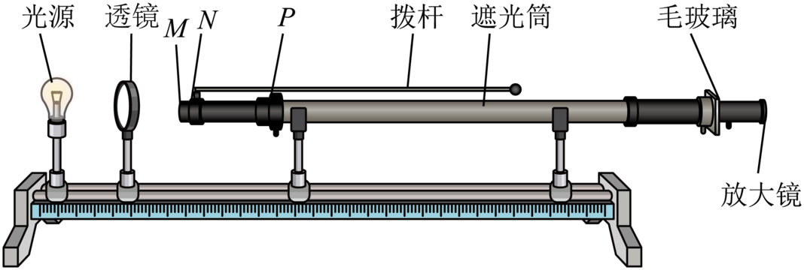

# Physics - 题目 1510

**ID**: f8fa5dd7153042c2afc00ff27afc3471
**年级**: Grade 11
**难度**: Medium
**题型**: Experiment

## 题目
在“用双缝干涉测量光的波长”的实验中，将双缝干涉实验仪按要求安装在光具座上，如图所示（1）M、N、P三个光学元件依次为。​​​​​​​‌

## 解答

1. （1）根据实验装置的正确安装顺序可知M、N、P三个光学元件依次为滤光片、单缝片、双缝片，故A正确，BCD错误。
2. （2）A．根据双缝干涉条纹间距公式 $Δx=\frac {l}{d}λ$ ，将光屏移近双缝，l减小，其他条件不变，干涉条纹间距变窄，故A正确；将滤光片由蓝色的换成红色的，波长变大，其他条件不变，干涉条纹间距变宽，故B正确；双缝干涉条纹间距与单缝和双缝之间的距离无关，将单缝向双缝移动一小段距离后，其他条件不变，干涉条纹间距不变，故C错误；换一个两缝之间距离更大的双缝，双缝之间的间距增大，其他条件不变，干涉条纹间距变窄，故D正确；
3. E．去掉滤光片，其他条件不变，光屏上出现彩色条纹，故E错误。
4. （3）实验中发现目镜中干涉条纹与分划板中心刻线始终有一定的角度，使得分划板中心刻线与干涉条纹平行，则仅旋转毛玻璃处的测量头即可，故ABD错误，C正确。
5. （4）10分度游标卡尺的精确度为0.1mm，第5条亮条纹中心对应的读数为 $x{{}_{2}}=9{\rm mm}+6\times 0.1{\rm mm}=9.6{\rm mm}$ ，相邻条纹间距为 $\Delta x=\frac {x{{}_{2}}-x{{}_{1}}}{5-1}=\frac {9.6-0.3}{4}{\rm mm}=2.325{\rm mm}$ ，根据双缝干涉条纹间距公式 $Δx=\frac {l}{d}λ$ ，解得波长 $λ=\frac {d}{l}\Delta x=\frac {0.20\times 2.325}{750}{\rm mm}=6.2\times 10{^{-7}}{\rm m}$
6. （5）从空气膜的上下表面分别反射的两列光是相干光，其光程差为 $Δx=2d$ ，即光程差为空气层厚度的2倍，当光程差 $Δx=nλ$ 时此处表现为亮条纹，故相邻亮条纹之间的空气层的厚度差为 $\frac {1}{2}λ$ ，抽去一张纸片后空气层的倾角变小，故相邻亮条纹（或暗条纹）之间的距离变大，故B正确，AC错误。若将空气膜抽成真空，入射光的波长变长，根据上述分析可知，相比原来观察到的干涉条纹变疏，故B正确，AC错误。

## 知识点

**中文**:
  - 实验：用双缝干涉测量光的波长

**English**:
  - Experiment: Measuring Wavelength using Double Slit

---
