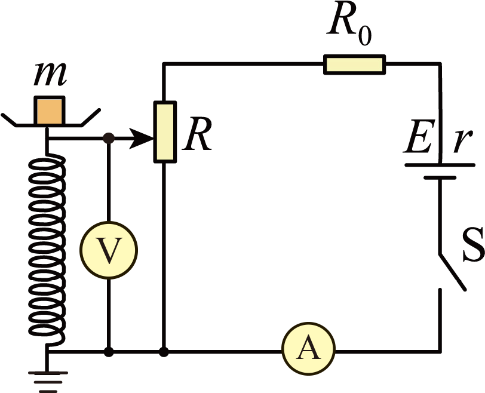

# Physics - 题目 698

**ID**: 15d0abb9bc204312b22d8eb3db67b64d
**年级**: Grade 11
**难度**: Medium
**题型**: Fill-in-the-blank

## 题目
“寒风”学习小组的同学们在学习了电路相关知识后，决定自制电子秤，经过讨论，同学们设计的电路图如图所示，托盘与绝缘轻弹簧相连，变阻器的总阻值为R，总长度为l，电源的电动势为E、内阻为r，保护电阻的阻值为 $R{{}_{0}}$ ，重力加速度大小为g，弹簧的劲度系数为k，电流表、电压表均为理想电表，不计滑片与滑动变阻器间的摩擦，不计托盘的质量。​​​​​​​‌(1)当托盘中没有放钩码时，弹簧恰好为原长，滑片恰好指在变阻器的最上端，此时电压表的示数（填“等于”或“大于”）0.(2)学习小组的同学们在托盘上逐渐增加钩码的过程中，电流表的示数（填“逐渐变小”“不变”或“逐渐变大”）。(3)同学们在托盘中放一定质量的钩码时，滑片恰好指在变阻器的最下端，弹簧仍处于弹性限度内，此时托盘中钩码的质量为（用g、l和k表示）。(4)该同学在托盘中放一定质量（未超出测量范围）的钩码时，弹簧的压缩量为x，此时电压表的示数 $U=$（用x、l、r、R、 $R{{}_{0}}$ 和E表示）。

## 解答

1. （1）当托盘中没有放钩码时，弹簧压缩量最小，与电压表并联的电阻最大，欧姆定律可知电压表示数大于0；
2. （2）当托盘中钩码逐渐增大时，弹簧压缩量增加，与电压表并联的电阻减小，欧姆定律可知电压表示数逐渐变小；
3. （3）设托盘中放的钩码质量为m时，滑片恰好指在变阻器的最下端，此时弹簧压缩量为l，由平衡条件有 $mg=kl$
4. 联立解得钩码质量 $m=\frac {kl}{g}$
5. （4）由闭合电路欧姆定律得电路中电路 $I=\frac {E}{r+R+R{{}_{0}}}$ ，当弹簧的压缩量为x时，与电压表并联的电阻 $R{{}_{x}}=\frac {l-x}{l}R$ ，此时电压表的示数 $U=IR{{}_{x}}=\frac {ER\left ({l-x}\right )}{\left ({R+R{{}_{0}}+r}\right )l}$

## 知识点

**中文**:
  - 生活中的传感器

**English**:
  - Sensors in Daily Life

---
