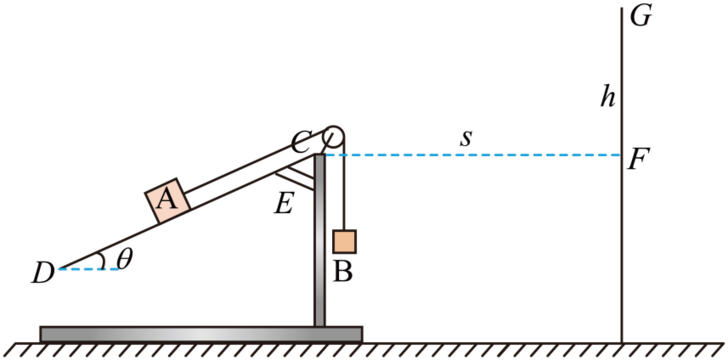

# Physics - 题目 2140

**ID**: 01b40c70291c4745a4c381265f1360c4
**年级**: Grade 11
**难度**: Medium-Hard
**题型**: Calculation

## 题目
有人设计了一个带有某些功能的斜面装置，如图所示。​​​​​​​‌ $E$ 处的机关可在需要的时候执行：使光滑斜面 $CD$ 绕 $C$ 点转动以改变其倾角、收起定滑轮、剪断细线等功能。整个装置（连同底座，但不含A、B物块）的质量为 $M=1{\rm{k}}{\rm{g}}$ ，放在水平粗糙地面上。在离斜面顶端 $C$ 点水平距离 $s=\sqrt {3}{\rm{m}}$ 处有一个竖直挡板，其顶端 $G$ 点高于 $C$ 点 $h=1{\rm{m}}$ 。初始时，装置上没有放置其他物体。其中 $a=\frac {v}{t}=\frac {25}{5}m/s{^{2}}=5m/s{^{2}}$ ， $g=10{\rm{m}}{\rm{/}}{\rm{s}}{^{2}}$ 。（1）设定斜面倾角为 $30{^{\circ }}$ ，将物块A单独放置于斜面上，A沿斜面下滑时装置未发生移动。求A沿斜面下滑的加速度大小。（2）设定斜面倾角为 $37{^{\circ }}$ ，将质量均为 $m=1{\rm{k}}{\rm{g}}$ 两物块A、B用轻质细线连接后放置在斜面上（如图所示），细线拉直且A与滑轮间细线与斜面平行，然后同时由静止释放A和B。观察到A沿斜面向上匀加速运动过程中整个装置保持静止。假设最大静摩擦力等于滑动摩擦力。求装置底部与地面之间的动摩擦因数的范围。（3）现在将装置固定在地面上，斜面倾角可按需调节，换用新的A、B物块，重复（2）问操作，当A运动到 $C$ 点前一瞬间，装置将自动收起定滑轮并切断细线，B离底座足够高。求要使A能够飞过挡板，A离开 $C$ 点时速度的最小值及此情况下A在斜面上经历了多长的加速距离（本问中 $m{{}_{{\rm{A}}}}=\sqrt {3}{\rm{k}}{\rm{g}},m{{}_{{\rm{B}}}}=3{\rm{k}}{\rm{g}}$ ）。

## 解答

1. （1）对物块A受力分析，由牛顿第二定律 $mg\sin θ=ma{{}_{1}}$
2. 解得A沿斜面下滑的加速度大小为 $a{{}_{1}}=g{\rm{s}}{\rm{i}}{\rm{n}}θ=5{\rm{m}}{\rm{/}}{\rm{s}}{^{{{2}}}}$
3. （2）由题意可知 $m{{}_{{\rm{A}}}}=m{{}_{{\rm{B}}}}=m=1{\rm{k}}{\rm{g}}$
4. 对两物块A、B整体由牛顿第二定律 $m{{}_{{\rm{B}}}}g-m{{}_{{\rm{A}}}}g{\rm{s}}{\rm{i}}{\rm{n}}{{3}}{{7}}{}\degree ={\rm{(}}m{{}_{{\rm{A}}}}+m{{}_{{\rm{B}}}})a{{}_{2}}$
5. 解得 $a{{}_{2}}=2{\rm{m}}{\rm{/}}{\rm{s}}{^{2}}$
6. 对两物块A、B和整个装置，整体水平方向有装置底部与地面之间的摩擦力大小为 $f=m{{}_{{\rm{A}}}}a{{}_{2}}{\rm{c}}{\rm{o}}{\rm{s}}{{3}}{{7}}{}\degree =1.6{\rm{N}}$
7. 竖直方向有 $\left ({m{{}_{{\rm{A}}}}+m{{}_{{\rm{B}}}}+M}\right )g-N=m{{}_{{\rm{B}}}}a{{}_{2}}-m{{}_{{\rm{A}}}}a{{}_{2}}{\rm{s}}{\rm{i}}{\rm{n}}{{3}}{{7}}{}\degree $
8. 解得 $N=29.2{\rm{N}}$
9. 根据 $f⩽μN$
10. 代入数据解得装置底部与地面之间的动摩擦因数的范围为 $μ⩾\frac {4}{73}$
11. （3）设物块A运动到C点时的速度大小为 $v{{}_{0}}$ ，将C点时的速度分解为 $v{{}_{x}}=v{{}_{0}}{\rm{c}}{\rm{o}}{\rm{s}}θ$ ， $v{{}_{y}}=v{{}_{0}}{\rm{s}}{\rm{i}}{\rm{n}}θ$
12. 当物块A运动越过挡板位置时，水平方向由匀速直线运动，有 $s=v{{}_{0}}{\rm{c}}{\rm{o}}{\rm{s}}θt$
13. 竖直方向由竖直上抛运动 $H=v{{}_{0}}{\rm{s}}{\rm{i}}{\rm{n}}θt-\frac {1}{2}gt{^{2}}$
14. 联立解得 $v{{}_{0}}=\sqrt {\frac {15}{{\rm{c}}{\rm{o}}{\rm{s}}{^{2}}θ\left ({\sqrt {3}{\rm{t}}{\rm{a}}{\rm{n}}θ-H}\right )}}$
15. 令 $y={\rm{c}}{\rm{o}}{\rm{s}}{^{2}}θ\left ({\sqrt {3}{\rm{t}}{\rm{a}}{\rm{n}}θ-H}\right )=\frac {\sqrt {3}{\rm{s}}{\rm{i}}{\rm{n}}2θ-H{\rm{c}}{\rm{o}}{\rm{s}}2θ-H}{2}=\frac {\sqrt {3+H{^{2}}}{\rm{s}}{\rm{i}}{\rm{n}}\left ({2θ-α}\right )-H}{2}$
16. 由题意 $H⩾1$ ，且 ${\rm{t}}{\rm{a}}{\rm{n}}α=\frac {H}{\sqrt {3}}$ ，则 $α⩾30{^{\circ }}$
17. 由 $0{^{\circ }}<θ<90{^{\circ }}$ ，则 ${\rm{s}}{\rm{i}}{\rm{n}}\left ({2θ-α}\right )$ 最大值为1
18. 即 $y=\frac {\sqrt {3+H{^{2}}}-H}{2}=\frac {3}{2\left ({\sqrt {3+H{^{2}}}+H}\right )}$
19. 则 $H$ 增大， $y$ 减小，当 $H=h=1{\rm{m}},θ=60{^{\circ }}$ 时， $y{{}_{{\rm{m}}{\rm{a}}{\rm{x}}}}=\frac {1}{2}$
20. 则 $v{{}_{0{\rm{m}}{\rm{i}}{\rm{n}}}}=\sqrt {30}{\rm{m}}{\rm{/}}{\rm{s}}$
21. 此时 $a{{}_{3}}=\frac {m{{}_{{\rm{B}}}}g-m{{}_{{\rm{A}}}}g{\rm{s}}{\rm{i}}{\rm{n}}60{^{\circ }}}{m{{}_{{\rm{A}}}}+m{{}_{{\rm{B}}}}}=\frac {15-5\sqrt {3}}{2}{\rm{m}}{\rm{/}}{\rm{s}}{^{{{2}}}}$
22. 由运动学公式可得在此情况下A在斜面上经历的加速距离为 $x=\frac {v{{}_{0{\rm{m}}{\rm{i}}{\rm{n}}}^{2}}}{2a{{}_{{{}_{3}}}}}=(3+\sqrt {3}){\rm{m}}$

## 知识点

**中文**:
  - 运动的合成与分解
  - 连接体问题（整体和隔离法）、临界问题

**English**:
  - Composition and Resolution of Motion
  - Connected Bodies Problems (Whole/Isolation Method), Critical Problems

---
