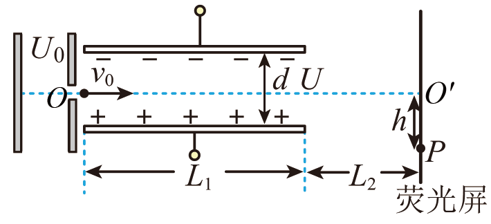

# Physics - 题目 2904

**ID**: 053b013abd634aa5b83f726dff01ec21
**年级**: Grade 11
**难度**: Medium-Hard
**题型**: Calculation

## 题目
如图所示，一个负粒子由静止开始经加速电场加速后，又沿中心轴线从 $O$ 点垂直射入偏转电场，并从另一侧射出打到荧光屏上的 $P$ 点， $O^\prime $ 点为荧光屏的中心。​​​​​​​‌已知负粒子质量 $m=1.0\times 10{^{-31}}{\rm{k}}{\rm{g}}$ ，电荷量大小 $q=3.2\times 10{^{-19}}{\rm{C}}$ ，加速电场电压 $U{{}_{0}}=250{\rm{V}}$ ，偏转电场电压 $U=200{\rm{V}}$ ，极板的长度 $L{{}_{1}}=10.0{\rm{c}}{\rm{m}}$ ，板间距离 $d=8{\rm{c}}{\rm{m}}$ ，极板的末端到荧光屏的距离 $L{{}_{2}}=3.0{\rm{c}}{\rm{m}}$ （忽略电子所受重力）。求：（1）负粒子射入偏转电场时的初速度 $v{{}_{0}}$ ；（2）负粒子打在荧光屏上的 $P$ 点到 $O^\prime $ 点的距离 $h$ ；（3）负粒子经过偏转电场过程中电势能的变化量；

## 解答

1. （1）根据动能定理有 $qU{{}_{0}}=\frac {1}{2}mv{{}_{0}}$
2. 解得 $v{{}_{0}}=\sqrt {\frac {2qU{{}_{0}}}{m}}=4\times 10{^{7}}{\rm{m}}{\rm{/}}{\rm{s}}$
3. （2）设电子在偏转电场中运动的时间为t，电子射出偏转电场时在竖直方向上的侧移量为y，电子在水平方向做匀速直线运动 $L{{}_{1}}=v{{}_{0}}t$
4. 电子在竖直方向上做匀加速运动 $y=\frac {1}{2}at{^{2}}$
5. 根据牛顿第二定律有 $\frac {qU}{d}=ma$
6. 解得 $y=\frac {qUL{{}_{1}}{^{2}}}{2mdv{{}_{0}}{^{2}}}=0.025{\rm{m}}$
7. 电子离开偏转电场时速度的反向延长线过偏转电场的中点，由图知
8. $\frac {y}{h}=\frac {\frac {L{{}_{1}}}{2}}{\frac {L{{}_{1}}}{2}+L{{}_{2}}}$
9. 解得 $h=0.04{\rm{m}}$
10. （3）电子在偏转电场运动的过程中电场力对它做的功为 $W=qEy=\frac {qUy}{d}=2\times 10{^{-17}}{\rm{J}}$
11. 即 $\Delta E=-W=-2\times 10{^{-17}}{\rm{J}}$

## 知识点

**中文**:
  - 动能定理的简单应用
  - 带电粒子在匀强电场中的运动

**English**:
  - Simple Applications of Work-Energy Theorem
  - Motion in Uniform Electric Field

---
