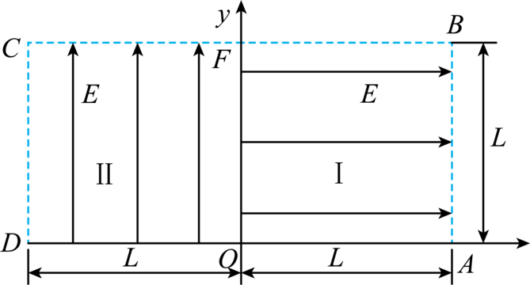

# Physics - 题目 2504

**ID**: 061e1700c8d84a1ebd64decadd432392
**年级**: Grade 11
**难度**: Medium-Hard
**题型**: Calculation

## 题目
如图所示为研究电子枪中电子在电场中运动的简化模型示意图。​​​​​​​‌在 $Oxy$ 平面的 $ABCD$ 区域内，存在两个大小均为E的匀强电场Ⅰ和Ⅱ，两电场的边界均是边长为 $L$ 的正方形（不计电子所受重力，电子的比为 $\frac {e}{m}$ ）。（1）在该区域 $AB$ 边的中点处由静止释放电子，求电子离开Ⅰ区域时的速度；（2）在满足（1）的情况下，判断电子能否从 $CD$ 边离开，并求电子离开 $ABCD$ 区域的位置坐标；（3）在电场Ⅰ区域内适当位置由静止释放电子，电子恰能从 $ABCD$ 区域左下角D处离开，求所有释放点的位置（电子释放点的横坐标x和纵坐标y之间应满足的关系式）。

## 解答

1. （1）在电场I中由动能定理得 ${\rm \mathit{eEL}＝}\frac {{{1}}}{{{2}}}{\rm \mathit{mv}\mathit{^{2}}}$
2. 解得 $v=\sqrt {\frac {2eEL}{m}}$
3. （2）在电场II中做类平抛运动，假设从CD边离开，有 ${\rm \mathit{vt}=\mathit{L}，\mathit{eE}＝\mathit{ma}，}y{{}_{1}}=\frac {{{1}}}{{{2}}}at{^{2}}$
4. 电子偏转的方向向下，联立解得 $y{{}_{1}}=\frac {L}{4}<\frac {L}{2}$
5. 则电子能从CD边离开，离开的纵坐标为 $y^{′}=\frac {L}{2}-y{{}_{1}}=\frac {L}{4}$
6. 则离开的坐标为 $(-L,\frac {L}{4})$ 。
7. （3）设释放点的位置坐标为（x，y），在电场I中由动能定理可得 ${\rm \mathit{eEx}＝}\frac {{{1}}}{{{2}}}mv{{}_{0}^{2}}$
8. 在电场II中做类平抛运动过D点，有 ${\rm \mathit{L}＝\mathit{v}_{0}\mathit{t}，\mathit{eE}＝\mathit{ma}，}y=\frac {{{1}}}{{{2}}}at{^{2}}$
9. 联立解得 $y=\frac {L{^{2}}}{4x}$

## 知识点

**中文**:
  - 动能定理的简单应用
  - 带电粒子在匀强电场中的运动

**English**:
  - Simple Applications of Work-Energy Theorem
  - Motion in Uniform Electric Field

---
