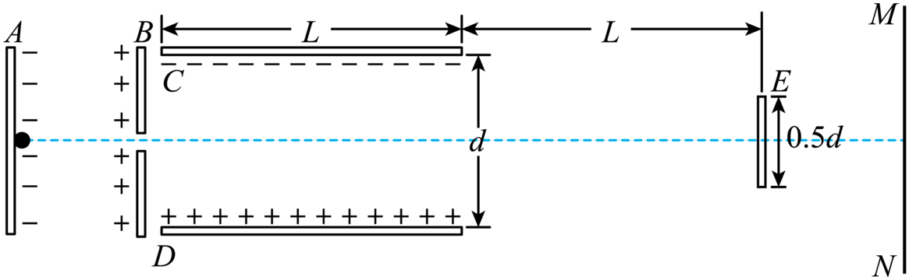

# Physics - 题目 2646

**ID**: 074360e795934d28aa1e69d8b5f90a45
**年级**: Grade 11
**难度**: Medium-Hard
**题型**: Calculation

## 题目
如图所示，电子由静止开始经加速电场加速后，沿平行于极板C、D的方向射入偏转电场，并从另一侧射出。​​​​​​​‌已知电子质量为m，电荷量为e，加速电场及偏转电场的电压分别为U_{1}、U_{2}，偏转电场的极板长度为L，C、D极板间距为d，在偏转电场的右侧有一挡板E以及足够大的荧光屏MN。已知挡板E与极板CD右端的距离为L，挡板E的长度为0.5d，B板的小孔，E板的中心均在CD连线的中垂线上，初始时刻电子处于A极板的中心，忽略电子所受重力。（1）求电子刚离开加速电场时的速度大小（用题中已给的物理量符号表示）；（2）求电子刚离开偏转电场时的偏转距离（用题中已给的物理量符号表示）；（3）若保持极板C、D的电性不变，请问调节U_{2}在什么范围内可以使电子打到荧光屏MN上（用题中已给的物理量符号表示）？

## 解答

1. （1）设电子刚离开加速电场时的速度为v_{0}，则 $eU{{}_{1}}=\frac {mv{{}_{0}^{2}}}{2}$
2. 解得 $v{{}_{0}}=\sqrt {\frac {2eU{{}_{1}}}{m}}$
3. （2）电子从C、D极板的左端进入偏转电场后做类平抛运动，加速度为 $a=\frac {eU{{}_{2}}}{md}$
4. 运动时间为 $t=\frac {L}{v{{}_{0}}}$
5. 所以偏转距离为 $y=\frac {at{^{2}}}{2}=\frac {eU{{}_{2}}L{^{2}}}{2mdv{{}_{0}^{2}}}=\frac {U{{}_{2}}L{^{2}}}{4U{{}_{1}}d}$
6. （3）临界情形一：电子恰好从挡板E的边缘掠过，设电子在偏转电场中的偏转距离为y_{1}，如图
7. 
8. 根据类平抛运动的规律有 $GH=\frac {L}{2}$ ， $HJ=y{{}_{1}}$
9. 根据已知条件有 $HI=L$ ， $IF=\frac {L}{4}$
10. 由于三角形GHJ与三角形GIF相似，因此 $\frac {HJ}{IF}=\frac {GH}{GI}$
11. 即 $\frac {4y{{}_{1}}}{d}=\frac {1}{3}$
12. 解得 $y{{}_{1}}=\frac {d}{12}$
13. 临界情形二：电子恰好从D极板右端掠过，电子在偏转电场中的偏转距离为 $y{{}_{2}}=\frac {d}{2}$
14. 所以要使电子能打到荧光屏MN上需满足条件 $\frac {d}{12}<y<\frac {d}{2}$
15. 联立解得 $\frac {U{{}_{1}}d{^{2}}}{3L{^{2}}}<U{{}_{2}}<\frac {2U{{}_{1}}d{^{2}}}{L{^{2}}}$

## 知识点

**中文**:
  - 带电粒子在匀强电场中的运动

**English**:
  - Motion in Uniform Electric Field

---
