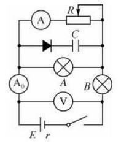

# Physics - 题目 819

**ID**: 08f6fa9b86274ca68b22815dfd144135
**年级**: Grade 11
**难度**: Medium-Hard
**题型**: 题有多项符合题目要求，全部选对的得5分，选对但不全的得3分，有选错的得0分）

## 题目
如图所示的直流电路中，电源的内阻不可忽略，电流表和电压表为理想电表，二极管为理想二极管（正向电阻近似为零，反向电阻无穷大），当滑动变阻器的滑动触头向左移动时，电压表、电流表 ${\text{A}}_{0}$ 示数变化量的绝对值分别表示为 $\text{Δ}U、\text{Δ}{I}_{0}$ .​​​​​​​‌下列说法正确的是（      ）

## 解答

1. 滑动变阻器的滑动触头向左移动，滑动变阻器接入电路的总电阻减小，由闭合电路欧姆定律可知，总电流 ${I}_{0}$ 增大，则小灯泡 $B$ 的电流增大，小灯泡 $B$ 变亮，由于小灯泡 $B$ 和电源的内压均增大，则小灯泡 $A$ 两端的电压减小，所以小灯泡 $A$ 变暗， $\text{A}$ 正确；电容器两极板间的电压减小，由公式 $Q={CU}$ 可知电容器所带的电荷量应减小，则电容器应放电，由于电容器的左板带正电，由二极管的连接方式可知电容器不能对外放电，B错误；当外电路的电阻与电源的内阻相同时，电源的输出功率最大，由于题中对电源的内阻与外电阻的大小关系未明确，因此该过程电源输出功率的变化不能确定，C错误；由闭合电路欧姆定律得 $E=U+{I}_{0}r$ ，整理得 $U{=-}{I}_{0}r+E$ ，则 $\frac{\text{Δ}U}{\text{Δ}{I}_{0}}=r$ ，所以该过程中 $\frac{\text{Δ}U}{\text{Δ}{I}_{0}}$ 的比值保持不变，D错误，

## 知识点

**中文**:
  - 平行板电容器电容大小及其影响因素
  - 电路的动态分析问题

**English**:
  - Factors Affecting Capacitance of Parallel Plate Capacitors
  - Dynamic Circuit Analysis

---
