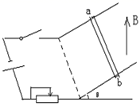

# Physics - 题目 255

**ID**: 097c7970c2f249c3af3e89a02e584f8c
**年级**: Grade 11
**难度**: Medium-Hard
**题型**: Calculation

## 题目
如图所示，相距20cm的平行金属导轨所在平面与水平面夹角θ=37°，现在导轨上放一质量为330g的金属棒ab，它与导轨间动摩擦因数为0.​​​​​​​‌50，整个装置处于磁感应强度为2T的竖直向上匀强磁场中，导轨所接的电源电动势为15V，内阻不计，滑动变阻器的阻值满足要求，其他部分电阻不计，取g=10m/s^{2}，为了保证ab处于静止状态，则：（1）ab通入的最大电流为多少？（2）ab通入的最小电流为多少？（3）R的调节范围是多大？

## 解答

1. 试题分析：（1）ab通过最大电流时，受力分析如图，此时静摩擦力最大，，方向沿斜面向下，由平衡条件得：
2. $F{{}_{1}}{\cos}θ=mg{\sin}θ+μ(mg{\cos}θ+F{{}_{1}}{\sin}θ)$
3. 得  $F{{}_{1}}=\frac {mg({\sin}θ+μ{\cos}θ)}{{\cos}θ-μ{\sin}θ}=6.6N$
4. $F{{}_{1}}=BI{{}_{1}}L$  解得
5. 
6. （2） $F{{}_{2}}{\cos}θ+μ(mg{\cos}θ+F{{}_{2}}{\sin}θ)=mg{\sin}θ$
7. 解得： $F{{}_{2}}=\frac {mg{\sin}θ-{\rm μm}g{\cos}θ}{{\cos}θ+μ{\sin}θ}=0.6N$
8. $I{{}_{2}}=\frac {F{{}_{2}}}{BL}=1.5A$
9. 
10. （3）当ab中电流最小时，变阻器阻值为：
11. 当ab中电流最强时，变阻器阻值为：，
12. 所以为保持ab静止，R的调节范围为0.91~10
13. 考点：此题考查静摩擦力、安培力的大小和方向及力的平衡条件问题．

## 知识点

**中文**:
  - 安培力的大小

**English**:
  - Magnitude of Ampere Force

---
