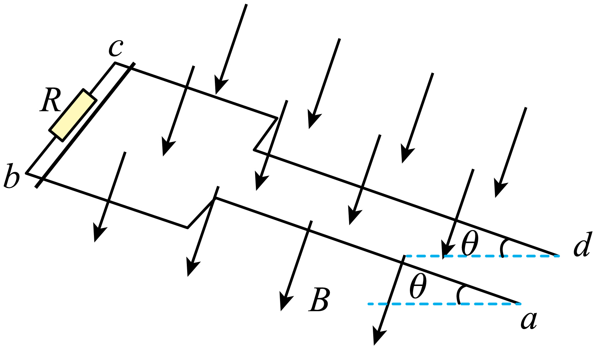

# Physics - 题目 2787

**ID**: 0bf507c5a5064f94aa720039fe90e0cc
**年级**: Grade 11
**难度**: Medium-Hard
**题型**: Calculation

## 题目
如图所示，金属导轨abcd与水平面成θ角固定，导轨各相邻段互相垂直，导轨顶端接有阻值为R的定值电阻。​​​​​​​‌已知宽轨间距为2L，宽轨长为2L，窄轨间距L，窄轨长3L，在导轨所在平面内有垂直于导轨平面向下的匀强磁场，磁感应强度为B。现有一根质量为m，长度为2L，粗细均匀、阻值均匀分布的金属棒，其总电阻也为R，从宽轨顶端由静止释放，已知金属棒到达宽轨底部和窄轨底部之前都已做匀速直线运动，不计一切摩擦，导轨电阻不计。求：(1)金属棒在宽轨上做匀速直线运动的速度大小；(2)金属棒在宽轨上运动的过程中通过电阻R的电荷量；(3)金属棒从宽轨顶端运动到窄轨底部的整个过程所用的总时间；(4)金属棒从宽轨顶端运动到窄轨底部的整个过程中金属棒中产生的焦耳热。

## 解答

1. （1）金属棒在宽轨上匀速运动时的受力情况，金属棒产生的感应电动势 $E=B\left ({2L}\right )v{{}_{1}}$ （ $v{{}_{1}}$ 为金属棒的速度），金属棒电阻为 $R$ ，定值电阻为 $R$ ，由闭合电路欧姆定律 $I=\frac {E}{R{{}_{总}}}=\frac {2BLv{{}_{1}}}{2R}=\frac {BLv{{}_{1}}}{R}$
2. 根据安培力公式 $F{{}_{安}}=BIL=B\frac {BLv{{}_{1}}}{R}2L=\frac {2B{^{2}}L{^{2}}v{{}_{1}}}{R}$
3. 金属棒匀速运动时，沿导轨方向受力平衡，即 $F{{}_{安}}=mg\sin θ$
4. 即 $\frac {2B{^{2}}L{^{2}}v{{}_{1}}}{R}=mg\sin θ$
5. 解得金属棒在宽轨上做匀速直线运动的速度大小为 $v{{}_{1}}=\frac {mgR\sin θ}{2B{^{2}}L{^{2}}}$
6. （2）根据电荷量公式 $q=IΔt$
7. 由闭合电路欧姆定律 $I=\frac {E}{R{{}_{总}}}=\frac {E}{2R}$
8. 再根据法拉第电磁感应定律 $E=\frac {ΔΦ}{{\rm{Δ}}t}$
9. 可得 $q=\frac {ΔΦ}{2R}$
10. 其中在宽轨上运动的过程磁通量的变化 $ΔΦ=B\cdot 2L\cdot 2L=4BL{^{2}}$
11. 所以通过电阻R的电荷量 $q{{}_{1}}=\frac {4BL{^{2}}}{2R}=\frac {2BL{^{2}}}{R}$
12. （3）在宽轨上运动的过程，对金属棒在宽轨上由动量定理 $mg{\rm{s}}{\rm{i}}{\rm{n}}θ\cdot t{{}_{1}}-\sum Bi{{}_{1}}2L\cdot Δt=\sum m\cdot Δv{{}_{1}}$
13. 得 $mg{\rm{s}}{\rm{i}}{\rm{n}}θ·t{{}_{1}}-Bq{{}_{1}}·2L=mv{{}_{1}}$
14. 代入 $q{{}_{1}}=\frac {2BL{^{2}}}{R}，v{{}_{1}}=\frac {mgR\sin θ}{2B{^{2}}L{^{2}}}$
15. 解得 $t{{}_{1}}=\frac {mR}{2B{^{2}}L{^{2}}}+\frac {4B{^{2}}L{^{3}}}{mgR\sin θ}$
16. 在窄轨上运动的过程，对金属棒在宽轨上由动量定理 $mg{\rm{s}}{\rm{i}}{\rm{n}}θ·t{{}_{2}}-\sum Bi{{}_{2}}L·Δt=\sum m·Δv{{}_{2}}$
17. 得 $mg{\rm{s}}{\rm{i}}{\rm{n}}θ·t{{}_{2}}-Bq{{}_{2}}L=mv{{}_{2}}-mv{{}_{1}}$
18. 再设金属棒在窄轨上匀速运动的速度为 $v{{}_{2}}$ ，同理第（1）问可知 $E{{}_{2}}=BLv{{}_{2}}$ ， $R{{}_{总}^{^{′}}}=\frac {3R}{2}$
19. 得在窄轨上匀速时 $F{{}_{安1}}=B·\frac {2BLv{{}_{2}}}{3R}·L=\frac {2B{^{2}}L{^{2}}v{{}_{2}}}{3R}$
20. 由 $F{{}_{安1}}=mg{\rm{s}}{\rm{i}}{\rm{n}}θ$
21. 解得 $v{{}_{2}}=\frac {3mgR\sin θ}{2B{^{2}}L{^{2}}}$
22. 在窄轨上运动的过程磁通量的变化 ${\rm{Δ}}{\rm{Φ}}^{′}=B·L·3L=3BL{^{2}}$
23. 通过电阻R的电荷量 $q{{}_{2}}=\frac {3BL{^{2}}}{\frac {3R}{2}}=\frac {2BL{^{2}}}{R}$
24. 再代入（1）,（2）问中的 $q{{}_{1}}=\frac {2BL{^{2}}}{R}，v{{}_{1}}=\frac {mgR\sin θ}{2B{^{2}}L{^{2}}}$
25. 解得 $t{{}_{2}}=\frac {mR}{B{^{2}}L{^{2}}}+\frac {2B{^{2}}L{^{3}}}{mgR\sin θ}$
26. 所以金属棒从宽轨顶端运动到窄轨底部的整个过程所用的总时间 $t=t{{}_{1}}+t{{}_{2}}=\frac {3mR}{2B{^{2}}L{^{2}}}+\frac {6B{^{2}}L{^{3}}}{mgR\sin θ}$
27. （4）金属棒在宽轨上运动过程中，由能量守恒定律 $mg2L\sin θ=\frac {1}{2}mv{{}_{1}^{2}}+Q{{}_{1}}$
28. 由（1）问知 $v{{}_{1}}=\frac {mgR\sin θ}{2B{^{2}}L{^{2}}}$
29. 所以 $Q{{}_{1}}=2mgL\sin θ-\frac {m{^{3}}g{^{2}}R{^{2}}\sin {^{2}}θ}{8B{^{4}}L{^{4}}}$
30. 而金属棒上产生的焦耳热只占总热量的 $\frac {1}{2}$
31. $Q{{}_{棒1}}=mgL\sin θ-\frac {m{^{3}}g{^{2}}R{^{2}}\sin {^{2}}θ}{16B{^{4}}L{^{4}}}$
32. 金属棒在窄轨上运动过程中，由能量守恒定律 $mg3L\sin θ=\frac {1}{2}mv{{}_{2}^{2}}-\frac {1}{2}mv{{}_{1}^{2}}+Q{{}_{2}}$
33. 由（3）问知 $v{{}_{2}}=\frac {3mgR\sin θ}{2B{^{2}}L{^{2}}}$
34. 代入得 $Q{{}_{2}}=3mgL\sin θ-\frac {m{^{3}}g{^{2}}R{^{2}}\sin {^{2}}θ}{B{^{4}}L{^{4}}}$
35. 而金属棒上产生的焦耳热只占总热量的 $\frac {1}{3}$
36. $Q{{}_{棒1}}=mgL\sin θ-\frac {m{^{3}}g{^{2}}R{^{2}}\sin {^{2}}θ}{3B{^{4}}L{^{4}}}$
37. 金属棒产生的焦耳热 $Q{{}_{棒}}=Q{{}_{棒1}}+Q{{}_{棒2}}=2mgL\sin θ-\frac {19m{^{3}}g{^{2}}R{^{2}}\sin {^{2}}θ}{48B{^{4}}L{^{4}}}$

## 知识点

**中文**:
  - 单杆模型

**English**:
  - Single Rod Model

---
