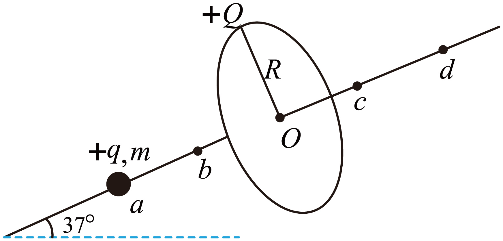

# Physics - 题目 323

**ID**: 0dacb0edae4240f98687d66732b8ebb0
**年级**: Grade 11
**难度**: Medium-Hard
**题型**: Calculation

## 题目
如图所示，真空中，与水平面成37°角的固定绝缘长细杆，垂直穿过一固定均匀带正电圆环的圆心O，套在细杆上的带正电小球从杆上的a点以某一初速度沿杆向上运动，恰好能运动到杆上d点，已知圆环半径为R，电荷量为Q，小球质量为m、电荷量为q，小球半径远小于 ${\rm \mathit{R}，}q<<Q$ ， $ab=bO=Oc=cd=R$ ，静电力常量为k，重力加速度大小为g，绝缘细杆与小球间的动摩擦因数 $μ=\frac {\sqrt {3}}{4}$ ， $\sin 37\mathrm{°}=0.6$ ， ${\cos}37\mathrm{°}=0.8$ 。​​​​​​​‌求：（1）小球在c点受到的电场力的大小；（2）小球在b点的加速度大小；（3）小球在a点的动能。

## 解答

1. （1）将圆环等分为n段小圆弧，每段小圆弧均可视为电荷量为 $q{{}_{0}}$ 的点电荷，有 $Q=nq{{}_{0}}$ ，在c点，由库仑定律， $q{{}_{0}}$ 对小球的电场力 $F{{}_{0}}=\frac {kqq{{}_{0}}}{r{{}_{c}^{2}}}$ ，由几何关系 $r{{}_{c}^{2}}=2R{^{2}}$ ，在c点，整个圆环对小球的电场力设为 $F{{}_{c}}$ ，有 $F{{}_{c}}=nF{{}_{0}}\sin 45{}\degree $ ，联立解得 $F{{}_{c}}=\frac {\sqrt {2}kQq}{4R{^{2}}}$ 。
2. （2）由对称性，小球在b点所受的电场力与在c点所受的电场力方向相反，大小相等，有 $F{{}_{b}}=F{{}_{c}}$ ，在b点，对小球，由牛顿第二定律，有 $mg\sin 37{}\degree +{\rm μm}g{\cos}37{}\degree +F{{}_{b}}=ma$ ，联立解得 $a=\frac {\left ({3+\sqrt {3}}\right )g}{5}+\frac {\sqrt {2}kQq}{4mR{^{2}}}$ 。
3. （3）小球从a到d，由对称性，电场力做功 $W{{}_{ad}}=0$ ，对小球，由动能定理，有 $W{{}_{ad}}-mg\sin 37{}\degree \cdot 4R-{\rm μm}g{\cos}37{}\degree \cdot 4R=0-E{{}_{{\rm{k}}}}$ ，联立解得 $E{{}_{{\rm{k}}}}=\frac {4\left ({3+\sqrt {3}}\right )mgR}{5}$ 。

## 知识点

**中文**:
  - 带电体在库仑力作用下的运动问题

**English**:
  - Motion under Coulomb Force

---
