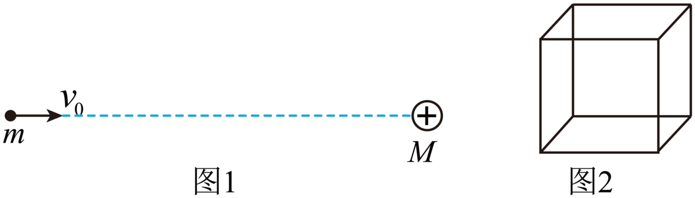

# Physics - 题目 1565

**ID**: 13917356ee89433e91ffed480b6712b3
**年级**: Grade 11
**难度**: Medium-Hard
**题型**: Calculation

## 题目
碰撞、反冲是十分普遍的现象，通过对这些现象的研究能了解微观粒子的结构与性质。​​​​​​​‌（1）在物理学史上，用 $α$ 粒子散射实验估测了原子核的半径。如图1所示，一个从很远处以速度 $v{{}_{0}}$ 运动的 $α$ 粒子与金原子核发生正碰，可认为金原子核始终静止， $α$ 粒子离金原子核最近的距离等于金原子核的半径。已知 $α$ 粒子的质量为m，电荷量为2e，金原子核的质量为M，电荷量为79e，取无穷远电势为零，两点电荷 $q{{}_{1}}$ 、 $q{{}_{2}}$ 相距为r时的电势能表达式为 $E{{}_{{\rm{p}}}}=k\frac {q{{}_{1}}q{{}_{2}}}{r}$ 。估算金原子核的半径 $r{{}_{0}}$ 。（2）从微观角度看，气体对容器的压强是大量气体分子对器壁的碰撞引起的。如图2所示，正方体容器内密封着一定质量的理想气体。每个气体分子的质量为m，单位体积内分子数量n为恒量，已知该理想气体分子平均动能 ${\overline{E{{}_{{\rm{k}}}}}}\propto T$ （T为热力学温度）。为简化问题，我们假定：分子大小可以忽略，速率均为v且与器壁各面碰撞的机会均等，气体分子与器壁垂直碰撞且无能量损失。证明：该理想气体的压强 $p\propto T$ 。（3）根据玻尔原子理论，一个静止氢原子从 $n\mathrm{=}2$ 能级 $\left ({E{{}_{2}}=-3.4{\rm{e}}{\rm{V}}}\right )$ 向基态 $\left ({E{{}_{1}}=-13.6{\rm{e}}{\rm{V}}}\right )$ 跃迁的过程中会辐射出一个光子，它的频率 $ν{{}_{0}}$ 满足： $hν{{}_{0}}=E{{}_{2}}-E{{}_{1}}$ 。某同学提出质疑：向外辐射的光子具有动量 $p=\frac {h}{λ}$ ，根据动量守恒定律，氢原子会发生反冲而具有动能，因此需对求解的频率 $ν{{}_{0}}$ 进行修正。已知氢原子质量为m且 $mc{^{2}}\approx 9.3\times 10{^{8}}{\rm{e}}{\rm{V}}$ ，请结合数据推导说明“在氢原子辐射问题中忽略原子动能”的合理性。

## 解答

1. （1） $α$ 粒子的动能转化为电势能
2. $E{{}_{{\rm{k}}}}=E{{}_{{\rm{p}}}}$
3. $\frac {1}{2}mv{{}_{0}^{2}}=k\frac {2e\times 79e}{r{{}_{0}}}$
4. 解得
5. $r{{}_{0}}=\frac {316ke{^{2}}}{mv{{}_{0}^{2}}}$
6. （2）设时间t内，面积为S，碰撞器壁的气体总体积为
7. $V=vtS$
8. 碰撞器壁的气体分子个数为
9. $N=nV=nvtS$
10. 由碰撞无能量损失，结合动量定理
11. $Ft=Mv-(-Mv)=2Mv$
12. 其中
13. $M=Nm=nvtSm$
14. 解得
15. $F=2nSmv{^{2}}$
16. 根据压强公式
17. $p=\frac {F}{S}=2nmv{^{2}}\propto {\overline{E{{}_{{\rm{k}}}}}}\propto T$
18. （3）由题意确定氢原子质量为
19. $m=\frac {9.3\times 10{^{8}}{\rm{e}}{\rm{V}}}{c{^{2}}}$
20. 光子动量为
21. $p=\frac {h}{λ}=\frac {hν{{}_{0}}}{c}=\frac {10.2{\rm{e}}{\rm{V}}}{c}$
22. 由动量守恒确定氢原子速度
23. $\frac {10.2{\rm{e}}{\rm{V}}}{c}=mv=\frac {9.3\times 10{^{8}}{\rm{e}}{\rm{V}}}{c{^{2}}}v$
24. 解得
25. $v=\frac {10.2}{9.3\times 10{^{8}}}c$
26. 氢原子的动能为
27. $E{{}_{{\rm{k}}}}=\frac {1}{2}mv{^{2}}=\frac {1}{2}\times \frac {9.3\times 10{^{8}}{\rm{e}}{\rm{V}}}{c{^{2}}}\times (\frac {10.2}{9.3\times 10{^{8}}}c){^{2}}=5.48\times 10{^{-9}}{\rm{e}}{\rm{V}}$
28. 远远小于辐射出光子的能量，所以在氢原子辐射中可以忽略原子动能。

## 知识点

**中文**:
  - 光电效应规律的综合应用
  - 经典理论的困难和玻尔原子假设

**English**:
  - Comprehensive Application of Photoelectric Effect
  - Difficulties of Classical Theory and Bohr's Postulates

---
