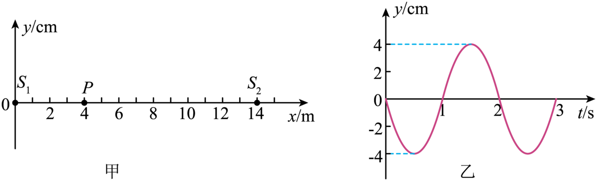

# Physics - 题目 1477

**ID**: 14edb68a51494234acc417e7fdf33475
**年级**: Grade 11
**难度**: Medium-Hard
**题型**: Calculation

## 题目
如图甲所示，在 $xOy$ 平面内的均匀介质中两波源 $S{{}_{1}}、S{{}_{2}}$ 分别位于 $x$ 轴上 $x{{}_{1}}=0、x{{}_{2}}=14{\rm{m}}$ 处，两波源均从 $t=0$ 时刻开始沿 $y$ 轴方向做简谐运动，波源 $S{{}_{1}}$ 的振动图像如图乙所示，波源 $S{{}_{2}}$ 的振动方程是 $y=3\sin (πt){\rm{c}}{\rm{m}}$ ，质点 $P$ 位于 $x$ 轴上 $x{{}_{P}}=4{\rm{m}}$ 处，在 $t=2.0{\rm{s}}$ 时，质点 $P$ 开始振动。​​​​​​​‌求：（1）这两列波的波长 $λ$ ；（2）两列波刚开始相遇的时刻，质点 $P$ 的位移 $y$ ；（3）从 $t=0$ 开始经 $5.5{\rm{s}}$ ， $x=7{\rm{m}}$ 处的质点通过的路程 $s$ 。

## 解答

1. （1）波源 $S{{}_{1}}$ 离质点 $P$ 较近，波源 $S{{}_{1}}$ 先传播至质点 $P$ ，两列波在同一均匀介质中传播，波速相等，波速为 $v=\frac {x{{}_{P}}}{t}=\frac {4}{2}{\rm{m}}{\rm{/}}{\rm{s}}=2{\rm{m}}{\rm{/}}{\rm{s}}$ ，波源 $S{{}_{1}}$ 的周期为 $2{\rm{s}}$ ，波源 $S{{}_{2}}$ 的周期为 $T=\frac {2π}{ω}=\frac {2π}{π}{\rm{s}}=2{\rm{s}}$ ，这两列波的波长为 $λ{{}_{1}}=λ{{}_{2}}=λ=vT=2\times 2{\rm{m}}=4{\rm{m}}$
2. （2）两列波刚开始相遇的时刻，有 $\Delta x{{}_{1}}=vt{{}_{1}}+vt{{}_{1}}=14{\rm{m}}$ ，解得 $t{{}_{1}}=3.5{\rm{s}}$ ，两列波刚开始相遇的时刻，波源 $S{{}_{2}}$ 未传播至质点 $P$ ，波源 $S{{}_{1}}$ 已传播至质点 $P$ ，质点 $P$ 振动时间为 $\Delta t{{}_{1}}=t{{}_{1}}-t=1.5{\rm{s}}=\frac {3}{4}T$ ，此时质点 $P$ 处于波峰位置，质点 $P$ 的位移为 $y=A{{}_{1}}=4{\rm{c}}{\rm{m}}$
3. （3）波源 $S{{}_{1}}$ 、 $S{{}_{2}}$ 传播至 $x=7{\rm{m}}$ 处的质点的时间为 $\Delta x{{}_{2}}=vt{{}_{2}}=7{\rm{m}}$ ，解得 $t{{}_{2}}=3.5{\rm{s}}$ ，由于波源 $S{{}_{1}}$ 、 $S{{}_{2}}$ 起振方向相反， $x=7{\rm{m}}$ 处的质点到波源 $S{{}_{1}}$ 、 $S{{}_{2}}$ 的波程差为零，则 $x=7{\rm{m}}$ 处的质点为振动减弱点，振幅为 $A=\left |{A{{}_{1}}-A{{}_{2}}}\right |=\left |{4-3}\right |{\rm{c}}{\rm{m}}=1{\rm{c}}{\rm{m}}$  $t{{}_{3}}=5.5{\rm{s}}$ 时， $x=7{\rm{m}}$ 处的质点振动时间为 $\Delta t{{}_{2}}=t{{}_{3}}-t{{}_{2}}=2{\rm{s}}=T$ ，从 $t=0$ 开始经 $5.5{\rm{s}}$ ， $x=7{\rm{m}}$ 处的质点通过的路程为 $s=4A=4{\rm{c}}{\rm{m}}$

## 知识点

**中文**:
  - 波的加强点与减弱点相关问题
  - 简谐运动中的位移与路程问题

**English**:
  - Constructive and Destructive Interference Points
  - Displacement and Distance in SHM

---
