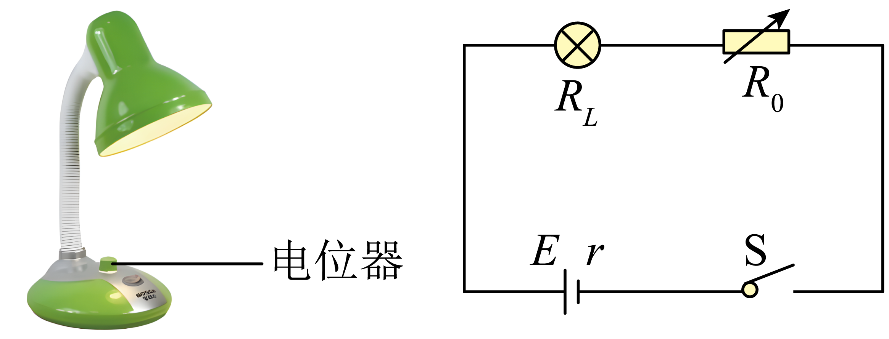

# Physics - 题目 2713

**ID**: 15c21f905c274e1294080fa859d9c6d6
**年级**: Grade 11
**难度**: Medium-Hard
**题型**: Calculation

## 题目
如图所示电路，电源部分可视作一个没有电阻的理想电源与电源电阻的串联。​​​​​​​‌设电源电动势为E，电源内阻为r，外电路电阻为R，闭合电路的电流为I。(1)请根据能量关系，推导闭合电路欧姆定律（结果用题干所涉及到的物理量表达）。(2)如图为手控可调节亮度的台灯，其内部电路可简化为如右图所示的电路图。通过调节右图所示电位器（可变电阻器）R_{0}接入电路的阻值，即可调节小灯泡的亮度。请列出必要的公式进行分析，说明当电位器R_{0}阻值被调大时，小灯泡亮度如何变化？(3)在第（2）问电路中，若已知电源电动势E=10V，内阻r=2Ω，灯泡电阻R_{L}=8Ω（固定不变），电位器R_{0}接入电路中的阻值可在0~30Ω之间调节，请分析说明， 电位器R_{0}阻值多大时，R_{0}的功率最大？功率最大为多少？

## 解答

1. （1）根据电动势的定义有
2. $E=\frac {W{{}_{非}}}{q}$
3. 在时间t内通过电路的电荷量为
4. q=It
5. 根据能量守恒定律，非静电力做的功应该等于内外电路产生焦耳热的总和。即
6. W_{非}=Q_{外}+Q_{内}
7. 在时间t内
8. Q_{外}=I^{2}Rt
9. Q_{内}=I^{2}rt
10. 联立可得
11. EIt=I^{2}Rt+I^{2}rt
12. 整理后可得
13. $I=\frac {E}{R+r}$
14. （2）灯泡的阻值为定值电阻，其电功率表达式为
15. $P{{}_{L}}=（\frac {E}{R{{}_{0}}+R{{}_{L}}+r}）{^{2}}R{{}_{L}}$
16. 即当R_{0}=0时，灯泡电功率最大，电位器R_{0}阻值被调大时，小灯泡亮度逐渐减小；
17. （3）变阻器R_{0}消耗的功率为
18. $P{{}_{R0}}=（\frac {E}{R{{}_{0}}+R{{}_{L}}+r}）{^{2}}R{{}_{0}}=\frac {E{^{2}}}{R{{}_{0}}+\frac {(R{{}_{L}}+r){^{2}}}{R{{}_{0}}}+2(R{{}_{L}}+r)}$
19. 可知当电位器的阻值满足R_{0}=r+R_{L}时，电位器的功率最大，即
20. R_{0}=r+R_{L}=2Ω+8Ω=10Ω
21. 时，电位器的电功率最大；此时
22. $P{{}_{R0{\rm{m}}}}=\frac {E{^{2}}}{4(R{{}_{L}}+r)}=2.5{\rm{W}}$

## 知识点

**中文**:
  - 闭合电路输出功率与效率

**English**:
  - Output Power and Efficiency of Closed Circuits

---
