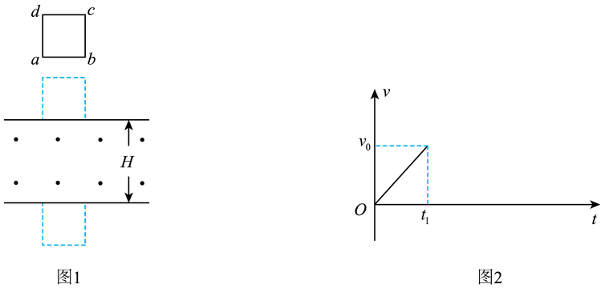

# Physics - 题目 1559

**ID**: 15c4046bb93945979e5594baada158bd
**年级**: Grade 11
**难度**: Medium-Hard
**题型**: Calculation

## 题目
如图1所示，有一边长为L、电阻为R的正方形导线框abcd从某高处自由下落，t_{1}时刻ab边进入匀强磁场时速度为v_{0}，匀强磁场区域宽度为H（H>L），磁感应强度大小为B，方向垂直于纸面向外，cd边穿出磁场前已经做匀速运动。​​​​​​​‌已知导线框质量为m，重力加速度为g。（1）求导线框刚进入磁场时感应电流的大小以及ab边中电流的方向；（2）若cd边离开磁场时速度也为v_{0}，求：①导线框穿越磁场过程中产生的焦耳热Q；②请在图2中定性画出导线框穿越磁场过程速度随时间变化的图像。

## 解答

1. （1）根据法拉第电磁感应定律，有 $E=BLv{{}_{0}}$ ，
2. 可得导线框刚进入磁场时感应电流的大小 $I=\frac {BLv{{}_{0}}}{R}$ ，
3. 由右手定则判断知感应电流方向b→a（向左）。
4. （2）①对导线框穿越匀强磁场的整个过程中，初末位置导线框动能相等。由能量守恒定律得 ${\rm{Δ}}E{{}_{减}}={\rm{Δ}}E{{}_{增}}$ ，
5. 即 $mg\left ({L+H}\right )=Q$ ，
6. 可得导线框穿越磁场过程中产生的焦耳热 $Q=mg\left ({L+H}\right )$ 。
7. ②因cd边离开磁场时速度与ab边进入匀强磁场时速度均为v_{0}，且cd边穿出磁场前已经做匀速运动，所以ab边进入磁场时刚好做匀速运动，则可知线框进入磁场时，安培力与重力平衡；完全进入磁场后，只受重力，线框做自由落体运动；线框ab边刚出磁场时，由于安培力大于重力，根据牛顿第二定律可知线框做加速度逐渐减小的减速运动，直到cd边匀速，最后穿出磁场。可定性画出导线框穿越磁场过程速度随时间变化的图像如图所示
8. 

## 知识点

**中文**:
  - 电磁感应定律中的图像问题
  - 线框模型
  - 电磁感应现象中的功能问题

**English**:
  - Graph Problems in EM Induction
  - Wire Frame Model
  - Work-Energy Problems in EM Induction

---
