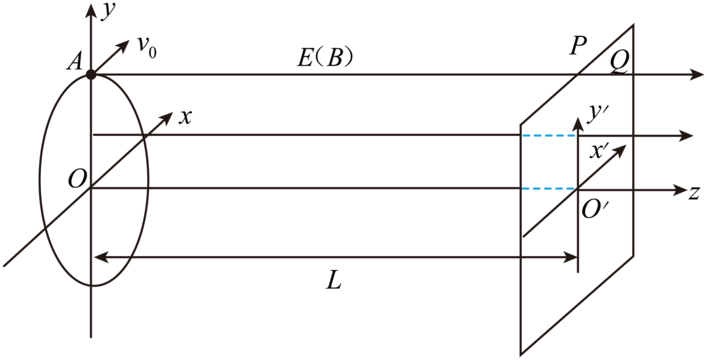

# Physics - 题目 2054

**ID**: 1886682b76144e148f2338d324dad4a3
**年级**: Grade 11
**难度**: Medium-Hard
**题型**: Calculation

## 题目
如图所示，在空间中存在沿着z轴正方向的匀强磁场或匀强电场，z轴经过O点垂直于坐标系xOy所在的平面，磁感应强度大小为B，电场强度大小为E。​​​​​​​‌将一检测器Q垂直于z轴放置于该空间，检测器中心 $O^{′}$ 在z轴上，当粒子撞击检测器Q时，检测器被撞击的位置会发光。在检测器所在平面上建立另一坐标系 $x^{′}O^{′}y^{′}$ ， $x^{′}/\mskip-4mu/x$ ， $y^{′}/\mskip-4mu/y$ ， $OO^{′}$ 之间的距离 $L=\frac {2π{^{2}}mE}{qB{^{2}}}$ 。一质量为m、电荷量为q的带正电的粒子从y轴上的A点沿x轴正方向以初速度 $v{{}_{0}}$ 射入场中，运动过程粒子所受重力可以忽略不计。（1）若空间内只存在匀强磁场，其轨迹圆的圆心在O点，求A点的位置，用坐标 $\left ({x，y}\right )$ 表示；（2）若空间内只存在匀强电场，求检测器上发光点的位置，用坐标 $\left ({x^{′}，y^{′}}\right )$ 表示；（3）若空间内同时存在上述的匀强磁场和匀强电场，求检测器上发光点的位置坐标 $\left ({x^{′}，y^{′}}\right )$ 及粒子打在检测器上时速度的大小。

## 解答

1. （1）粒子做匀速圆周运动，由洛伦兹力提供向心力，则有 $qv{{}_{0}}B=m\frac {v{{}_{0}^{2}}}{R}$ ，
2. 解得 $R=\frac {mv{{}_{0}}}{qB}$ ，
3. 故A点的位置为 $\left ({0，\frac {mv{{}_{0}}}{qB}}\right )$ 。
4. （2）粒子做类平抛运动，则有 $L=\frac {2π{^{2}}mE}{qB{^{2}}}=\frac {1}{2}\cdot \frac {qE}{m}\cdot t{^{2}}$ ，
5. 解得 $t=\frac {2πm}{qB}$ ，
6. 则横坐标为 $x^{′}=v{{}_{0}}t=\frac {2πmv{{}_{0}}}{qB}$ ，
7. 纵坐标与 $\mathrm{A}$ 点的纵坐标相同，故发光点的位置为 $\left ({\frac {2πmv{{}_{0}}}{qB}，\frac {mv{{}_{0}}}{qB}}\right )$ 。
8. （3）粒子的运动均可以分解为沿 $z$ 轴方向初速度为零的匀加速直线运动和与 $xoy$ 平面平行的速度为 $v{{}_{0}}$ 的匀速圆周运动。结合上述有 $t=\frac {2πm}{qB}$ ，
9. 可知，恰好完成一周的运动，
10. 所以 $x^{′}=0$ ， $y{^{\prime }}=\frac {mv{{}_{0}}}{qB}$ ，
11. 故发光点的位置为 $\left ({0，\frac {mv{{}_{0}}}{qB}}\right )$ ，
12. 粒子的分速度 $v^{′}{{{}_{x}}}=v{{}_{0}}$ ， $v^{′}{{{}_{z}}}=\frac {qE}{m}\cdot t=\frac {2πE}{B}$ ，
13. 则有 $v=\sqrt {v{{}_{0}^{2}}+v{{}_{z}^{2}}}=\sqrt {v{{}_{0}^{2}}+\frac {4π{^{2}}E{^{2}}}{B{^{2}}}}$ 。

## 知识点

**中文**:
  - 带电粒子在叠加场中的运动

**English**:
  - Motion in Superimposed Fields

---
