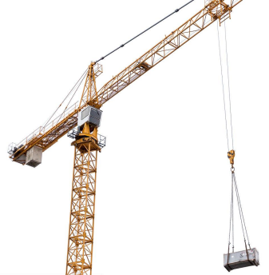

# Physics - 题目 2856

**ID**: 192323986be042d3a2fe191575ffdfdc
**年级**: Grade 11
**难度**: Medium-Hard
**题型**: Calculation

## 题目
如图所示，一工地正在利用起重机将货物吊至建筑物顶端。​​​​​​​‌ $t=0$ 时刻，货物由静止开始先向上加速，再保持一段时间的提升速度不变， $t=26{\rm{s}}$ 时恰好减速到达建筑物顶端。已知货物质量 $m=1\times 10{^{3}}{\rm{k}}{\rm{g}}$ ，货物的最大速度 $v=2{\rm{m}}/{\rm{s}}$ ，加速和减速阶段视为匀变速运动，加速度大小均为 $a=1{\rm{m}}/{\rm{s}}{^{2}}$ ，不计空气阻力， $g$ 取 $10{\rm{m}}/{\rm{s}}{^{2}}$ ，求：(1)匀加速阶段货物受到的拉力大小；(2)建筑物的高度；(3) $t\prime =9{\rm{s}}$ 时货物底部的一个小螺帽突然掉落，求螺帽落地的时刻。

## 解答

1. （1）对货物受力分析，根据牛顿第二定律可得 $F-mg=ma$ ，
2. 代入数据解得 $F=m(g+a)=1.1\times 10{^{4}}{\rm{N}}$ ，
3. 即匀加速阶段货物受到拉力的大小为 $1.1\times 10{^{4}}{\rm{N}}$ ；
4. （2）由题可知，匀加速货物运动的时间 $t=\frac {v}{a}=2{\rm{s}}$ ，
5. 根据对称性可知，匀减速阶段的时间等于匀加速阶段的时间，匀加速、匀减速阶段的位移 $x=2\centerdot \frac {1}{2}vt=4{\rm{m}}$ ，
6. 货物匀速运动的时间 $t{{}_{0}}=t{{}_{总}}-t=22{\rm{s}}$ ，
7. 匀速运动的位移 $x{^{^{′}}}=vt{{}_{0}}=44{\rm{m}}$ ，
8. 建筑物的高度为 $h=x+x{^{^{′}}}=48{\rm{m}}$ 。
9. （3）根据上述分析可知，小螺帽加速上升的高度为 $h{{}_{1}}=\frac {1}{2}vt=2{\rm{m}}$ ，
10. 匀速上升的时间 $t{{}_{0}^{^{′}}}=t{^{^{′}}}-t=7{\rm{s}}$ ，
11. 匀速上升的高度为 $h{{}_{2}}=vt{{}_{0}^{^{′}}}=14{\rm{m}}$ ，
12. 小螺帽掉落时离地面的高度为 $h=h{{}_{1}}+h{{}_{2}}=16{\rm{m}}$ ，
13. 掉落时的速度 $v=2{\rm{m}}{\rm{/}}{\rm{s}}$ ，
14. 选取向上的方向为正方向，根据匀变速直线运动规律可得 $-h=vt{{}_{落}}-\frac {1}{2}gt{{}_{落}^{2}}$ ，
15. 代入数据整理可得 $5t{{}_{落}^{2}}-2t{{}_{落}}-16=0$ ，
16. 解得 $t{{}_{落}}=2{\rm{s}}$ （另一解为负值，舍去），落地时刻为11 s。

## 知识点

**中文**:
  - 竖直上抛的对称性与多解性问题

**English**:
  - Symmetry and Multi-Solution Problems in Vertical Throw

---
