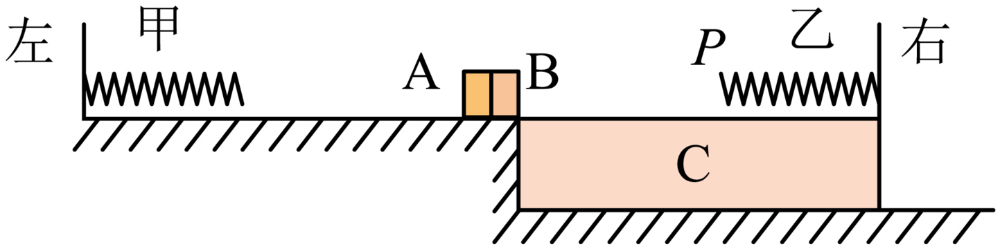

# Physics - 题目 2508

**ID**: 19b25e3c9bdb4a31bf4c46f113a22214
**年级**: Grade 11
**难度**: Medium-Hard
**题型**: Calculation

## 题目
如图所示，一表面粗糙的水平平台，在平台左端固定一轻质弹簧甲，平台最右端并排静止放置可视为质点的两个小物块A和B，其中质量 $m{{}_{{\rm{A}}}}=2{\rm{k}}{\rm{g}}$ ， $m{{}_{{\rm{B}}}}=1{\rm{k}}{\rm{g}}{\rm ，A}$ 、B间夹有少量炸药。​​​​​​​‌在平台右侧紧挨着平台的光滑水平地面上静止放置一质量 $m{{}_{{\rm{C}}}}=3{\rm{k}}{\rm{g}}$ 的木板C，木板C的上表面与平台在同一水平面上，且其最右端固定另一轻质弹簧乙，弹簧乙的自由端在P点，P到木板C最左端的距离L＝0.5m。某时刻炸药爆炸，A、B分别沿水平方向运动，物块A压缩弹簧甲后被弹回并恰好停在爆炸前的位置，且弹簧甲被压缩过程中的最大弹性势能 $E{{}_{{\rm{p}}}}=2{\rm{J}}$ 。B、C发生相对运动的整个过程中，弹簧乙的最大压缩量x＝6cm。已知物块B与木板C上表面间的动摩擦因数 $μ{{}_{1}}=0.4$ ，重力加速度 $g=10{\rm{m}}/{\rm{s}}{^{2}}$ 。求：(1)爆炸后瞬间，物块B的速度大小；(2)弹簧乙具有的最大弹性势能；(3)整个过程中B、C间由于摩擦产生的热量Q。

## 解答

1. （1）设爆炸后瞬间，物块A的速度大小为v_{A0}，物块A向左运动的最大距离为S，物块A与水平平台间的动摩擦因数为μ。由功能关系可知
2. $-{\rm μm}{{}_{\mathrm{A}}}g\cdot 2S=0-\frac {1}{2}m{{}_{\mathrm{A}}}v{{}_{\mathrm{A}0}^{2}}$
3. ${\rm μm}{{}_{\mathrm{A}}}gS=E{{}_{\mathrm{P}}}$
4. 爆炸前、后系统A、B动量守恒
5. m_{B}v_{B0}－m_{A}v_{A0}＝0
6. 得
7. v_{B0}＝4m/s
8. （2）B进入木板C的上表面后，弹簧乙具有的最大弹性势能时，两者共速，以B、C及弹簧乙为系统动量守恒
9. m_{B}v_{B0}＝（m_{B}＋m_{C}）v_{共}_{ }
10. 由系统能量守恒可得
11. $E{{}_{\mathrm{P}}}=\frac {1}{2}m{{}_{\mathrm{B}}}v{{}_{\mathrm{B}0}^{2}}-\frac {1}{2}\left ({m{{}_{\mathrm{B}}}+m{{}_{\mathrm{C}}}}\right )v{{}_{共}^{2}}-μ{{}_{1}}m{{}_{{\rm{B}}}}g\left ({L+x}\right )$
12. 可得
13. E_{P}＝3.76J
14. （3）假设B相对于C向左滑动离开弹簧后系统又达到共同速度v′，此时B相对C向左滑动的距离为S，由动量守恒
15. m_{B}v_{B0}＝（m_{B}＋m_{C}）v′
16. 由系统能量守恒
17. $E{{}_{\mathrm{P}}}+\frac {1}{2}\left ({m{{}_{\mathrm{B}}}+m{{}_{\mathrm{C}}}}\right )v{{}_{共}^{2}}=\frac {1}{2}\left ({m{{}_{\mathrm{B}}}+m{{}_{\mathrm{C}}}}\right )v^{′}{^{2}}+μ{{}_{1}}m{{}_{\mathrm{B}}}gS$
18. 解得
19. S＝0.94m＞（L＋x）
20. 所以假设不成立，物块B最终离开木板C。整个过程中B、C间由于摩擦产生的热量
21. Q＝2μ_{1}m_{B}g（L＋x）＝4.48J

## 知识点

**中文**:
  - 动量守恒与弹簧相结合

**English**:
  - Momentum Conservation with Springs

---
