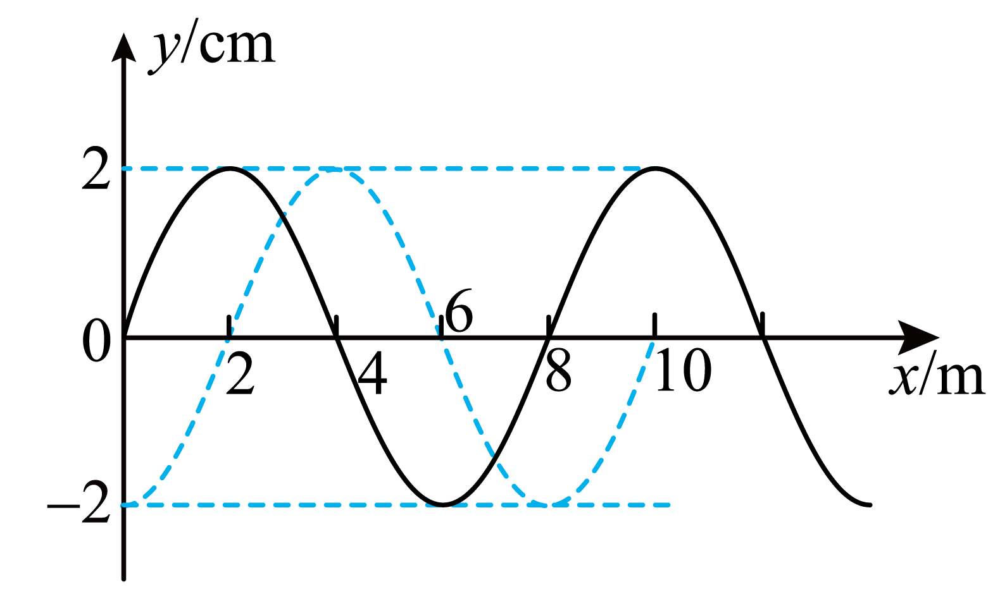

# Physics - 题目 617

**ID**: 1aa1f89e0a8644a8b06b83c4d493cf49
**年级**: Grade 11
**难度**: Medium-Hard
**题型**: Calculation

## 题目
一列简谐横波在沿x轴方向传播。​​​​​​​‌在 $t{{}_{1}}=0$ 与 $t{{}_{2}}=0.05{\rm{s}}$ 时，其波形图分别用如图所示的实线和虚线表示，求：（1）这列波的波长 $λ$ ；（2）这列波可能的波速：（3）若波速为280m/s，从 $t{{}_{1}}=0$ 时刻起，图中 $x=8{\rm{m}}$ 的质点从图中实线位置运动至波谷所需的最短时间t是多少。

## 解答

1. （1）对波形图分析可知，该波波长λ＝8m
2. （2）若波沿x轴正向传播，则有 ${\rm Δ\mathit{x}_{1}＝\mathit{nλ}＋}\frac {λ}{4}$ ＝(8n＋2)＝v_{1}Δt(n＝0、1、2、3…)
3. 得 ${\rm \mathit{v}_{1}＝}\frac {8n+2}{Δt}{\rm ＝(40＋160\mathit{n})m}$ /s(n＝0、1、2、3…)
4. 若波沿x轴负方向传播，则有 ${\rm Δ\mathit{x2}＝\mathit{nλ}＋}\frac {3λ}{4}$ ＝(8n＋6)＝v2Δt(n＝0、1、2、3…)
5. 得 ${\rm \mathit{v2}＝}\frac {8n+6}{Δt}{\rm ＝(120＋160\mathit{n})m}$ /s(n＝0、1、2、3…)
6. （3）当波速为 $280{\rm{m}}{\rm{/}}{\rm{s}}$ 时，有 $280=(120+160n)$
7. 可得 $n=1$
8. 所以波沿 $x$ 轴负向传播；质点 $P$ 第一次达到波谷所需最短时间为： $t=\frac {3}{4}T=\frac {3}{4}\times \frac {λ}{v}=\frac {3}{4}\times \frac {8}{280}{\rm{s}}\approx 2.1\times 10{^{-2}}{\rm{s}}$

## 知识点

**中文**:
  - 波的多解问题

**English**:
  - Multi-solution Problems in Waves

---
