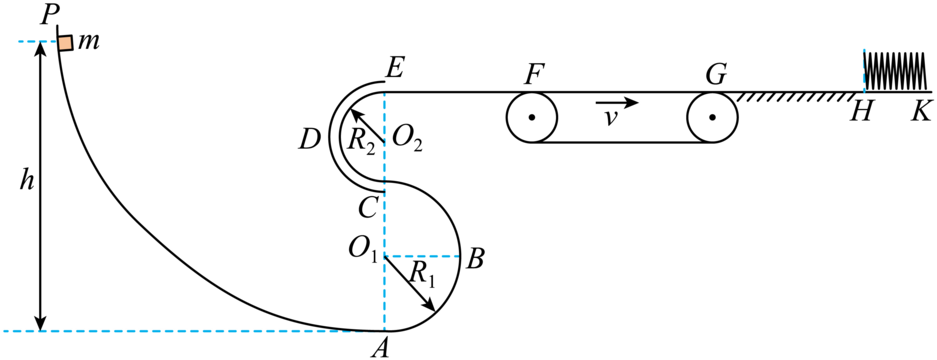

# Physics - 题目 2092

**ID**: 1c2fd3e6a6f04409b228eca08b4fafb4
**年级**: Grade 11
**难度**: Medium-Hard
**题型**: Calculation

## 题目
物理老师自制了一套游戏装置供同学们一起娱乐和研究，其装置可以简化为如图所示的模型。​​​​​​​‌该模型由同一竖直平面内的曲线轨道PA、半径为 $R{{}_{1}}=0.6{\rm{m}}$ 的半圆单轨道ABC、半径为 $R{{}_{2}}=0.1{\rm{m}}$ 的半圆圆管轨道CDE、光滑水平面EF、长度 $L{{}_{1}}=2{\rm{m}}$ 的水平传送带FG、长度 $L{{}_{2}}=0.8{\rm{m}}$ 的粗糙水平面GH、光滑水平面HK组成，且各段各处平滑连接。轨道的右端K固定一轻质弹簧，弹簧自然伸长时其自由端的位置在H点。现将一质量为m=0.1kg的小滑块（可视为质点）从PA轨道h高处静止释放。已知传送带的速度v=2m/s，小滑块与传送带动摩擦因数为 $μ{{}_{1}}=0.5$ ，与GH间的动摩擦因数为 $μ{{}_{2}}=0.1$ 。（1）若h=1.2m，求小滑块运动到B点时对轨道的压力大小；（2）要保证小滑块能够到达E点，求h的最小值；（3）若h=2.2m， 求①小滑块第一次到达传送带G点因与传送带摩擦产生的热量Q；②小滑块最终停止的位置距H点的距离。

## 解答

1. （1）小滑块从初始位置到B点，只有重力做功，根据机械能守恒有 $mgh=\frac {1}{2}mv{{}_{B}^{2}}+mgR{{}_{1}}$
2. 在B点，根据牛顿第二定律 $F{{}_{{\rm{N}}}}=m\frac {v{{}_{1}^{2}}}{R{{}_{1}}}$
3. 解得 $F{{}_{{\rm{N}}}}=2{\rm{N}}$
4. 根据牛顿第三定律，所以 $F{{}_{{\rm{N}}}}{^{\prime }}=2{\rm{N}}$
5. （2）小滑块恰好能到达C点时，即 $mg=m\frac {v{{}_{C}^{2}}}{R{{}_{1}}}$
6. 可得 $v{{}_{C}}=\sqrt {gR{{}_{1}}}$
7. 从初始位置到C点，根据机械能守恒定律 $mgh{{}_{{\rm \min }}}=\frac {1}{2}mv{{}_{C}^{2}}+mg\cdot 2R{{}_{1}}$
8. 得 $h{{}_{{\rm \min }}}=1.{{5}}{\rm{m}}{\rm{>}}{{1}}{{.}}{{4}}{\rm{m}}$ ，小滑块能通过E点。
9. （3）①小滑块到达F点的速度v_{F}
10. 从初始位置到F点，根据机械能守恒定律 $mgh=\frac {1}{2}mv{{}_{F}^{2}}+mg\cdot 2R{{}_{1}}+mg\cdot 2R{{}_{2}}$
11. 解得 $v{{}_{F}}=4{\rm{m}}{\rm{/}}{\rm{s}}$
12. 小滑块在传送带上受到的摩擦力 $f=μ{{}_{1}}mg=0.5{\rm{N}}$
13. $a=\frac {f}{m}=5{\rm{m}}{\rm{/}}{\rm{s}}{^{{{2}}}}$
14. 根据 $v{^{2}}-v{{}_{F}^{2}}=-2ax$
15. 解得 $x=1.2{\rm{m}}<L{{}_{1}}=2{\rm{m}}$
16. 小滑块减速运动的时间 $t=\frac {v{{}_{F}}-v}{a}=0.4{\rm{s}}$
17. 在0.4s内，传送带的位移x_{带}=vt=2×0.4=0.8m
18. 小滑块的位移 $x{{}_{块}}=\frac {v{{}_{F}}+v}{2}t=1.2{\rm{m}}$
19. 相对位移 $\Delta x=x{{}_{块}}-x{{}_{带}}=1.2-0.8=0.4{\rm{m}}$
20. 根据 $Q=μ{{}_{1}}mgΔx=0.2{\rm{J}}$
21. ②求小滑块最终停止的位置距H点的距离
22. 因为小滑块在传送带上先减速后匀速，所以小滑块到达G点的速度v_{G}=v=2m/s
23. 小滑块在GH段受到的摩擦力 $f^{′}=μ{{}_{2}}mg=0.1{\rm{N}}$
24. 则 $a^{′}=\frac {f{^{\prime }}}{m}=1{\rm{m}}{\rm{/}}{\rm{s}}{^{{{2}}}}$
25. 设小滑块在GH段运动的位移为x′，根据 $v{{}_{G}^{2}}-0=2a^{′}x^{′}$
26. $x^{′}=2{\rm{m}}>L{{}_{2}}=0.8{\rm{m}}$ ，说明小滑块会压缩弹簧。
27. 设小滑块从G点开始到最终停止，在GH段运动的总路程为s，根据能量守恒 $\frac {1}{2}mv{{}_{G}^{2}}=μ{{}_{2}}mgs$
28. 解得s =2m
29. 因为 $L{{}_{2}}=0.8{\rm{m}}$ ，所以小滑块最终停止的位置距H点的距离为0.4m

## 知识点

**中文**:
  - 传送带模型中的能量守恒问题

**English**:
  - Energy Conservation in Conveyor Belt Models

---
