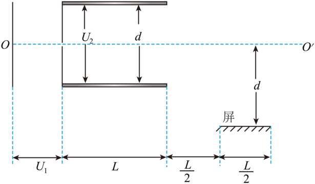

# Physics - 题目 69

**ID**: 226e0d1776ec47508bd5b8a78dc2cc00
**年级**: Grade 11
**难度**: Medium-Hard
**题型**: Calculation

## 题目
如图所示，偏转电场的两平行金属板长为L，板间距为d，距偏转电场极板的右侧为 $\frac {L}{2}$ 处有一水平放置，长度为 $\frac {L}{2}$ 的荧光屏，屏到两极板中心线OO′的距离为d。​​​​​​​‌若加速电场的极板间加上可调电压 $U{{}_{1}}$ ，偏转电场的两板之间加上恒定电压 $U{{}_{2}}$ ，一电子无初速地从O加速后进入偏转电场，经过偏转电场后可打在右侧的荧光屏上，已知电子的质量为m，电子的电荷量为e，不计电子的重力。（1）求电子进入偏转电场时的速度大小v；（2）求电子离开平行金属板时距中心线OO′的偏移量y；（3）电子从进入偏转电场到飞出，电子电势能的变化量 $ΔE$ ；（4）若使电子能打在屏上，求 $U{{}_{1}}$ 的调节范围。

## 解答

1. （1）电子在加速电场中，由动能定理得 $eU{{}_{1}}=\frac {1}{2}mv{^{2}}$
2. 解得 $v=\sqrt {\frac {2eU{{}_{1}}}{m}}$
3. （2）电子在偏转电场中做类平抛运动
4. 水平方向 $L=vt$
5. 竖直方向加速度 $a=\frac {eE}{m}=\frac {eU{{}_{2}}}{md}$
6. 偏移量 $y=\frac {1}{2}at{^{2}}$
7. 解得 $y=\frac {U{{}_{2}}L{^{2}}}{4dU{{}_{1}}}$
8. （3）电子在偏转电场中，电场力做功 $W=eEy=e\cdot \frac {U{{}_{2}}}{d}\cdot y$
9. 根据功能关系，电势能变化量 ${\rm{Δ}}E=-W=-\frac {eU{{}_{2}}{^{2}}L{^{2}}}{4d{^{2}}U{{}_{1}}}$
10. （4）电子离开偏转电场后，做匀速直线运动，设偏转角为 $θ$ ，则 ${\tan}θ=\frac {v{{}_{y}}}{v}=\frac {at}{v}$
11. 解得 ${\tan}θ=\frac {U{{}_{2}}L}{2dU{{}_{1}}}$
12. 电子打在屏的最左端时，竖直方向的总偏移量需满足 $y+\frac {L}{2}{\tan}θ=d$
13. 解得 $U{{}_{1}}=\frac {U{{}_{2}}L{^{2}}}{2d{^{2}}}$
14. 电子打在屏的最右端时，竖直方向的总偏移量需满足 $y+L{\tan}θ=d$
15. 解得 $U{{}_{1}}=\frac {3U{{}_{2}}L{^{2}}}{4d{^{2}}}$
16. 因此加速电场的电压调节范围 $\frac {U{{}_{2}}L{^{2}}}{2d{^{2}}}⩽U{{}_{1}}⩽\frac {3U{{}_{2}}L{^{2}}}{4d{^{2}}}$

## 知识点

**中文**:
  - 动能定理的简单应用
  - 带电粒子在匀强电场中的运动

**English**:
  - Simple Applications of Work-Energy Theorem
  - Motion in Uniform Electric Field

---
