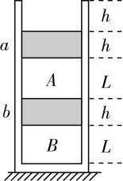

# Physics - 题目 2790

**ID**: 23a017d843604b6cb97c09256ca8d785
**年级**: Grade 11
**难度**: Medium-Hard
**题型**: Calculation

## 题目
如图所示，一圆柱形细金属汽缸直立于地面上，两段水银柱 $a$ 、 $b$ 高度均为 $h=25\mathrm{c}\mathrm{m}$ ，封闭了两部分理想气体 $A$ 和 $B$ .​​​​​​​‌水银柱与汽缸接触良好（不漏气）且无摩擦，系统静止时，水银柱 $a$ 的上表面到汽缸口的距离也为 $h$ ， $A$ 、 $B$ 气柱的长度均为 $L=40\mathrm{c}\mathrm{m}$ .开始气体温度均为 $27℃$ ，大气压强为 ${p}_{0}={10}^{5}\mathrm{P}\mathrm{a}=75\mathrm{c}\mathrm{m}\mathrm{H}\mathrm{g}$ .（1） 若缓慢向汽缸注入水银长度 $25\mathrm{c}\mathrm{m}$ （与水银柱 $a$ 之间无间隙）， $A$ 、 $B$ 气体温度都不变，求最终水银柱 $a$ 上表面与汽缸口的高度差；（2） 若初始状态下，在水银柱 $b$ 的下方插入隔板，使气体 $B$ 体积恒定，只对气体 $A$ 缓慢加热使水银柱 $a$ 全部流出，求气体 $A$ 的热力学温度至少要达到多大（保留3位有效数字）.

## 解答

1. （1） 对气体 $A$ ,初态 ${p}_{A1}={p}_{0}+\rho gh=100\mathrm{c}\mathrm{m}\mathrm{H}\mathrm{g}$ , ${V}_{A1}=LS$ ,
2. 末态 ${p}_{A2}={p}_{0}+2\rho gh=125\mathrm{c}\mathrm{m}\mathrm{H}\mathrm{g}$ , ${V}_{A2}={L}_{A}S$ ,
3. 由玻意耳定律有 ${p}_{A1}{V}_{A1}={p}_{A2}{V}_{A2}$ ,解得 ${L}_{A}=32\mathrm{c}\mathrm{m}$ ,
4. 对气体 $B$ ,初态 ${p}_{B1}={p}_{0}+2\rho gh=125\mathrm{c}\mathrm{m}\mathrm{H}\mathrm{g}$ , ${V}_{B1}=LS$ ,
5. 末态 ${p}_{B2}={p}_{0}+3\rho gh=150\mathrm{c}\mathrm{m}\mathrm{H}\mathrm{g}$ , ${V}_{B2}={L}_{B}S$ ,
6. 由玻意耳定律有 ${p}_{B1}{V}_{B1}={p}_{B2}{V}_{B2}$ ,
7. 解得 ${L}_{B}=\frac{100}{3}\mathrm{c}\mathrm{m}$ ,
8. 根据题意可知,水银柱 $a$ 上表面与汽缸口的高度差为
9. $\mathrm{\Delta }h=2L-{L}_{A}-{L}_{B}$ ,
10. 解得 $\mathrm{\Delta }h=\frac{44}{3}\mathrm{c}\mathrm{m}$ .
11. （2） 对气体 $A$ ,初态 ${p}_{1}={p}_{0}+\rho gh=100\mathrm{c}\mathrm{m}\mathrm{H}\mathrm{g}$ , ${V}_{1}=LS$ , ${T}_{1}=300\mathrm{K}$ ,
12. 流出水银后 $($ 剩余长度 $x)$ ,则 ${p}_{2}={p}_{0}+\rho gx$ , ${V}_{2}=(L+2h-x)S$ ,
13. 根据理想气体状态方程可知 $\frac{{p}_{1}{V}_{1}}{{T}_{1}}=\frac{{p}_{2}{V}_{2}}{{T}_{2}}$ ,
14. 即 $\frac{100\mathrm{c}\mathrm{m}\mathrm{H}\mathrm{g}×40\mathrm{c}\mathrm{m}}{300\mathrm{K}}=\frac{(75\mathrm{c}\mathrm{m}+x)\mathrm{H}\mathrm{g}(90\mathrm{c}\mathrm{m}-x)}{{T}_{2}}$ ,
15. 根据数学知识可得,当 $x=7.5\mathrm{c}\mathrm{m}$ 时, ${T}_{2}$ 存在最大值,最大值为 ${T}_{2\mathrm{m}}=510\mathrm{K}$ ，故气体 $A$ 的热力学温度至少要达到 $510\mathrm{K}$ .

## 知识点

**中文**:
  - 气体等温变化与玻意耳定律
  - 理想气体与理想气体状态方程

**English**:
  - Isothermal Change and Boyle's Law
  - Ideal Gas and Ideal Gas Law

---
