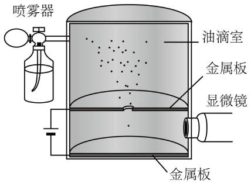

# Physics - 题目 275

**ID**: 276bb2bc663c48d7bad4fbc54658cba9
**年级**: Grade 11
**难度**: Medium-Hard
**题型**: Calculation

## 题目
如图所示为美国物理学家密立根测量油滴所带电荷量装置的截面图，两块水平放置的平行金属板间距离为d。​​​​​​​‌油滴从喷雾器的喷嘴喷出时，油滴散布在油滴室中，在重力作用下，少数油滴通过上面金属板的小孔进入平行金属板间。当平行金属板间不加电压时，由于受到气体阻力的作用，油滴最终以速度v_{1}竖直向下匀速运动；当上板带正电，下板带负电，两板间的电压为U时，带电油滴恰好能以速度v_{2}竖直向上匀速运动。已知油滴在极板间运动时所受气体阻力的大小与其速率成正比，k为阻力系数，油滴密度为m，重力加速度为g。（1）油滴电性，并说明原因；（2）求k的大小；（3）求油滴所带电荷量q。

## 解答

1. （1）由图知上板带正电，下板带负电，两板间的电压为U时，带电油滴恰好能以速度v_{2}竖直向上匀速运动，粒子受到的重力及空气阻力竖直向下，由平衡条件知油滴受到的电场力方向竖直向上，与电场方向相反，故油滴带负电；
2. （2）依题意，油滴速度为v_{1}时，所受阻力
3. $f{{}_{1}}=kv{{}_{1}}$
4. 油滴向下匀速运动时，重力与阻力平衡，则有
5. $f{{}_{1}}=mg$
6. 解得
7. $k=\frac {mg}{v{{}_{1}}}$
8. （3）设油滴所带电荷量为q，油滴向上匀速运动时，阻力向下，油滴受力平衡
9. $kv{{}_{2}}+mg=q\frac {U}{d}$
10. 则油滴所带电荷量
11. $q=\frac {mgd\left ({v{{}_{1}}+v{{}_{2}}}\right )}{Uv{{}_{1}}}$

## 知识点

**中文**:
  - 电容器与力学知识的综合

**English**:
  - Integration of Capacitors and Mechanics

---
