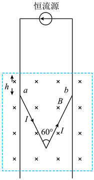

# Physics - 题目 1284

**ID**: 28c0438bfdf34e5a891cfaac8d003359
**年级**: Grade 11
**难度**: Medium-Hard
**题型**: Calculation

## 题目
如图所示，接有恒流源的两根金属导轨固定在竖直平面内，导轨下半部分处于垂直纸面向里的有界匀强磁场中，磁感应强度为 $B=1{\rm{T}}$ 。​​​​​​​‌长为 $d=2{\rm{m}}$ 的刚性导体棒折成边长相等、夹角为60°的“V”形，固定于竖直平面内且与导轨接触良好，导体棒两端点与磁场的上边界距离 $h{{}_{0}}=0.1{\rm{m}}$ 。在 $t=0$ 时刻释放导体棒同时通以 $I=2{\rm{A}}$ 的电流。已知导体棒质量为 $m=0.1{\rm{k}}{\rm{g}}$ ，电阻为 $R=1Ω$ ，不计导体棒和导轨间的摩擦及空气阻力。求（1） $t=0$ 时“V”形通电导体棒受到的安培力 $F{{}_{0}}$ ；（2）导体棒端点ab与磁场上边界距离 $h=0.05{\rm{m}}$ 时，恒流源输出功率P；（3）“V”形导体棒上升的最大高度H。

## 解答

1. （1） $t=0$ 时“V”形通电导体棒受到的安培力 $F{{}_{0}}=BI\times 2\cdot \frac {d}{2}\sin 30{^{\circ }}=\frac {1}{2}\times 1\times 2\times 2{\rm{N}}{\rm{=}}{{2}}{\rm{N}}$
2. （2）“V”形通电导体棒向上的加速度为 $a=\frac {F{{}_{0}}-mg}{m}=10{\rm{m}}{\rm{/}}{\rm{s}}{^{2}}$
3. 导体棒端点ab与磁场上边界距离 $h=0.05{\rm{m}}$ 时的速度 $v=\sqrt {2aΔh}=1{\rm{m}}{\rm{/}}{\rm{s}}$
4. 恒流源输出功率 $P=F{{}_{0}}v+I{^{2}}R=6{\rm{W}}$
5. （3）“V”形导体棒的ab端离开磁场后，所受的安培力与上升的高度成线性关系或者 ${\overline{F{{}_{A}}}}=1{\rm{N}}$ ，则“V”形导体棒离开磁场过程中，由动能定理 $BILh{{}_{0}}+{\overline{F{{}_{A}}}}\cdot \frac {\sqrt {3}}{2}L-mg\left ({h{{}_{0}}+\frac {\sqrt {3}}{2}L}\right )=\frac {1}{2}mv{^{2}}-0$
6. 其中 $L=\frac {1}{2}d$
7. 解得 $v=\sqrt {2}{\rm{m}}{\rm{/}}{\rm{s}}$
8. 由 $-mgh=0-\frac {1}{2}mv{^{2}}$
9. 解得h=0.1m
10. 则 $H=h+\frac {\sqrt {3}}{2}L+h{{}_{0}}=\left ({0.2+\frac {\sqrt {3}}{2}}\right ){\rm{m}}$

## 知识点

**中文**:
  - 安培力作用下的运动问题
  - 电磁感应现象中的功能问题

**English**:
  - Motion under Ampere Force
  - Work-Energy Problems in EM Induction

---
