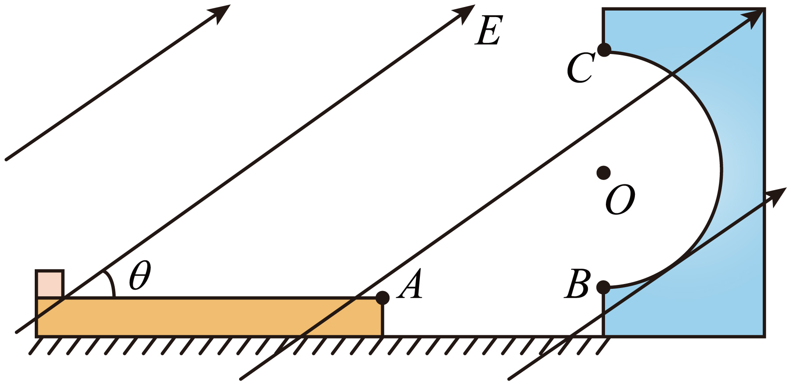

# Physics - 题目 396

**ID**: 2904abde7af841228d690db683d61d59
**年级**: Grade 11
**难度**: Medium-Hard
**题型**: Calculation

## 题目
如图所示，质量M=1.0kg的绝缘长木板放在粗糙水平地面上，其右侧固定一光滑半圆弧轨道，圆弧轨道的最低点B与木板右上端的A点等高。​​​​​​​‌在长木板左端放一带电小滑块，小滑块带电量为q=+0.01C，质量为m=0.5kg，小滑块与长木板间的动摩擦因数μ_{1}=0.5，长木板与地面间的动摩擦因数μ_{2}=0.05。整个装置处于真空室内的匀强电场中，场强大小E=500V/m，方向与水平方向成θ=37°斜向右上。释放小滑块，经过t=1s，长木板与半圆弧轨道相碰，此时小滑块恰好滑到木板最右端A点，之后进入光滑半圆弧轨道，刚好能经过轨道最高点C。小滑块视为质点，重力加速度大小g=10m/s^{2}，sin37°=0.6，cos37°=0.8，求：(1)木板长度L；(2)圆弧半径R；(3)小滑块由B到C的运动过程中，电势能最小时滑块的速度大小。

## 解答

1. （1）对小滑块受力分析，如图所示
2. 
3. 根据牛顿第二定律，有 $f{{}_{1}}=μ{{}_{1}}\left ({mg-qE\sin 37{}\degree }\right )$ ， $qE{\cos}37{}\degree -f{{}_{1}}=ma{{}_{1}}$ ，联立解得 $a{{}_{1}}=6{\rm{m}}{\rm{/}}{\rm{s}}{^{2}}$ ，小滑块位移 $x{{}_{1}}=\frac {1}{2}a{{}_{1}}t{^{2}}$ ，对长木板受力分析，如图所示
4. 
5. 根据牛顿第二定律，有 $f{{}_{2}}=μ{{}_{2}}\left [\left ({m+M}\right )g-qE\sin 37{}\degree \right ]$ ， $f^{′}{{{}_{1}}}-f{{}_{2}}=Ma{{}_{2}}$ ，其中 $f{{}_{1}}=f^{′}{{{}_{1}}}$ ，联立解得 $a{{}_{2}}=0.4{\rm{m}}{\rm{/}}{\rm{s}}{^{2}}$ ，长木板位移 $x{{}_{2}}=\frac {1}{2}a{{}_{2}}t{^{2}}$ ，长木板长度 $L=x{{}_{1}}-x{{}_{2}}$ ，联立解得 $L=2.8{\rm{m}}$
6. （2）在B点，小滑块速度为 $v{{}_{B}}=a{{}_{1}}t$ ，小滑块恰好经过C点，根据牛顿第二定律，有 $mg-qE\sin 37{}\degree =\frac {mv{{}_{C}^{2}}}{R}$ ，小滑块由B点到C点，根据动能定理，有 $2qER\sin 37{}\degree -2mgR=\frac {1}{2}mv{{}_{C}^{2}}-\frac {1}{2}mv{{}_{B}^{2}}$ ，联立解得 $R=1.8{\rm{m}}$
7. （3）小球在D点时电势能最小，滑块速度方向与电场方向垂直；小球由B到D，根据动能定理，有 $qER\left ({1+\sin 37{}\degree }\right )-mgR\left ({1+\sin 37{}\degree }\right )=\frac {1}{2}mv{{}_{D}^{2}}-\frac {1}{2}mv{{}_{B}^{2}}$ ，联立解得 $v{{}_{D}}=v{{}_{B}}=6{\rm{m}}{\rm{/}}{\rm{s}}$

## 知识点

**中文**:
  - 匀强电场
  - 板块模型

**English**:
  - Uniform Electric Field
  - Plate Model

---
