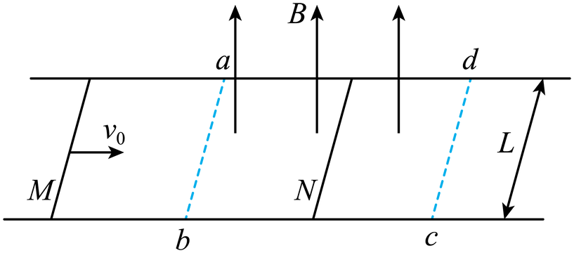

# Physics - 题目 1669

**ID**: 2bec96e96419431392859fed223f9710
**年级**: Grade 11
**难度**: Medium-Hard
**题型**: Calculation

## 题目
如图所示，两平行光滑长直金属导轨水平放置，间距为L。​​​​​​​‌abcd区域有匀强磁场，磁感应强度大小为B，方向竖直向上。初始时刻，磁场外的细金属杆M以初速度v_{0}向右运动，磁场内的细金属杆N处于静止状态。两金属杆与导轨接触良好且运动过程中始终与导轨垂直。两杆的质量均为m，在导轨间的电阻均为R，感应电流产生的磁场及导轨的电阻忽略不计。（1）求M刚进入磁场时受到的安培力F的大小；（2）若两杆在磁场内未相撞且N出磁场时的速度为 $\frac {v{{}_{0}}}{3}$ ，求：①N在磁场内运动过程中通过回路的电荷量q；②初始时刻N到ab的最小距离x；（3）初始时刻，若N到cd的距离与第（2）问初始时刻的相同、到ab的距离为kx（k>1），求M出磁场后不与N相撞条件下k的取值范围。

## 解答

1. （1）细金属杆M以初速度 $v{{}_{0}}$ 向右刚进入磁场时，产生的动生电动势为 $E=BLv{{}_{0}}$ ，电流方向为 $a\to b$ ，电流的大小为 $I=\frac {E}{2R}$ ，则所受的安培力大小为 $F=BIL=\frac {B{^{2}}L{^{2}}v{{}_{0}}}{2R}$ ，安培力的方向由左手定则可知水平向左。
2. （2）①金属杆N在磁场内运动过程中，由动量定理有 $B{\overline{I}}L\cdot Δt=m\cdot \frac {v{{}_{0}}}{3}-0$ ，且 $q={\overline{I}}\cdot Δt$ ，联立解得通过回路的电荷量为 $q=\frac {mv{{}_{0}}}{3BL}$ ，②设两杆在磁场中相对靠近的位移为 $Δ{\rm{x}}$ ，有 ${\overline{I}}=\frac {{\overline{E}}}{2R}$ ， ${\overline{E}}=\frac {BL\cdot Δx}{Δt}$ ，整理可得 $q=\frac {BL\cdot Δx}{2R}$ ，联立可得 $Δx=\frac {2mv{{}_{0}}R}{3B{^{2}}L{^{2}}}$ ，若两杆在磁场内刚好相撞，N到 $ab$ 的最小距离为 $x=Δx=\frac {2mv{{}_{0}}R}{3B{^{2}}L{^{2}}}$
3. （3）两杆出磁场后在平行光滑长直金属导轨上运动，若N到 $cd$ 的距离与第（2）问初始时刻的相同、到 $ab$ 的距离为 $kx(k>1)$ ，则N到cd边的速度大小恒为 $\frac {v{{}_{0}}}{3}$ ，根据动量守恒定律可知 $mv{{}_{0}}=mv{{}_{1}}+m\cdot \frac {v{{}_{0}}}{3}$ ，解得N出磁场时，M的速度大小为 $v{{}_{1}}=\frac {2}{3}v{{}_{0}}$ ，由题意可知，此时M到cd边的距离为 $s=(k-1)x$ ，若要保证M出磁场后不与N相撞，则有两种临界情况：
4. ①M减速出磁场，出磁场的速度刚好等于N的速度，一定不与N相撞，对M根据动量定理有 $B{\overline{I{{}_{1}}}}L\cdot Δt{{}_{1}}=m\cdot \frac {2}{3}v{{}_{0}}-m\cdot \frac {v{{}_{0}}}{3}$ ， $q{{}_{1}}={\overline{I{{}_{1}}}}\cdot Δt{{}_{1}}=\frac {BL\cdot (k-1)x}{2R}$ ，联立解得 $k=2$ ，②M运动到cd边时，恰好减速到零，则对M由动量定理有 $B{\overline{I{{}_{2}}}}L\cdot Δt{{}_{2}}=m\cdot \frac {2v{{}_{0}}}{3}-0$ ， $q{{}_{2}}={\overline{I{{}_{2}}}}\cdot {\rm{Δ}}t{{}_{2}}=\frac {BL\cdot \left ({k-1}\right )x}{2R}$ ，同理解得 $k=3$ ，综上所述，M出磁场后不与N相撞条件下k的取值范围为 $2\leqslant k<3$

## 知识点

**中文**:
  - 电磁感应现象中的功能问题

**English**:
  - Work-Energy Problems in EM Induction

---
