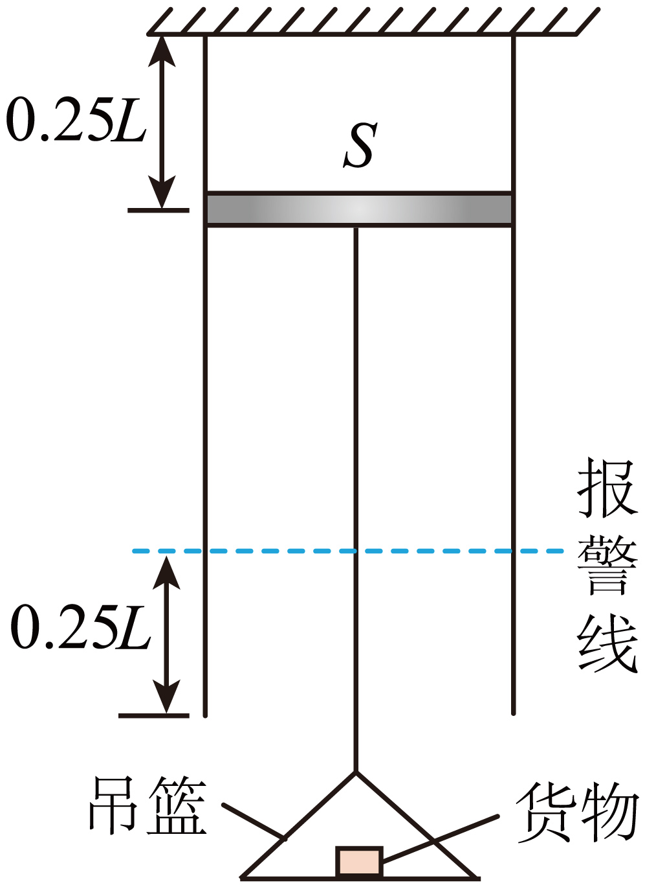

# Physics - 题目 941

**ID**: 2c0cd13ea99449558cdd5ef917fce3f2
**年级**: Grade 11
**难度**: Medium-Hard
**题型**: Calculation

## 题目
如图所示，将深度为 $L$ 、横截面积为 $\mathrm{S}$ 、导热性能良好的圆柱形薄壁容器竖直倒置固定，容器内有一厚度不计、质量为 $m$ 且导热性能良好的活塞，活塞中心用不可伸长的轻绳与质量也为 $m$ 的吊篮连接，稳定时正好封闭一段高度为 $0.25L$ 的理想气体柱，此时活塞与容器壁之间恰好无摩擦。​​​​​​​‌缓慢增加吊篮内货物的质量，当活塞距容器最低处小于 $0.25L$ 时会触发报警装置，若继续增加货物质量，活塞有被拉出容器的风险。当刚好触发报警装置时，保持货物质量不变，仅使环境温度缓慢降低，直至活塞刚好回到初始位置，该过程中容器内气体内能减少了 $\Delta U$ 。已知大气压强恒为 $p{{}_{0}}$ ，初始时环境热力学温度为 $T{{}_{0}}$ ，重力加速度为 $g$ ，活塞与容器壁之间的滑动摩擦力大小恒为 $f$ ，活塞始终保持水平状态，设最大静摩擦力等于滑动摩擦力、摩擦产生的热量全部由外界大气吸收，求：（1）刚好触发报警装置时容器内气体的压强 $p{{}_{1}}$ 和重物的质量 $M$ ；（2）活塞刚开始上升时容器内气体的温度 $T{{}_{1}}$ ；（3）活塞刚回到初始位置时的环境温度 $T{{}_{2}}$ 及降温过程中整个装置向外界释放的热量 $Q$ 。

## 解答

1. （1）活塞中心用不可伸长的轻绳与质量也为 $m$ 的吊篮连接，稳定时正好封闭一段高度为 $0.25L$ 的理想气体柱，设此时理想气体的压强为 $p$ ，对活塞受力分析，根据平衡条件得 $pS+mg+T=p{{}_{0}}S$
2. 又 $T=mg$
3. 解得 $p=p{{}_{0}}-\frac {2mg}{S}$
4. 刚好触发报警装置时，设理想气体的压强为 $p{{}_{1}}$ ，对活塞受力分析得 $p{{}_{1}}S+\left ({M+2m}\right )g=p{{}_{0}}S+f$
5. 对理想气体，由玻意耳定律得 $p\cdot 0.25LS=p{{}_{1}}\cdot 0.75LS$
6. 联立，解得 $p{{}_{1}}=\frac {p{{}_{0}}}{3}-\frac {2mg}{3S}$ ， $M=\frac {2p{{}_{0}}S+3f-4mg}{3g}$
7. （2）活塞刚开始上升时对活塞受力分析得 $p{{}_{2}}S+\left ({M+2m}\right )g+f=p{{}_{0}}S$
8. 解得 $p{{}_{2}}=\frac {p{{}_{0}}}{3}-\frac {2mg}{3S}-\frac {2f}{S}$
9. 根据查理定律 $\frac {p{{}_{1}}}{T{{}_{0}}}=\frac {p{{}_{2}}}{T{{}_{1}}}$
10. 解得此时容器内气体的温度 $T{{}_{1}}=\frac {\frac {p{{}_{0}}}{3}-\frac {2mg}{3S}-\frac {2f}{S}}{\frac {p{{}_{0}}}{3}-\frac {2mg}{3S}}T{{}_{0}}=\left ({1-\frac {2f}{\frac {p{{}_{0}}S}{3}-\frac {2mg}{3}}}\right )T{{}_{0}}$
11. （3）对理想气体，由盖—吕萨克定律得 $\frac {0.75L}{T{{}_{1}}}=\frac {0.25L}{T{{}_{2}}}$
12. 解得 $T{{}_{2}}=\left ({\frac {1}{3}-\frac {2f}{p{{}_{0}}S-2mg}}\right )T{{}_{0}}$
13. 此过程中外界对气体做的功为 $W=p{{}_{2}}\left ({0.75LS-0.25LS}\right )=\frac {p{{}_{0}}LS}{6}-\frac {mgL}{3}-fL$
14. 容器内气体内能减少了 $\Delta U$ ，根据热力学第一定律 $-\Delta U=-Q+W$
15. 解得降温过程中整个装置向外界释放的热量 $Q=\frac {p{{}_{0}}LS}{6}-\frac {mgL}{3}-fL+\Delta U$

## 知识点

**中文**:
  - 气体的等压变化与盖—吕萨克定律
  - 气体等温变化与玻意耳定律
  - 气体的等容变化与查理定律
  - 热力学第一定律及其应用

**English**:
  - Isobaric Change and Gay-Lussac's Law
  - Isothermal Change and Boyle's Law
  - Isochoric Change and Charles's Law
  - First Law of Thermodynamics and Applications

---
