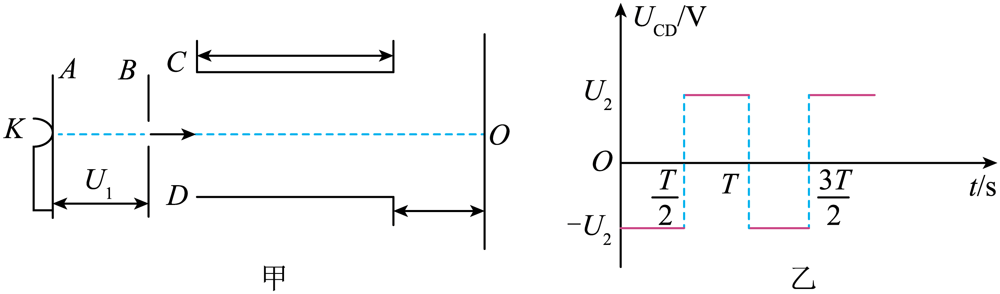

# Physics - 题目 428

**ID**: 2dfa12b4b55f44bc84a70f5811e88b33
**年级**: Grade 11
**难度**: Medium-Hard
**题型**: Calculation

## 题目
如图甲所示，真空室中电极K连续发出的电子（初速度不计）经过电势差为 $U{{}_{1}}$ 的加速电场加速后，沿两水平金属板C、D间的中心线射入两板间的偏转电场，最后打在荧光屏上。​​​​​​​‌C、D两板间的电势差 $U{{}_{{\rm{C}}{\rm{D}}}}$ 随时间变化如图乙所示，设C、D间的电场可看作是均匀的，且两板外无电场。已知电子的质量为 $m$ 、电荷量为 $e$ （重力不计），板间距离为 $d$ ，偏转电压 $U{{}_{2}}$ ，所有电子都能通过偏转电场且通过偏转电场的时间为 $t{{}_{0}}$ ，电子从离开偏转电场到达荧光屏所需时间为 $\frac {t{{}_{0}}}{6}$ 。求：(1)偏转电场的长度 $L$ ；(2)若 $U{{}_{{\rm{C}}{\rm{D}}}}$ 的周期 $T=t{{}_{0}}$ ，荧光屏上电子能够到达的区域的长度；(3)若 $U{{}_{{\rm{C}}{\rm{D}}}}$ 的周期 $T=2t{{}_{0}}$ ，哪些时刻进入偏转电场的电子刚好能到达荧光屏上的 $O$ 点？

## 解答

1. （1）电子经过加速电场过程，根据动能定理可得 $eU{{}_{1}}=\frac {1}{2}mv{{}_{0}^{2}}$ ，解得 $v{{}_{0}}=\sqrt {\frac {2eU{{}_{1}}}{m}}$ ，所有电子都能通过偏转电场且通过偏转电场的时间为 $t{{}_{0}}$ ，则偏转电场的长度为 $L=v{{}_{0}}t{{}_{0}}$ ，可得 $L=t{{}_{0}}\sqrt {\frac {2eU{{}_{1}}}{m}}$
2. （2）若 $U{{}_{{\rm{C}}{\rm{D}}}}$ 的周期 $T=t{{}_{0}}$ ，所有电子在偏转电场中运动过程，在竖直方向有半个周期时间内的加速度方向竖直向上，有半个周期时间内的加速度方向竖直向下，可知经过一个周期，电子的竖直分速度刚好为0；则 $t=0$ 时刻进入的电子向下侧移距离最大，为 $y{{}_{下}}=\frac {1}{2}\cdot \frac {eU{{}_{2}}}{dm}\cdot {\left({\frac {t{{}_{0}}}{2}}\right)^{2}}\times 2=\frac {eU{{}_{2}}t{{}_{0}^{2}}}{4dm}$ ，同理可知 $t=\frac {t{{}_{0}}}{2}$ 时刻进入的电子向上侧移距离最大，为 $y{{}_{上}}=\frac {1}{2}\cdot \frac {eU{{}_{2}}}{dm}\cdot {\left({\frac {t{{}_{0}}}{2}}\right)^{2}}\times 2=\frac {eU{{}_{2}}t{{}_{0}^{2}}}{4dm}$ ，所以荧光屏上电子能够到达的区域的长度为 ${\rm{Δ}}y=y{{}_{上}}+y{{}_{下}}=\frac {eU{{}_{2}}t{{}_{0}^{2}}}{2dm}$
3. （3）若 $U{{}_{{\rm{C}}{\rm{D}}}}$ 的周期 $T=2t{{}_{0}}$ ，则电子在偏转电场的运动时间为 $\frac {T}{2}$ ，电子要到达O点必须在竖直方向有先加速后减速再反向加速过程，并且加速大小相等，离开偏转电场后做匀速直线遇到你，最终到达O点；整个过程向下的位移和向上的位移大小相等；对于在 $0\sim \frac {T}{2}=t{{}_{0}}$ 内射入的电子，设向下加速时间为 $Δt$ ，加速度大小为 $a$ ，则在竖直方向上有 $y{{}_{下}}=\frac {1}{2}a(Δt){^{2}}\times 2$ ， $y{{}_{上}}=\frac {1}{2}a(t{{}_{0}}-2Δt){^{2}}+a(t{{}_{0}}-2Δt)\frac {t{{}_{0}}}{6}$ ，要到达O点时，应满足 $y{{}_{下}}=y{{}_{上}}$ ，联立解得 $Δt=\frac {t{{}_{0}}}{3}$ ，根据对称性和周期性可知电子刚好能到达荧光屏上 $O$ 点的电子进入偏转电场的时刻为 $t=nT+\frac {2}{3}t{{}_{0}}=2nt{{}_{0}}+\frac {2}{3}t{{}_{0}}$ （ $n=0$ ， $1$ ， $2\cdots $ ）或 $t=nT+\frac {5}{3}t{{}_{0}}=2nt{{}_{0}}+\frac {5}{3}t{{}_{0}}$ （ $n=0$ ， $1$ ， $2\cdots $ ）

## 知识点

**中文**:
  - 带电粒子在交变电场中的运动

**English**:
  - Motion in Alternating Electric Field

---
