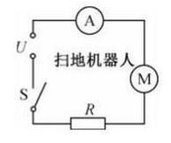

# Physics - 题目 2066

**ID**: 2ef94d6b6dee40619d2b5339ae7c1728
**年级**: Grade 11
**难度**: Medium-Hard
**题型**: 题有多项符合题目要求，全部选对的得5分，选对但不全的得3分，有选错的得0分）

## 题目
扫地机器人正常工作时的工作电压为 $\text{12V}$ ，额定功率为 $\text{30W}$ ，现将该扫地机器人接入如图所示的电路，已知电流表的内阻为 $\text{0.​​​​​​​‌5Ω}$ ，定值电阻的阻值为 $\text{3.5Ω}$ ，电源内阻不计，当电源电压为 $\text{2V}$ 时，扫地机器人不工作，此时电流表的示数为 $\text{0.4A}$ .下列说法正确的是（      ）

## 解答

1. 当电压为 $\text{2V}$ 时，由欧姆定律得 ${R}_{总}=\frac{{U}_{1}}{{I}_{1}}=\frac{2}{0.4}\text{Ω=5Ω}$ .扫地机器人的内阻为 $r={R}_{总}-R-{R}_{\text{A}}\text{=1.0Ω}，\text{A}$ 错误；扫地机器人正常工作时，电路中的电流为 ${I}_{0}=\frac{{P}_{0}}{{U}_{0}}=\frac{30}{12}\text{ A=2.5A}$ .定值电阻和电流表分得的电压为 ${U}_{2}={I}_{0}(R+{R}_{\text{A}})\text{=10V}，$ 则电源电压为 $U={U}_{0}+{U}_{2}\text{=22V}，\text{B}$ 正确；扫地机器人正常工作时，内耗功率为 ${P}_{r}={I}_{0}^{2}r\text{=6.25W}$ ，扫地机器人输出的机械功率为 $P={P}_{0}-{P}_{v}\text{=23.75 W}$ ，扫地机器人正常工作时的效率为 $\mathit{\eta }=\frac{P}{{P}_{0}}{×100\%=79.17\%}，\text{C}$ 错误：扫地机器人正常工作时， $\mathrm{1\min }$ 的时间内该电路消耗的总电能为 $W=U{I}_{0}t$ ，代入数据解得 $W\text{=3300J}，{\rm D}$ 错误。
2. 

## 知识点

**中文**:
  - 非纯电阻电路中的电功、电功率和电热

**English**:
  - Work, Power, and Heat in Non-Pure Resistive Circuits

---
