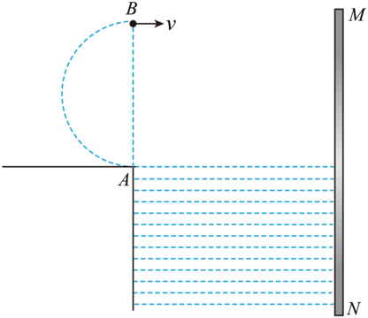

# Physics - 题目 1091

**ID**: 34dff361e873429781e61a6c2801f1e4
**年级**: Grade 11
**难度**: Medium-Hard
**题型**: Calculation

## 题目
学校科创团队的同学们设计了一套智能化轨道模拟系统来研究小球的运动情况。​​​​​​​‌如题图所示，固定在水平台面上的竖直半圆形光滑轨道半径可调，直径为AB，A端切线水平。轨道右侧有一个与A等高的装满新型材料（ER流体）的试验池，材料的力学特性能保证小球落入其中后以原速度做匀速直线运动。每次实验前调好轨道半径，弹射器（图中未画出）能使小球从A点以不同速度冲入轨道并始终以恒定速度 $\sqrt {3gL}$ 从B点飞出，竖直挡板MN到AB的水平距离为7L，已知多次实验过程中位于轨道B点的力学传感器显示轨道所受最小压力为0、最大压力为4mg，重力加速度为g，挡板MN足够长，小球可视作质点，忽略空气阻力。求上述实验过程中：（1）当B点力学传感器示数为0时，轨道的半径大小；（2）小球离开B点到刚落入试验池的最短时间；（3）若轨道半径连续可调，挡板MN上可能有小球打到的区域的最大长度。

## 解答

1. （1）当B点受到压力为0时，设轨道AB的半径为R_{1}，则 $mg=m\frac {v{{}_{0}^{2}}}{R{{}_{1}}}$
2. 解得 $R{{}_{1}}=\frac {v{{}_{0}^{2}}}{g}=3L$
3. （2）设轨道AB的最小半径为R_{2}，根据牛顿第二定律可得 $4mg+mg=m\frac {v{{}_{0}^{2}}}{R{{}_{2}}}$
4. 根据平抛运动的规律可得 $2R{{}_{2}}=\frac {1}{2}gt{^{2}}$
5. 解得 $R{{}_{2}}=\frac {3}{5}L$ ， $t=\sqrt {\frac {12L}{5g}}$
6. （3）由以上分析可得 $\frac {3}{5}L⩽R⩽3L$
7. 即小球从B点平抛的高度为 $\frac {6}{5}L⩽H⩽6L$
8. 根据平抛运动的规律 $x=v{{}_{0}}t$ ， $H=\frac {1}{2}gt{^{2}}$
9. 可得 $\frac {6}{\sqrt {5}}L⩽x⩽6L$
10. 由此可知，小球平抛的水平位移总是小于7L，每次都会落入试验池，如图所示
11. 
12. 设小球落入试验池后，其与MN的碰撞点到液面的高度为y，根据平抛的规律可得 $\frac {y}{2R}=\frac {7L-x}{\frac {x}{2}}$
13. 解得 $y=\frac {4R(7L-x)}{x}=-\frac {g}{v{{}_{0}^{2}}}x{^{2}}+\frac {7gL}{v{{}_{0}^{2}}}x$
14. 由数学知识可知，当 $x=\frac {7}{2}L$ （抛物线对称轴）时，y取得极大值，且 $y{{}_{{\rm \max }}}=-\frac {1}{3L}\cdot (\frac {7}{2}L){^{2}}+\frac {7}{3}\cdot \frac {7}{2}L=\frac {49}{12}L$
15. 当 $x=6L$ 时，y取得极小值，且 $y{{}_{{\rm \min }}}=-\frac {1}{3L}\cdot (6L){^{2}}+\frac {7}{3}\cdot 6L=2L$
16. 挡板MN上能有小球打到的区域长度为 $Δy=y{{}_{{\rm \max }}}-y{{}_{{\rm \min }}}=\frac {25}{12}L$ 。

## 知识点

**中文**:
  - 平抛运动中的临界问题
  - 竖直面内圆周运动问题

**English**:
  - Critical Problems in Horizontal Projectile Motion
  - Circular Motion in Vertical Plane

---
