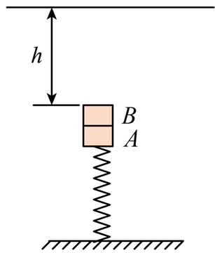

# Physics - 题目 1258

**ID**: 357d2e4cb3064480b235d9925d6785e5
**年级**: Grade 11
**难度**: Medium-Hard
**题型**: Calculation

## 题目
如图所示，劲度系数 $k=100{\rm{\;}}{\rm{N}}/{\rm{m}}$ 的轻弹簧一端固定于水平面上，另一端连接物块A，物块B置于A上（不粘连），A、B质量均为 $1{\rm{\;}}{\rm{k}}{\rm{g}}$ ，开始时物块A和B处于静止状态，物块B的正上方 $h$ 高处固定一水平挡板（ $h$ 高度可以调节）。​​​​​​​‌现对物块B施加方向始终向上、大小为 $F=10{\rm{\;}}{\rm{N}}$ 的恒力，使A、B开始运动，已知A、B均可视为质点、B与挡板、A之间的碰撞均为弹性碰撞，且碰撞时间极短，弹簧的弹性势能 $E{{}_{{\rm{p}}}}=\frac {1}{2}{\rm{\;}}kx{^{2}}(x$ 为弹簧的形变量， $k$ 为弹簧的劲度系数），质量为 $m$ 的质点做简谐运动的周期为 $T=2{\rm{\;}}{\rm{π}}\sqrt {\frac {m}{k}}(k$ 为物体做简谐运动时的比例系数，即弹簧的劲度系数），重力加速度大小 $g=10{\rm{\;}}{\rm{m}}/{\rm{s}}{^{2}}$ 。（注意：本题中作用于物体 $B$ 的恒力 $F$ 始终存在）(1)求A、B第一次分离时，A、B的速度大小；(2)A、B第一次分离后，若二者没有发生碰撞，则A做简谐运动，求做简谐运动的A上升到最大高度时的加速度大小；(3)若A、B第一次分离后，经过一段时间后二者恰好能够在第一次分离位置相碰且相碰时二者速度方向相反，求 $h$ 应满足的条件。

## 解答

1. （1）设开始时弹簧的压缩量为x_{1}，根据平衡条件有 $2mg=kx{{}_{1}}$ ，解得 $x{{}_{1}}=0.2{\rm m}$ ，设A、B第一次分离时，弹簧的形变量为x_{2}，此时A、B之间弹力为零，加速度、速度（大小设为v）均相同，又因为恒力F与B的重力大小相等、方向相反，所以此时B的加速度均为0，则A的加速度也为0，有 $mg=kx{{}_{2}}$ ，解得 $x{{}_{2}}=0.1{\rm m}$ ，对从开始到A、B第一次分离的过程，根据功能关系有 $(F-2mg)(x{{}_{1}}-x{{}_{2}})+\frac {1}{2}kx{{}_{1}}{^{2}}-\frac {1}{2}kx{{}_{2}}{^{2}}=\frac {1}{2}\cdot 2mv{^{2}}$ ，解得 $v=\frac {\sqrt {2}}{2}{\rm{m}}{\rm{/}}{\rm{s}}$ 。
2. （2）A、B第一次分离后，若二者没有发生碰撞，则A做简谐运动，由于分离时A的加速度为0，所以A刚好位于平衡位置，设A的振幅A，对A从平衡位置上升到最大高度的过程，根据机械能守恒定律有 $\frac {1}{2}mv{^{2}}+\frac {1}{2}kx{{}_{2}^{2}}=mgA+\frac {1}{2}k(x{{}_{2}}-A){^{2}}$ ，解得 $A=\frac {\sqrt {2}}{20}{\rm m}$ ，设A上升到最大高度时的加速度大小为a，根据牛顿第二定律有 $mg-k(x{{}_{2}}-A)=ma$ ，解得 $a=5\sqrt {2}{\rm{m}}{\rm{/}}{\rm{s}}{^{{{2}}}}$ 。
3. （3）A、B第一次分离后，由于B受力平衡，所以向上做匀速直线运动，且由于与挡板发生的是弹性碰撞，所以碰撞后速度大小不变，仍为v。A从平衡位置开始向上做简谐运动，周期为 $T=2{\rm{π}}\sqrt {\frac {m}{k}}=\frac {{\rm{π}}}{5}{\rm s}$ ，根据简谐运动的对称性可知，A再次经过第一次分离位置时速度大小仍为v，为使A、B在此处能够发生碰撞，此时A一定向上运动，所以若A、B第一次分离后，经过一段时间后二者恰好能够在第一次分离位置相碰，应满足 $\frac {2[h-(x{{}_{1}}-x{{}_{2}})]}{v}=nT$ （n=1,2,3…解得 $h=(0.1+\frac {\sqrt {2}}{20}{\rm{π}}n)$ m（n=1,2,3…）。

## 知识点

**中文**:
  - 简谐运动

**English**:
  - Simple Harmonic Motion

---
