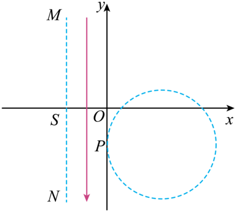

# Physics - 题目 1413

**ID**: 37072511f11747db9734b84345c1d15a
**年级**: Grade 11
**难度**: Medium-Hard
**题型**: Calculation

## 题目
如图所示的坐标系中，y轴与虚线MN间存在竖直向下的匀强电场，y轴的右侧存在一圆形匀强磁场，磁场方向垂直纸面向里（图中未画出），磁场与y轴相切于P点，一比荷为k的带正电粒子由虚线与x轴的交点S处沿x轴的正方向以速度v_{0}射入电场，粒子由P点进入圆形磁场，经过一段时间粒子由y轴的 $(0，\frac {\sqrt {3}}{8}L)$ 处垂直y轴再次进入电场，已知 $SO=L$ 、 $OP=\frac {\sqrt {3}}{2}L$ ，粒子的重力可忽略不计。​​​​​​​‌求：（1）电场强度E的大小；（2）圆形磁场的半径R以及磁感应强度B的大小；（3）粒子再次回到虚线MN时到S点的距离以及由S点开始出发到再次回到虚线MN的总时间t。

## 解答

1. （1）粒子从S点射出后，粒子在电场中做类平抛运动，沿x轴方向有 $L=v{{}_{0}}t{{}_{1}}$ ，沿y轴方向有 $\frac {\sqrt {3}}{2}L=\frac {1}{2}at{{}_{1}}{^{2}}$ ，解得 $a=\frac {\sqrt {3}v{{}_{0}^{2}}}{L}$ ，根据牛顿第二定律得 $Eq=ma$ ，解得 $E=\frac {\sqrt {3}v{{}_{0}^{2}}}{kL}$ 。
2. （2）粒子经过P点时沿y轴方向的速度大小为 $v{{}_{y}}=at{{}_{1}}$ ，结合上述解得 $v{{}_{y}}=\sqrt {3}v{{}_{0}}$ ，粒子经过P点的速度大小为 $v=\sqrt {v{{}_{0}^{2}}+v{{}_{y}^{2}}}=2v{{}_{0}}$ ，令粒子在P点时速度方向与水平方向的夹角为 $α$ ，则有 ${\tan}α=\frac {v{{}_{y}}}{v{{}_{0}}}=\sqrt {3}$ ，解得 $α=60{}\degree $ ，设粒子由Q点射出磁场，然后由T点垂直y轴进入电场，粒子在磁场中运动的轨道半径为r，作出粒子运动轨迹如图所示，
3. 
4. 根据几何关系得 $r{\cos}60{}\degree +r=PT=OP+OT$ ， $R=2r{\cos}30{}\degree $ ，解得 $r=\frac {5\sqrt {3}}{12}L$ ， $R=\frac {5}{4}L$ ，粒子在磁场中做圆周运动时，由洛伦兹力提供向心力，则有 $qvB=\frac {mv{^{2}}}{r}$ ，解得 $B=\frac {8\sqrt {3}v{{}_{0}}}{5kL}$ 。
5. （3）粒子由T点回到电场后做类平抛运动，则粒子运动到虚线MN的时间为 $t{{}_{4}}=\frac {L}{2v{{}_{0}}}$ ，沿y轴方向的位移为 $y=\frac {1}{2}at{{}_{4}^{2}}$ ，解得 $y=\frac {\sqrt {3}}{8}L=OT$ ，可知粒子由S点经过MN，即到S点的距离为0，又由几何关系可知，粒子在磁场中偏转的角度为 $θ=240{}\degree $ 。粒子在磁场中运动的时间为 $t{{}_{2}}=\frac {θ}{360}T$ ，粒子在磁场中的运动周期为 $T=\frac {2{\rm{π}}m}{qB}$ ，解得 $t{{}_{2}}=\frac {5\sqrt {3}{\rm{π}}L}{18v{{}_{0}}}$ ，粒子由Q到T做匀速直线运动，位移为 $x=r\sin 60{}\degree =\frac {5}{8}L$ ，粒子匀速的时间为 $t{{}_{3}}=\frac {x}{v}=\frac {5L}{16v{{}_{0}}}$ ，所以总时间为 $t=t{{}_{1}}+t{{}_{2}}+t{{}_{3}}+t{{}_{4}}=\frac {29L}{16v{{}_{0}}}+\frac {5\sqrt {3}{\rm{π}}L}{18v{{}_{0}}}$ 。

## 知识点

**中文**:
  - 带电粒子在组合场中的运动

**English**:
  - Motion in Combined Fields

---
