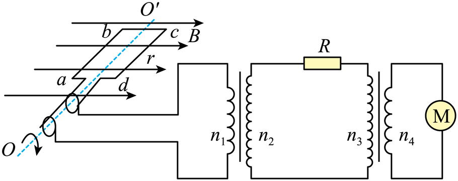

# Physics - 题目 163

**ID**: 3c24be09826c47b6baa32e19e056dcb0
**年级**: Grade 11
**难度**: Medium-Hard
**题型**: Calculation

## 题目
如图所示，用一小型交流发电机向远处用户供电，已知发电机线圈匝数N=500匝，面积 $S=2.32\times 10{^{-2}}{\rm{m}}{^{2}}$ ，线圈匀速转动的角速度ω=100πrad/s，匀强磁场的磁感应强度 $B=\frac {\sqrt {2}}{10π}{\rm{T}}$ ，输电时先用升压变压器将电压升高，经高压输电，到达用户区再用降压变压器将电压降下来后供用户使用，两根输电导线的总电阻为R=5Ω，变压器可视为理想变压器，降压变压器原、副线圈的匝数比为 $n{{}_{3}}:n{{}_{4}}=10:1$ ，若用户区标有“220V，8.8kW”的电动机恰能正常工作。​​​​​​​‌发电机线圈电阻不可忽略，其它导线的电阻值均可忽略。（1）求交流发电机产生电动势的最大值 $E{{}_{{\rm{m}}}}$ ；（2）求输电线路上损耗的电功率 $ΔP$ ；（3）若升压变压器原、副线圈匝数比为 $n{{}_{1}}:n{{}_{2}}=1:20$ ，求交流发电机线圈上的热功率P_{r}。

## 解答

1. （1）电动势的最大值为 $E{{}_{{\rm{m}}}}=NBSω=500\times \frac {\sqrt {2}}{10π}\times 2.32\times 10{^{-2}}\times 100π{\rm{V}}=116\sqrt {2}{\rm{V}}$
2. （2）设降压变压器原、副线圈的电流分别为 $I{{}_{3}}$ 、 $I{{}_{4}}$ ，电动机恰能正常工作，有 $I{{}_{4}}=\frac {P{{}_{用}}}{U{{}_{4}}}=\frac {8800}{220}{\rm{A}}=40{\rm{A}}$
3. 由于 $\frac {I{{}_{3}}}{I{{}_{4}}}=\frac {n{{}_{4}}}{n{{}_{3}}}=\frac {1}{10}$
4. 解得 $I{{}_{3}}=4{\rm{A}}$
5. 所以输电线路上损耗的电功率为 ${\rm{Δ}}P=I{{}_{3}^{2}}R=80{\rm{W}}$
6. （3）由于 $\frac {U{{}_{3}}}{U{{}_{4}}}=\frac {n{{}_{3}}}{n{{}_{4}}}$
7. 可得 $U{{}_{3}}=2200{\rm{V}}$
8. 升压变压器副线圈两端电压为 $U{{}_{2}}=U{{}_{3}}+I{{}_{3}}R=2220{\rm{V}}$
9. 又由 $\frac {U{{}_{1}}}{U{{}_{2}}}=\frac {n{{}_{1}}}{n{{}_{2}}}$
10. 可得 $U{{}_{1}}=111{\rm{V}}$
11. 电动势有效值为 $E=\frac {E{{}_{{\rm{m}}}}}{\sqrt {2}}=116{\rm{V}}$
12. 则交流发电机线圈电阻r电压为 $U{{}_{{\rm{r}}}}=E-U{{}_{1}}=5{\rm{V}}$
13. 根据升压变压器副线圈电流关系 $\frac {I{{}_{1}}}{I{{}_{2}}}=\frac {I{{}_{1}}}{I{{}_{3}}}=\frac {n{{}_{2}}}{n{{}_{1}}}$
14. 可得 $I{{}_{1}}=80{\rm{A}}$
15. 则，交流发电机线圈上的热功率为 $P{{}_{{\rm{r}}}}=U{{}_{{\rm{r}}}}I{{}_{1}}=400{\rm{W}}$

## 知识点

**中文**:
  - 电能的输送

**English**:
  - Transmission of Electrical Energy

---
