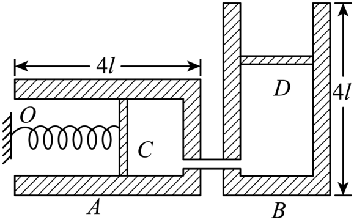

# Physics - 题目 2537

**ID**: 40663c84c30a4121815b518251daa65e
**年级**: Grade 11
**难度**: Medium-Hard
**题型**: Calculation

## 题目
如图所示，内壁光滑、长度均为 $4l$ 、横截面积均为 $S$ 的导热汽缸 ${\rm A}$ 、B， ${\rm A}$ 水平固定，B竖直固定，两汽缸之间由一段容积可忽略的细管相连，整个装置置于温度恒定、大气压强为 $p{{}_{0}}$ 的环境中，活塞C、D的质量及厚度均忽略不计。​​​​​​​‌原长为 $3l$ 、劲度系数 $k=\frac {4p{{}_{0}}S}{l}$ 的水平轻弹簧，一端连接活塞C、另一端固定在位于汽缸 ${\rm A}$ 缸口的 $O$ 点。开始时活塞D距汽缸B的底部 $3l$ ，后在D上放一质量 $m=\frac {p{{}_{0}}S}{2g}$ 的物体，其中 $g$ 为重力加速度。弹簧始终在弹性限度内，求：（1）稳定后弹簧的形变量；（2）稳定后活塞D下降的距离。

## 解答

1. （1）开始时被封闭的气体的压强为 $p{{}_{1}}=p{{}_{0}}$ ，活塞C到气缸A底部的距离为 $l$ ，被封闭的气体的体积为 $4lS$ ，重物放在活塞D上稳定后，被封闭的气体的压强为
2. $p{{}_{2}}=p{{}_{0}}+\frac {mg}{S}=\frac {3p{{}_{0}}}{2}$
3. 活塞C将弹簧向左压缩的距离为 $l{{}_{1}}$ ，则活塞C受力平衡时有
4. $kl{{}_{1}}=(p{{}_{2}}-p{{}_{0}})S$
5. 解得
6. $l{{}_{1}}=\frac {l}{8}$
7. （2）根据玻意耳定律得
8. $p{{}_{0}}\times 4lS=p{{}_{2}}xS$
9. 解得
10. $x=\frac {8}{3}l$
11. 活塞D下降的距离
12. $Δl=4l-\frac {8}{3}l+\frac {l}{8}=\frac {35l}{24}$

## 知识点

**中文**:
  - 气体等温变化与玻意耳定律

**English**:
  - Isothermal Change and Boyle's Law

---
