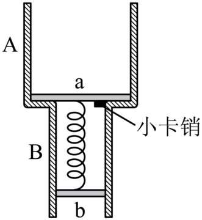

# Physics - 题目 160

**ID**: 4eff2b44c8984b5997748f7a132c2837
**年级**: Grade 11
**难度**: Medium-Hard
**题型**: Calculation

## 题目
如图所示，一竖直放置的足够长的导热汽缸由A、B两部分构成，厚度不计的绝热活塞a、b可以上下无摩擦地移动，汽缸连接处有小卡销，使活塞b不能通过连接处进入汽缸A。​​​​​​​‌现将活塞a和活塞b用一轻质细弹簧拴接，两活塞之间封闭有一定量的理想气体，刚开始时，活塞a位于汽缸A底端，系统处于静止状态，此时两活塞间气体的温度为 $T{{}_{0}}$ ，压强等于大气压强 $p{{}_{{{0}}}}$ 。已知活塞a、b的质量分别为2m、m，横截面积分别为2S、S，弹簧原长为 $L{{}_{0}}$ ，劲度系数为 $k=\frac {16mg}{L{{}_{0}}}$ ，大气压强为 $p{{}_{0}}=\frac {14mg}{S}$ ，重力加速度为g。现缓慢加热两活塞间的气体。（1）求活塞a刚要开始运动时活塞间气体的压强 $p{{}_{1}}$ 和温度 $T{{}_{1}}$ ；（2）求当活塞b刚到达汽缸连接处时，活塞间气体的温度 $T{{}_{2}}$ ；（3）两活塞间封闭气体的温度从 $T{{}_{1}}$ 升高到 $T{{}_{2}}$ 的过程中，封闭气体的内能增加了 $\Delta U$ ，求该过程中封闭气体从外界吸收的热量。

## 解答

1. （1）设初始状态弹簧的伸长量为 $x{{}_{0}}$ ，活塞a刚要开始运动时活塞间气体的压强 $p{{}_{1}}$ 和温度 $T{{}_{1}}$ ，对活塞 ${\rm{b}}$  $kx{{}_{0}}=mg$
2. 解得 $x{{}_{0}}=\frac {mg}{k}=\frac {mg}{\frac {16mg}{L{{}_{0}}}}=\frac {L{{}_{0}}}{16}$
3. 初状态气体体积 $V{{}_{0}}=S(L{{}_{0}}+x{{}_{0}})=\frac {17}{16}L{{}_{0}}S$
4. 活塞a刚要开始向上运动时，设弹簧弹力为 $F$ ，对活塞 ${\rm a}2p{{}_{0}}S+2mg+F=p{{}_{1}}\cdot 2S{\rm{\;}}$
5. 对活塞 ${\rm{b}}$  $p{{}_{0}}S+F=mg+p{{}_{1}}S$
6. 解得 $p{{}_{1}}=p{{}_{0}}+\frac {3mg}{S}=\frac {14mg}{S}+\frac {3mg}{S}=\frac {17mg}{S}$ ， $F=4mg$
7. 设活塞a刚要开始运动时弹簧伸长量为 $x{{}_{1}}$ ，由胡克定律 $F=kx{{}_{1}}$
8. 得 $x{{}_{1}}=\frac {F}{k}=\frac {4mg}{k}=\frac {4mg}{\frac {16mg}{L{{}_{0}}}}=\frac {L{{}_{0}}}{4}$
9. 此时气体的体积 $V{{}_{1}}=S(L{{}_{0}}+x{{}_{1}})=\frac {5}{4}L{{}_{0}}S$
10. 对活塞间气体由理想气体状态方程 $\frac {p{{}_{0}}V{{}_{0}}}{T{{}_{0}}}=\frac {p{{}_{1}}V{{}_{1}}}{T{{}_{1}}}$
11. 解得 $T{{}_{1}}=\frac {10}{7}T{{}_{0}}$
12. （2）当活塞b刚到达汽缸连接处时，活塞间气体的温度为 $T{{}_{2}}$ ，活塞a运动后，活塞间气体压强保持不变，由盖吕萨克定律 $\frac {S\left ({L{{}_{0}}+x{{}_{1}}}\right )}{T{{}_{1}}}=\frac {2S\left ({L{{}_{0}}+x{{}_{1}}}\right )}{T{{}_{2}}}$
13. 解得 $T{{}_{2}}=\frac {20}{7}T{{}_{0}}$
14. （3）设两活塞间封闭气体的温度从 $T{{}_{1}}$ 升高到 $T{{}_{2}}$ 的过程中，外界对气体做的功为W，则 $W=-p{{}_{1}}\cdot ΔV$
15. 又 $ΔV=\left ({2S-S}\right )\left ({L{{}_{0}}+x{{}_{1}}}\right )=\frac {5}{4}L{{}_{0}}S$
16. 根据热力学第一定律 $ΔU=W+Q$
17. 解得 $Q=ΔU+\frac {85}{4}mgL{{}_{0}}$

## 知识点

**中文**:
  - 热力学第一定律与理想气体状态方程的综合应用

**English**:
  - Integrated Application of 1st Law and Ideal Gas Law

---
