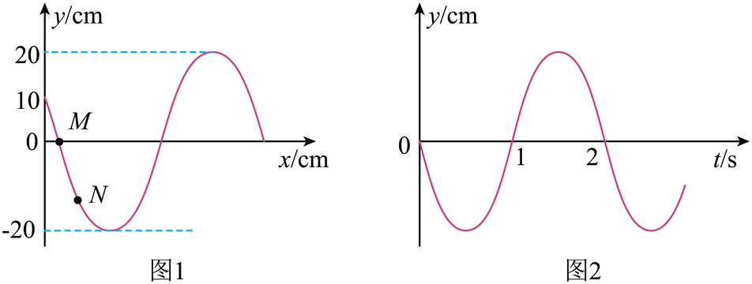

# Physics - 题目 2313

**ID**: 5004875ddcba4e04b6c4402956a9d293
**年级**: Grade 11
**难度**: Medium-Hard
**题型**: Calculation

## 题目
一列简谐横波沿x轴传播，M、N是x轴上的两个质点。​​​​​​​‌某时刻开始计时，在 $t=\frac {1}{3}{\rm{s}}$ 时的波形如图1所示，N的振动图像如图2所示。已知波速v=0.36m/s，求：（1）M、N平衡位置间的距离；（2）M点在 $0\sim \frac {4}{3}{\rm{s}}$ 内的路程。

## 解答

1. （1）由图2可知， $\frac {1}{3}{\rm{s}}$ 时质点N向下振动，结合图1根据同侧法可知该波沿x轴负方向传播，波从N传至M需 $\frac {1}{3}{\rm{s}}$ ，两者平衡位置之间距离为 $Δx=vΔt=0.36\times \frac {1}{3}=0.12{\rm{m}}$
2. （2）由图像可知，简谐横波的周期T=2s，振幅A=20cm，由同侧法可知，质点M沿y轴负方向振动，则 $t=\frac {1}{3}{\rm{s}}$ 时刻计时后质点M的振动方程为 $y=-A\sin \frac {2π}{T}t=-20\sin \left ({πt}\right ){\rm{c}}{\rm{m}}$
3. t=0时刻计时后质点M的振动方程为 $y=-A\sin \frac {2π}{T}(t-\frac {1}{3}{\rm{s}})=-20\sin \left ({πt-\frac {π}{3}}\right ){\rm{c}}{\rm{m}}$
4. 可知t=0时， $y=10\sqrt {3}{\rm{c}}{\rm{m}}$ ， $t=\frac {4}{3}{\rm{s}}$ 时，y=0，由于 $\frac {4}{3}{\rm{s}}=\frac {1}{3}{\rm{s}}+1{\rm{s}}=\frac {1}{3}{\rm{s}}+\frac {T}{2}$ ，则M点在 $0\sim \frac {4}{3}{\rm{s}}$ 内的路程为 $s=10\sqrt {3}{\rm{c}}{\rm{m}}+2A=(40+10\sqrt {3}){\rm{c}}{\rm{m}}$

## 知识点

**中文**:
  - 波的图像和振动图像的综合应用

**English**:
  - Integrated Application of Wave and Vibration Graphs

---
