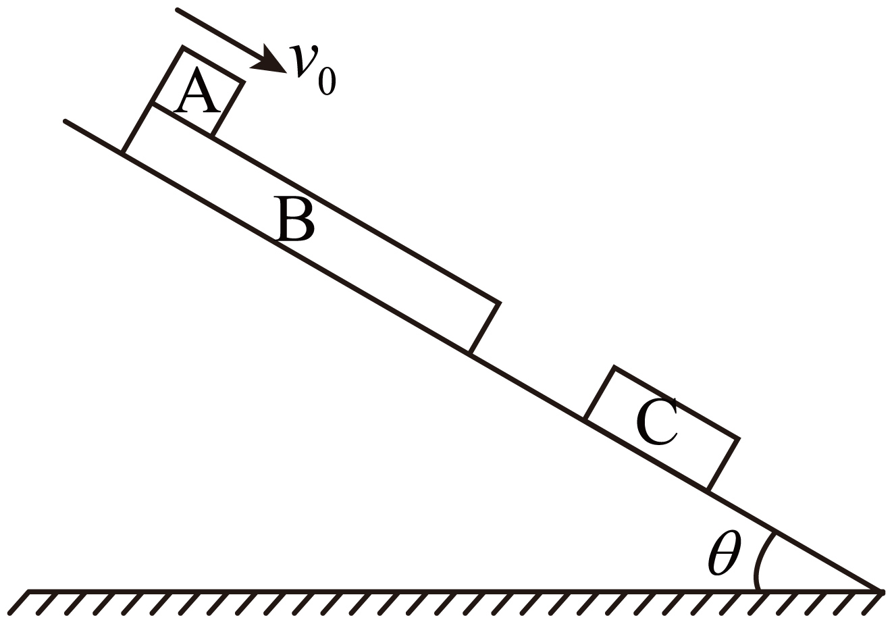

# Physics - 题目 929

**ID**: 502da75cbe73400f9a7a31468d6e8d5e
**年级**: Grade 11
**难度**: Medium-Hard
**题型**: Calculation

## 题目
如图，一倾角 $θ=37{}\degree $ 的固定斜面上锁定一木板B，木板B上表面粗糙，下表面光滑。​​​​​​​‌在木板B下方有一木板C恰好静止在斜面上。某时刻滑块A以初速度 $v{{}_{0}}=8{\rm{m}}{\rm{/}}{\rm{s}}$ 平行斜面从上端冲上木板B，同时解除木板B的锁定，当A、B共速瞬间A恰好运动到B的最下端，且此时木板B与木板C相碰，相碰后瞬间B、C共速且速度大小为碰前木板B速度大小的一半，A、B、C的质量均为 $m=1{\rm{k}}{\rm{g}}$ ，滑块A与木板B、C上表面的动摩擦因数均为 $μ{{}_{1}}=0.5$ ，木板C长 $L{{}_{{\rm{C}}}}=2{\rm{m}}$ ，木板B、C厚度相同。重力加速度 $g=10{\rm{m}}{\rm{/}}{\rm{s}}{^{2}}$ ，滑块A视为质点，忽略空气阻力，斜面足够长， ${\rm{s}}{\rm{i}}{\rm{n}}37{}\degree =0.6$ ，求：（1）初始时刻木板B下端与木板C上端的距离L_{0}；（2）木板B的长度L_{B}；（3）通过计算判断滑块A能否从木板C下端滑出？若能滑出，求滑块A滑出木板C下端时的速度大小；若不能滑出，求滑块A在木板C上表面滑行的距离。

## 解答

1. （1）A在B上滑行，对A，其加速度为 $a{{}_{1}}=\frac {mg{\rm{s}}{\rm{i}}{\rm{n}}θ-μ{{}_{1}}mg{\rm{c}}{\rm{o}}{\rm{s}}θ}{m}=2{\rm{m}}{\rm{/}}{\rm{s}}{^{2}}$
2. 对B，其加速度为 $a{{}_{2}}=\frac {mg{\rm{s}}{\rm{i}}{\rm{n}}θ+μ{{}_{1}}mg{\rm{c}}{\rm{o}}{\rm{s}}θ}{m}=10{\rm{m}}{\rm{/}}{\rm{s}}{^{{{2}}}}{\rm B}$ 达到共同速度所需要的时间为 $v{{}_{0}}+a{{}_{1}}t{{}_{1}}=a{{}_{2}}t{{}_{1}}$
3. 解得 $t{{}_{1}}=1{\rm{s}}$
4. B下滑距离即为初始时刻木板B下端与木板C上端的距离 $L{{}_{0}}=\frac {1}{2}a{{}_{2}}t{{}_{1}^{2}}=5{\rm{m}}$
5. （2）A下滑距离 $x{{}_{1}}=v{{}_{0}}t{{}_{1}}+\frac {1}{2}a{{}_{1}}t{{}_{1}^{2}}=9{\rm{m}}$
6. B木板长度 $L{{}_{{\rm{B}}}}=x{{}_{1}}-L{{}_{0}}=4{\rm{m}}$
7. （3）A、B共速瞬间的速度 $v{{}_{1}}=a{{}_{2}}t{{}_{1}}=10{\rm{m}}{\rm{/}}{\rm{s}}{\rm C}$ 碰撞后瞬间速度 $v{{}_{2}}=\frac {1}{2}v{{}_{1}}=5{\rm{m}}{\rm{/}}{\rm{s}}$
8. C恰好能静止在斜面上，设其与斜面的动摩擦因数为μ_{2}$mg{\rm{s}}{\rm{i}}{\rm{n}}θ=μ{{}_{2}}mg{\rm{c}}{\rm{o}}{\rm{s}}θ$
9. 解得 $μ{{}_{2}}=0.75$
10. A滑上C后， B、C整体的加速度为 $a{{}_{3}}=\frac {2mg{\rm{s}}{\rm{i}}{\rm{n}}θ+μ{{}_{1}}mg{\rm{c}}{\rm{o}}{\rm{s}}θ-μ{{}_{2}}\cdot 2mg{\rm{c}}{\rm{o}}{\rm{s}}θ}{2m}=2{\rm{m}}{\rm{/}}{\rm{s}}{^{2}}$
11. 可知 $a{{}_{1}}=a{{}_{3}}$ ，滑块A一定能从C下端滑出木板C
12. 设A在C上滑行时间为 ${\rm \mathit{t}_{2}}L{{}_{{\rm{C}}}}=\left ({v{{}_{1}}t{{}_{2}}+\frac {1}{2}a{{}_{1}}t{{}_{2}^{2}}}\right )-\left ({v{{}_{2}}t{{}_{2}}+\frac {1}{2}a{{}_{3}}t{{}_{2}^{2}}}\right )$
13. 解得 $t{{}_{2}}=0.4{\rm{s}}$
14. 此时滑块A的速度大小 $v{{}_{{\rm{A}}}}=v{{}_{1}}+a{{}_{1}}t{{}_{2}}=10.8{\rm{m}}{\rm{/}}{\rm{s}}$

## 知识点

**中文**:
  - 板块模型

**English**:
  - Plate Model

---
