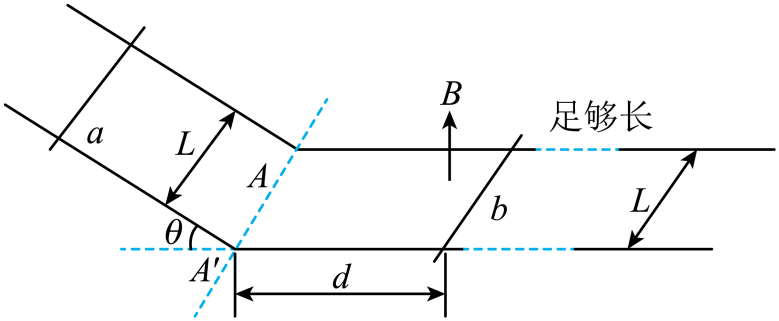

# Physics - 题目 375

**ID**: 516ac77c8bd54a83955321866ad0602d
**年级**: Grade 11
**难度**: Medium-Hard
**题型**: Calculation

## 题目
如图，倾斜平行轨道与水平面间的夹角为 $(θ=37\mathrm{°}$ ，水平轨道足够长，两轨道宽度均为 $L=1{\rm{\;}}{\rm{m}}$ ，在 $AA^{′}$ 处平滑连接，使导体棒a从倾斜轨道运动到水平轨道上时速度大小不变，过 $AA^{′}$ 的虚线 $($ 包含虚线边界 $)$ 右侧水平轨道上有磁感应强度大小为 $B=1{\rm{\;}}{\rm{T}}$ 、方向竖直向上的匀强磁场。​​​​​​​‌导体棒a、b的质量均为 $m=0.1{\rm{\;}}{\rm{k}}{\rm{g}}$ ，两棒与轨道始终垂直且接触良好，两棒接入轨道的电阻 $R{{}_{a}}=R{{}_{b}}=1{\rm{\;}}{\rm{Ω}}$ 。初始时刻，导体棒a在倾斜轨道上离 $AA^{′}$ 的距离为 $s=3{\rm{\;}}{\rm{m}}$ 处由静止释放，导体棒b静止在水平轨道上并锁定，且导体棒b到 $AA^{′}$ 位置的水平距离为 $d=1.0{\rm{\;}}{\rm{m}}$ 。不计一切摩擦阻力，导体棒a、b不会发生碰撞，轨道电阻不计。 ${\rm{s}}{\rm{i}}{\rm{n}}37\mathrm{°}=0.6$ ， ${\rm{c}}{\rm{o}}{\rm{s}}37\mathrm{°}=0.8$ ， $g=10{\rm{\;}}{\rm{m}}{\rm{/}}{\rm{s}}{^{2}}$ 。求：（1）导体棒a滑到倾斜轨道底端 $AA^{′}$ 位置时受到的安培力大小；（2）导体棒a从 $AA^{′}$ 位置到最后停止的过程中，导体棒a上产生的焦耳热；（3）若导体棒a滑到倾斜轨道底端， $AA^{′}$ 位置时，立即解除对导体棒b的锁定，导体棒a、b运动稳定时，导体棒a、b相距的距离。

## 解答

1. （1）导体棒a在倾斜轨道上运动的过程，由动能定理有 $mgs{\rm{s}}{\rm{i}}{\rm{n}}37\mathrm{°}=\frac {1}{2}mv{{}_{1}^{2}}$ ，由法拉第电磁感应定律有 $E{{}_{1}}=BLv{{}_{1}}$ ，由闭合电路欧姆定律有 $I{{}_{1}}=\frac {E{{}_{1}}}{R{{}_{a}}+R{{}_{b}}}$ ，导体棒a滑到倾斜轨道底端 $AA^{′}$ 位置时受到的安培力 $F{{}_{1}}=BLI{{}_{1}}$ ，解得 $F{{}_{1}}=3{\rm{N}}$ 。
2. $（2）$ 导体棒a在水平轨道上受向左的安培力做减速运动，最后速度减为零，根据能量守恒定律有 $Q=\frac {1}{2}mv{{}_{1}^{2}}$ ，又由 $Q=I{^{2}}Rt$ ，可得 $Q{{}_{a}}=Q{{}_{b}}=\frac {1}{2}Q$ ，解得 $Q{{}_{a}}=0.9{\rm{J}}$ 。
3. $（3）$ 若导体棒a滑到倾斜轨道底端 $AA^{′}$ 位置时，立即解除对导体棒b的锁定，导体棒a做减速运动，导体棒b做加速运动，最终二者以相同速度做匀速运动，设共同速度为 $v{{}_{2}}$ ，以导体棒a和b为系统，由动量守恒定律有 $mv{{}_{1}}=\left ({m+m}\right )v{{}_{2}}$ ，以导体棒a为研究对象，由动量定理有 $-B\bar ILt=mv{{}_{2}}-mv{{}_{1}}$ ，根据法拉第电磁感应定律 $\bar E=\frac {BLΔd}{t}$ ，由闭合电路欧姆定律 $\bar I=\frac {\bar E}{R{{}_{a}}+R{{}_{b}}}$ ，导体棒a与导体棒b运动稳定时，相距的距离 $d{{}_{1}}=d-\vartriangle d$ ，解得 $d{{}_{1}}=0.4{\rm{m}}$ 。

## 知识点

**中文**:
  - 电磁感应现象中的功能问题

**English**:
  - Work-Energy Problems in EM Induction

---
