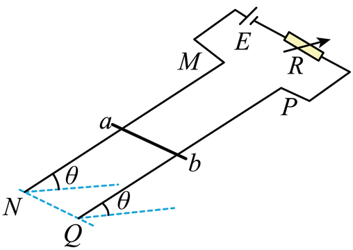

# Physics - 题目 2619

**ID**: 51792ccb0d3c4da085b3ddd2b44d4038
**年级**: Grade 11
**难度**: Medium-Hard
**题型**: Calculation

## 题目
如图所示，两根倾斜直金属导轨MN、PQ平行放置，它们所构成的轨道平面与水平面之间的夹角θ=37°，两导轨之间的距离L=0.50m。​​​​​​​‌一根质量m=0.20kg的均匀直金属杆ab放在两导轨上，并与导轨垂直，且接触良好，整套装置处于与ab杆垂直的匀强磁场中。在导轨的上端接有电动势E=36V、内阻r=1.6Ω的直流电源和电阻箱R。已知导轨与金属杆的电阻均可忽略不计，sin37°=0.6，cos37°=0.8，重力加速度g取10m/s^{2}。(1)若金属杆ab和导轨之间的摩擦可忽略不计，当电阻箱接入电路中的电阻R_{1}=2.0Ω时，金属杆ab静止在导轨上。①如果磁场方向竖直向下，求满足条件的磁感应强度的大小；②如果磁场的方向可以随意调整，求满足条件的磁感应强度的最小值及方向；(2)如果金属杆ab和导轨之间的摩擦不可忽略，金属杆ab受到的最大静摩擦力为0.6N，整套装置处于垂直于导轨平面斜向下、磁感应强度大小B=0.40T的匀强磁场中，要使金属杆ab仍保持静止，求电阻箱接入电路中的电阻取值范围。

## 解答

1. （1）①磁场的方向向下，由左手定则可知，ab棒受到的安培力的方向水平向右，受力如图
2. 
3. 由平衡条件得
4. ${\tan}37{}\degree =\frac {BIL}{mg}$
5. 电流为
6. $I=\frac {E}{R{{}_{1}}+r}=\frac {36}{2.0+1.6}{\rm{A}}=10{\rm{A}}$
7. 联立可得磁感应强度大小为
8. $B=0.3{\rm{T}}$
9. ②由受力分析可知当安培力方向与支持力的方向垂直时，安培力最小，磁感应强度最小，有
10. $mg\sin θ=B{{}_{{\rm \min }}}IL$
11. 则磁感应强度的最小值为
12. $B{{}_{{\rm \min }}}=\frac {mg\sin θ}{IL}=\frac {2\times 0.6}{10\times 0.5}{\rm{T}}=0.24{\rm{T}}$
13. 根据左手定则知，磁感应强度方向垂直于轨道平面斜向下；
14. （2）最大静摩擦力向下时，有
15. $F{{}_{{\rm \max }}}=f+mg\sin θ$
16. $F{{}_{{\rm \max }}}=BI{{}_{{\rm \max }}}L$
17. $I{{}_{{\rm \max }}}(R{{}_{{\rm \min }}}+r)=E$
18. 联立解得
19. $R{{}_{{\rm \min }}}=2.4Ω$
20. 最大静摩擦力向上时，有
21. $F{{}_{{\rm \min }}}+f=mg\sin θ$
22. $F{{}_{{\rm \min }}}=BI{{}_{{\rm \min }}}L$
23. $I{{}_{{\rm \min }}}(R{{}_{{\rm \max }}}+r)=E$
24. 联立解得
25. $R{{}_{{\rm \max }}}=10.4Ω$
26. 则电阻箱接入电路中的电阻取值范围为
27. $2.4Ω⩽R⩽10.4Ω$

## 知识点

**中文**:
  - 安培力作用下的平衡问题

**English**:
  - Equilibrium under Ampere Force

---
