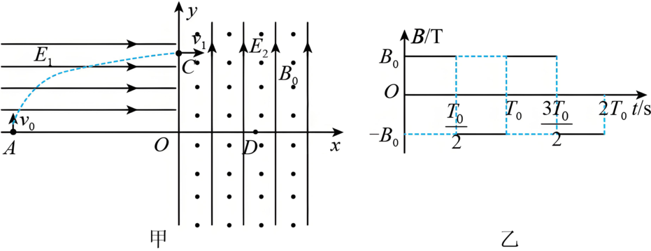

# Physics - 题目 1471

**ID**: 53c09225481b4664b8790bf9cae9787a
**年级**: Grade 11
**难度**: Medium-Hard
**题型**: Calculation

## 题目
在竖直平面内建立一平面直角坐标系xoy，x轴沿水平方向，如图甲所示。​​​​​​​‌第二象限内有一水平向右的匀强电场，场强为E_{1}。坐标系的第一、四象限内有一正交的匀强电场和匀强交变磁场，电场方向竖直向上，场强 $E{{}_{2}}=\frac {E{{}_{1}}}{3}$ ，匀强磁场方向垂直纸面。现一个比荷为 $\frac {q}{m}{\rm =10^{2}C}$ /kg的带正电微粒（可视为质点）以v_{0}=4m/s的速度从x轴上A点竖直向上射入第二象限，并以v_{1}=12m/s的速度从y轴正方向上的C点沿水平方向进入第一象限。取微粒刚进入第一象限的时刻为0时刻，磁感应强度按图乙所示规律变化（以垂直纸面向外的磁场方向为正方向），重力加速度g=10m/s^{2 }。则：(1)求微粒在x方向的加速度大小和电场强度E_{1}的大小；(2)在x轴正方向上有一点D，OD=OC，若带电微粒在通过C点后的运动过程中不再越过y轴，要使其恰能沿x轴正方向通过D点，求磁感应强度B_{0}及磁场的变化周期T_{0 }各为多少？(3)要使带电微粒通过C点后的运动过程中不再越过y轴，求交变磁场磁感应强度B_{0}和变化周期T_{0}的乘积B_{0}T_{0}应满足的关系？

## 解答

1. （1）将粒子在第二象限内的运动分解为水平方向和竖直方向，在竖直方向上做竖直上抛运动，在水平方向上做匀加速直线运动
2. $t=\frac {v{{}_{0}}}{g}=0.4{\rm{s}}$
3. $a{{}_{x}}=\frac {v{{}_{1}}}{t}=30{\rm{m}}{\rm{/}}{\rm{s}}{^{{{2}}}}$
4. $a{{}_{x}}=\frac {qE{{}_{1}}}{m}$
5. 计算得出
6. E_{1}=0.3N/C
7. （2）由E_{1}=3E_{2}，可得
8. qE_{2}=mg
9. 所以带电的粒子在第一象限将做匀速圆周运动
10. 
11. 设粒子运动圆轨道半径为R，周期为T，则有
12. $qv{{}_{1}}B{{}_{0}}=m\frac {v{{}_{1}^{2}}}{R}$
13. 可得
14. $R=\frac {mv{{}_{1}}}{qB{{}_{0}}}$
15. 使粒子从C点运动到D点，则有
16. $h=\frac {v{{}_{0}}}{2}t=0.8{\rm{m}}$
17. $h=\left ({2n}\right )R=\left ({2n}\right )\frac {mv{{}_{1}}}{qB{{}_{0}}}$
18. 计算得出
19. $B{{}_{0}}=0.3n\left ({{\rm{T}}}\right )$  （n=1，2，3…）
20. $T=\frac {2πm}{qB{{}_{0}}}$
21. $\frac {T{{}_{0}}}{2}=\frac {T}{4}$
22. 解得
23. $T{{}_{0}}=\frac {π}{30n}$  s （n=1，2，3…）
24. （3）当交变磁场周期取最大值而粒子不再越过y轴时可作如图运动情形：
25. 
26. 由图可以知道
27. $θ{\rm{=}}\frac {5{\rm{π}}}{6}$
28. 则
29. $T{{}_{0}}⩽\frac {5}{6}T$
30. $B{{}_{0}}T{{}_{0}}⩽\frac {π}{60}{\rm{k}}{\rm{g}}{\rm{/}}{\rm{C}}$
31. 【点睛】
32. 

## 知识点

**中文**:
  - 带电粒子在周期性变化的电磁场中的运动

**English**:
  - Motion in Periodically Varying EM Fields

---
