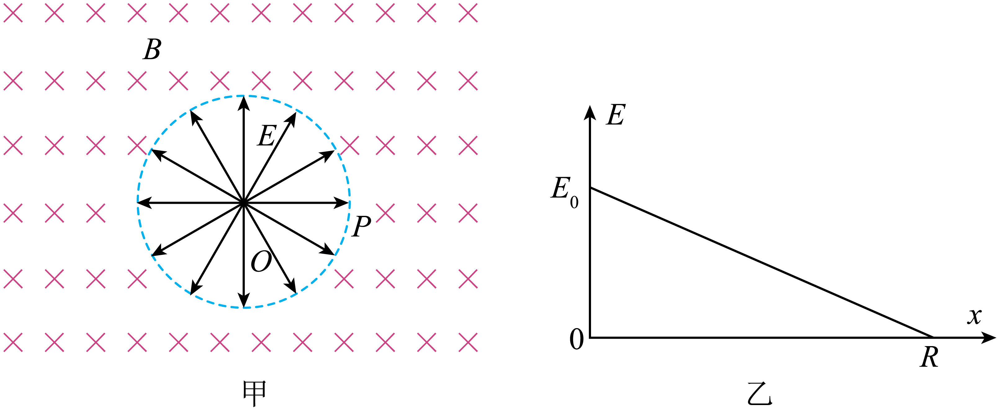

# Physics - 题目 2897

**ID**: 5cdbaa51ef814d6aad3bdf4578cfe754
**年级**: Grade 11
**难度**: Medium-Hard
**题型**: Calculation

## 题目
如图甲所示，半径为R的圆形区域内存在辐向电场，电场方向由圆心沿半径向外，电场强度大小E随距圆心O的距离x的变化如图乙所示，图中 $E{{}_{0}}$ 为已知量。​​​​​​​‌圆形区域外存在垂直纸面向里的匀强磁场。一质量为m，电荷量为+q的带电粒子，从圆心O点由静止释放，粒子沿半径OP运动至虚线边界上的P点进入磁场偏转再返回电场，粒子每次到达O点后沿进入电场的路径返回磁场，最后刚好沿PO方向回到O点，这个过程中粒子在磁场中运动的总时间记为 $t{{}_{0}}$ （未知）。已知磁场的磁感应强度 $B=\sqrt {\frac {mE{{}_{0}}}{3qR}}$ ，不计带电粒子的重力。求：(1)带电粒子经过P点时的速度大小；(2) $t{{}_{0}}$ 的大小；(3)若改变带电粒子的释放位置，将带电粒子在OP之间的某点Q（图中未标出）释放，粒子经过一段时间后沿PQ方向第一次回到释放点Q，该过程粒子在磁场区域运动的总时间为 $4t{{}_{0}}$ ，求粒子释放点Q到P点的可能距离。

## 解答

1. （1）根据乙图，图中图线所围成面积代表电势差，则
2. $U{{}_{OP}}=\frac {E{{}_{0}}R}{2}$
3. 
4. 由动能定理可得
5. $qU{{}_{OP}}=\frac {1}{2}mv{^{2}}$
6. 解得
7. $v=\sqrt {\frac {E{{}_{0}}Rq}{m}}$
8. （2）设带电粒子在磁场中运动的轨道半径为 $r$ ，根据题意作轨迹图，由向心力公式得
9. $qvB=m\frac {v{^{2}}}{r}$
10. 设
11. $\angle O{{}_{1}}OP=θ$
12. 由几何关系可知
13. ${\tan}θ=\frac {r}{R}$
14. 解得
15. $θ=\frac {π}{3}$
16. 所以
17. $\angle MOP=\frac {2π}{3}$
18. 粒子在磁场中运动过程所转过的角度为
19. $θ{{}_{0}}=3\times \left [2π-\left ({π-\frac {2π}{3}}\right )\right ]=5π$
20. 粒子在磁场中运动总时间
21. $t{{}_{0}}=\frac {θ{{}_{0}}}{2π}T$
22. 粒子在磁场中运动周期为
23. $T=\frac {2πr}{v}$
24. 解得
25. $t{{}_{0}}=5π\sqrt {\frac {3mR}{qE{{}_{0}}}}$
26. （3）如图，设改变释放位置后，粒子在磁场中第一次从S点回到电场区域，令
27. $\angle SOP=β$
28. 粒子在磁场中运动的圆弧所对圆心角为 $α$ ，根据题意可知
29. 
30. $nβ=m\times 2π$    $α=2π-\left ({π-β}\right )$
31. 联立以上公式得
32. $n\left ({α-π}\right )=m\times 2π$
33. 粒子在磁场中运动总时间为 $4t{{}_{0}}$ ，所以
34. $nα=20π$
35. 将
36. $nα=20π$
37. 带入
38. $n\left ({α-π}\right )=m2π$
39. 可得
40. $20-n=2m$
41. 其中n和m均为正整数，由题意可知
42. π<α<2π
43. 且
44. $nα=20π$
45. 所以
46. $20>n>10$
47. ①当 $n=18$ ， $m=1$ ，由几何关系可得
48. $β{{}_{1}}=\frac {π}{9}$
49. 则
50. ${\tan}\frac {β{{}_{1}}}{2}=\frac {r{{}_{1}}}{R}$
51. 由洛伦兹力提供向心力公式得
52. $qv{{}_{1}}B=m\frac {v{{}_{1}^{2}}}{r{{}_{1}}}$
53. 由动能定理可得
54. $\frac {1}{2}\frac {E{{}_{0}}q}{R}x{{}_{1}^{2}}=\frac {1}{2}mv{{}_{1}^{2}}$
55. 解得
56. $x{{}_{1}}=\frac {\sqrt {3}}{3}R{\tan}\frac {π}{18}$
57. ②当 $n=16$ ， $m=2$ 时，由几何关系可得
58. $β{{}_{2}}=\frac {π}{4}$
59. 同理解得
60. $x{{}_{2}}=\frac {\sqrt {3}}{3}R{\tan}\frac {π}{8}$
61. ③当 $n=14$ ， $m=3$ 时，由几何关系可得
62. $β{{}_{3}}=\frac {3π}{7}$
63. 同理解得
64. $x{{}_{2}}=\frac {\sqrt {3}}{3}R{\tan}\frac {3π}{14}$
65. ④当 $n=12$ ， $m=4$ 时，由几何关系可得
66. $β{{}_{4}}=\frac {2π}{3}$
67. 同理解得
68. $x{{}_{2}}=\frac {\sqrt {3}}{3}R{\tan}\frac {π}{3}$

## 知识点

**中文**:
  - 带电粒子在磁场中做圆周运动的多解问题

**English**:
  - Multi-solution Problems of Circular Motion in Magnetic Fields

---
