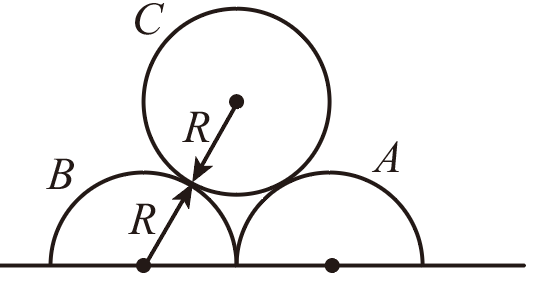

# Physics - 题目 185

**ID**: 5dbd07760f06446db1aaf87396939e44
**年级**: Grade 11
**难度**: Medium-Hard
**题型**: Calculation

## 题目
如图所示，两个半圆柱A、B紧靠着静置于水平地面上，其上有一光滑圆柱C，三者半径均为R。​​​​​​​‌C的质量为m，A、B的质量都为 $\frac {m}{2}$ ，与地面间的动摩擦因数均为 $μ$ 。现用水平向右的力拉A，使A缓慢移动，直至C恰好降到地面。整个过程中B保持静止。设最大静摩擦力等于滑动摩擦力，重力加速度为g。求：（1）未拉A时，A对地面的压力的大小N；（2）未拉A时，C受到B作用力的大小F；（3）动摩擦因数的最小值 $μ{{}_{{\rm \min }}}$ 。

## 解答

1. （1）将A、B、C看成一整体，A对地面的压力 $N=\frac {1}{2}(mg+mg)=mg$
2. （2）对C受力分析，如图所示
3. 
4. 根据平衡条件，有 $2F{\cos}30{}\degree =mg$
5. 解得 $F=\frac {\sqrt {3}}{3}mg$
6. （3）C恰好降到地面时，B受C压力的水平分力最大，如图所示
7. $F{{}_{x{\rm \max }}}=\frac {\sqrt {3}}{2}mg$
8. B受地面的最大静摩擦力 $F{{}_{f}}=μN={\rm μm}g$
9. 根据题意，B保持静止，则有 $F{{}_{f{\rm \min }}}=F{{}_{x{\rm \max }}}$
10. 解得 $μ{{}_{{\rm \min }}}=\frac {\sqrt {3}}{2}$

## 知识点

**中文**:
  - 在共点力平衡中整体法与隔离法的应用

**English**:
  - Whole and Isolation Methods in Equilibrium

---
