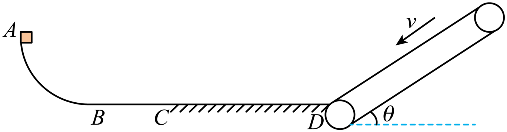

# Physics - 题目 213

**ID**: 62921e269cde4832b300643fc5aacb6b
**年级**: Grade 11
**难度**: Medium-Hard
**题型**: Calculation

## 题目
如图所示，AB是竖直平面内的四分之一光滑圆弧轨道，半径R=1 m，下端B与水平直轨道BD平滑相切，水平直轨道BD由光滑的BC段和粗糙的CD段组成，其中L_{BC}=1 m，L_{CD}=2 m。​​​​​​​‌直轨道的D端与一个足够长的倾角θ=37°的传送带平滑连接，传送带以恒定的速率v逆时针运动。有一个质量m=1 kg的小物块（可看作质点）从A点无初速度释放，物块与CD面间的动摩擦因数为μ_{1}=0.4，与传送带间的动摩擦因数为μ_{2}=0.5，不计连接处能量的损失。（g=10 m/s^{2}，sin37°=0.6，cos37°=0.8），求：（1）物块第一次到B点对圆轨道的压力大小；（2）若传送带的速度v=2 m/s，则物块在CD段上产生的热量与在传送带上产生的热量的比值；（3）物块从传送带上返回后，最后停在CD上，离C点的距离为x，传送带的速率v可以通过电机调节，写出x与v的关系式。

## 解答

1. （1）从A到B由机械能守恒可知 $mgR=\frac {1}{2}mv{{}_{B}^{2}}$ ，在B点时 $F{{}_{{\rm{N}}}}-mg=m\frac {v{{}_{B}}{^{2}}}{R}$ ，解得 $F{{}_{{\rm{N}}}}=3mg=30{\rm{\;}}{\rm{N}}$ ，根据牛顿第三定律可知，物块第一次到B点对圆轨道的压力大小 $F^{′}{{{}_{{\rm{N}}}}}=F{{}_{{\rm{N}}}}=30{\rm{\;}}{\rm{N}}$ 。
2. （2）物块在CD段上产生的热量 $Q{{}_{CD1}}=μ{{}_{1}}mgL{{}_{CD}}=8{\rm{\;}}{\rm{J}}$ ，从开始下滑到到达D点由动能定理可得 $mgR-μ{{}_{1}}mgL{{}_{CD}}=\frac {1}{2}mv{{}_{D}^{2}}-0$ ，解得 $v{{}_{D}}=2{\rm{\;}}{\rm{m}}{\rm{/}}{\rm{s}}$ ，滑上传送带上的加速度 $a{{}_{1}}=g\sin 37{}\degree +μ{{}_{2}}g{\cos}37{}\degree =10{\rm{\;}}{\rm{m}}{\rm{/}}{\rm{s}}{^{2}}$ ，到达最高点的时间 $t{{}_{1}}=\frac {v{{}_{D}}}{a{{}_{1}}}=0.2{\rm{\;}}{\rm{s}}$ ，上滑的距离 $x{{}_{1}}=\frac {v{{}_{D}^{2}}}{2a{{}_{1}}}=0.2{\rm{\;}}{\rm{m}}$ ，滑块相对传送带的位移 $Δs{{}_{1}}=x{{}_{1}}+vt{{}_{1}}=0.6{\rm{\;}}{\rm{m}}$ ，下滑时 $a{{}_{2}}=g\sin 37{}\degree +μ{{}_{2}}g{\cos}37{}\degree =10{\rm{\;}}{\rm{m}}{\rm{/}}{\rm{s}}{^{2}}$ ，与传送带共速时 $t{{}_{2}}=\frac {v}{a{{}_{2}}}=0.2{\rm{\;}}{\rm{s}}$ ， $x{{}_{2}}=\frac {v{^{2}}}{2a{{}_{2}}}=0.2{\rm{\;}}{\rm{m}}$ ，滑块相对传送带的位移 $Δs{{}_{2}}=vt{{}_{2}}-x{{}_{2}}=0.2{\rm{\;}}{\rm{m}}$ ，与传送带摩擦生热 $Q{{}_{传}}=μ{{}_{2}}mg{\cos}37{}\degree (Δs{{}_{1}}+Δs{{}_{2}})=3.2{\rm{\;}}{\rm{J}}$ ，再次滑上CD时 $x{{}_{3}}=\frac {v{^{2}}}{2μ{{}_{1}}g}=0.5{\rm{\;}}{\rm{m}}<L{{}_{CD}}$ ，在CD上产生的热量 $Q{{}_{CD2}}=μ{{}_{1}}mgx{{}_{3}}=2{\rm{\;}}{\rm{J}}$ ，则 $Q{{}_{CD}}=Q{{}_{CD1}}+Q{{}_{CD2}}=10{\rm{\;}}{\rm{J}}$ ， $Q{{}_{CD}}:Q{{}_{传}}=25:8$ 。
3. （3）①若传送带的速度 $v⩾2{\rm{\;}}{\rm{m}}{\rm{/}}{\rm{s}}$ ，物块返回到D点的速度为2 m/s，则根据 $\frac {1}{2}mv{^{2}}=μ{{}_{1}}mgx^{′}$ ，在CD上滑行的距离 $x^{′}=0.5{\rm{\;}}{\rm{m}}$ ，距离C点距离为 $x=1.5{\rm{\;}}{\rm{m}}$ ；
4. ②若传送带的速度 $0<v<2{\rm{\;}}{\rm{m}}{\rm{/}}{\rm{s}}$ ，与传送带共速后 $a{{}_{3}}=g\sin 37{}\degree -μ{{}_{2}}g{\cos}37{}\degree =2{\rm{\;}}{\rm{m}}{\rm{/}}{\rm{s}}{^{2}}$ ，到达底端时 $2a{{}_{3}}(0.2-\frac {v{^{2}}}{2a{{}_{2}}})=v^{′}{{^{2}}}-v{^{2}}$ ，在CD上滑行时 $\frac {1}{2}mv^{′}{{^{2}}}=μ{{}_{1}}mgx^{′}$ ，停止时距离D点的距离 $x^{′}=0.1+0.1v{^{2}}$ ，停止时距离C点的距离 $x=1.9-0.1v{^{2}}$ 。

## 知识点

**中文**:
  - 传送带模型中的能量守恒问题

**English**:
  - Energy Conservation in Conveyor Belt Models

---
