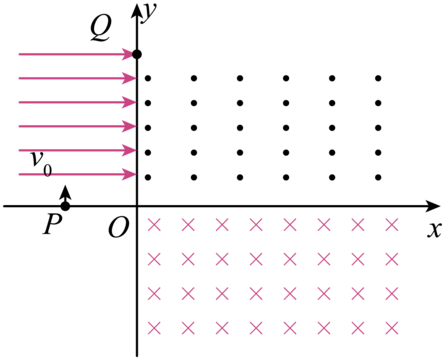

# Physics - 题目 1783

**ID**: 633924c9d2594a2085f9173b1aa46a72
**年级**: Grade 11
**难度**: Medium-Hard
**题型**: Calculation

## 题目
如图所示的 $xOy$ 平面直角坐标系中，第1象限存在垂直纸面向外的匀强磁场，磁感应强度大小为 $B{{}_{1}}$ （未知），第4象限存在垂直纸面向里的匀强磁场，磁感应强度大小 $B{{}_{2}}=2B{{}_{1}}$ ，第2象限存在沿x轴正方向的匀强电场。​​​​​​​‌在x轴上P点 $\left ({-L,0}\right )$ 位置，一质量为m、带电荷量为q的带正电粒子以初速度大小 $v{{}_{0}}$ 沿y轴正方向射入电场，恰好从y轴上Q点 $\left ({0,2L}\right )$ 进入第1象限的磁场，粒子第一次通过x轴时速度方向与x轴正方向夹角为 $60{}\degree $ ，不计粒子重力。求：(1)匀强电场的场强大小E；(2)第1象限中匀强磁场的磁感应强度大小 $B{{}_{1}}$ ；(3)从粒子进入第1象限开始计时，粒子每次向下通过x轴的时刻。

## 解答

1. （1）粒子在第2象限内做类平抛运动，x方向和y方向分别有
2. $L=\frac {1}{2}at{^{2}}$
3. $2L=v{{}_{0}}t$
4. 根据牛顿第二定律有
5. $qE=ma$
6. 联立求得
7. $t=\frac {2L}{v{{}_{0}}}$
8. $E=\frac {mv{{}_{0}^{2}}}{2qL}$
9. （2）粒子在第2象限运动的加速度大小为
10. $a=\frac {qE}{m}=\frac {v{{}_{0}^{2}}}{2L}$
11. 粒子进入第2象限时x方向的速度大小为
12. $v{{}_{x}}=at=v{{}_{0}}$
13. 所以，粒子进入第2象限时的速度大小为
14. $v=\sqrt {v{{}_{x}^{2}}+v{{}_{0}^{2}}}=\sqrt {2}v{{}_{0}}$
15. 速度方向与y轴夹角为 $θ$ ，则
16. ${\tan}θ=\frac {v{{}_{x}}}{v{{}_{0}}}=1$
17. 即
18. $θ=45{}\degree $
19. 粒子在第1象限内的运动轨迹如图所示
20. 
21. 由几何关系得
22. $r{{}_{1}}{\cos}45{}\degree -r{{}_{1}}\sin 30{}\degree =2L$
23. 根据洛伦兹力提供向心力有
24. $qvB{{}_{1}}=m\frac {v{^{2}}}{r{{}_{1}}}$
25. 联立求得
26. $r{{}_{1}}=4\left ({\sqrt {2}+1}\right )L$
27. $B{{}_{1}}=\frac {\left ({2-\sqrt {2}}\right )mv{{}_{0}}}{4qL}$
28. （3）根据洛伦兹力提供向心力有
29. $qvB=m\frac {v{^{2}}}{r}$
30. 又
31. $T=\frac {2πr}{v}$
32. 联立得
33. $T=\frac {2πm}{qB}$
34. 由于
35. $B{{}_{2}}=2B{{}_{1}}$
36. 所以
37. $T{{}_{2}}=\frac {1}{2}T{{}_{1}}$
38. 粒子在第1象限内圆周运动的周期为
39. $T{{}_{1}}=\frac {2πr{{}_{1}}}{v}=\frac {8\left ({2+\sqrt {2}}\right )πL}{v{{}_{0}}}$
40. 粒子在第4象限内圆周运动时的周期为
41. $T{{}_{2}}=\frac {1}{2}T{{}_{1}}=\frac {4\left ({2+\sqrt {2}}\right )πL}{v{{}_{0}}}$
42. 从粒子进入第1象限开始计时，粒子第一次向下通过x轴的时刻为
43. $t{{}_{1}}=\frac {105{}\degree }{360{}\degree }T{{}_{1}}=\frac {7}{24}T{{}_{1}}$
44. 粒子第一次向下通过x轴后的运动轨迹如图所示
45. 
46. 由图可知，粒子每相邻两次向下通过x轴之间在两磁场中匀速圆周运动转过的圆心角均 $120{}\degree $ ，所以从粒子进入第1象限开始计时，粒子每次向下通过x轴的时刻为
47. $t{{}_{{\rm{n}}}}=t{{}_{1}}+\left ({n-1}\right )\cdot \frac {120{}\degree }{360{}\degree }\left ({T{{}_{1}}+T{{}_{2}}}\right )=\frac {\left ({2+\sqrt {2}}\right )\left ({12n-5}\right )πL}{3v{{}_{0}}}$ （ $n=1，2，3，……$ ）

## 知识点

**中文**:
  - 带电粒子在磁场中做圆周运动的多解问题

**English**:
  - Multi-solution Problems of Circular Motion in Magnetic Fields

---
