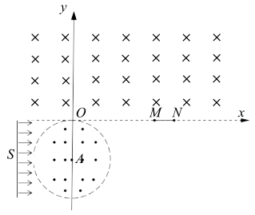

# Physics - 题目 2063

**ID**: 63cda9fbcfd34535a5f5e7c69239e3f2
**年级**: Grade 11
**难度**: Medium-Hard
**题型**: Calculation

## 题目
某装置可以研究带电粒子的运动轨迹，其原理如图所示，在x轴上方存在垂直xOy平面向里的匀强磁场。​​​​​​​‌x轴下方有一个半径为R的圆形区域磁场，方向垂直xOy平面向外，大小为B，其圆心为y轴上的A点，边界过坐标原点O。x轴正半轴上有一绝缘板MN，M、N点坐标分别为（ $\frac {\sqrt {3}}{2}L{\rm ，0}$  ）、（L，0），板厚度可以忽略。位于圆形磁场左侧有一个粒子发射装置S， 可以发射一束速度方向平行于x轴、沿y轴宽度为2R的粒子流，且粒子沿y轴方向均匀分布。粒子的质量为m，电荷量为-q（q>0）。已知速度方向对准A点的粒子经过磁场后刚好从坐标原点射出并打在N点。不计粒子的重力及相互作用。求：(1)该粒子流的速度大小v；(2)打在M点上的粒子在第一象限中运动的时间t；(3)打在MN探测板上的粒子占粒子总数的比例η。

## 解答

1. （1）粒子束中心粒子在磁场中运动半径为R，由 $qvB=\frac {mv{^{2}}}{R}$ ，得 $v=\frac {qBR}{m}$ 。
2. 
3. （2）粒子的运行半径为 $R{^{\prime }}=\frac {L}{2}$ ，
4. 打在M点上的粒子，对应的O点入射角为： $2R^{′}{{\rm s}}{\rm in}α=\frac {\sqrt {3}}{2}L$ ，
5. 得 $α=\frac {\mathrm{π}}{3}$ 或 $\frac {2\mathrm{π}}{3}$ ，
6. 圆心角为θ对应圆周运动时间为 $t=\frac {θR^{′}}{v}$ ，
7. 第一象限中运动的时间为 $t=\frac {m\mathrm{π}L}{3qBR}$ 或 $\frac {m\mathrm{π}L}{2qBR}$ 。
8. 
9. （3）由（2）可知打在M点上的粒子， 对应的入射角为α=60°或120°，
10. 由几何关系得，入射点纵坐标分别为 $-\frac {R}{2}$ 或 $-\frac {3R}{2}$ ，
11. 得 $y=\frac {\frac {3R}{2}-\frac {R}{2}}{2R}\times 100\%=50\%$ 。
12. 

## 知识点

**中文**:
  - 带电粒子在有界匀强磁场中的运动

**English**:
  - Motion in Bounded Uniform Magnetic Field

---
