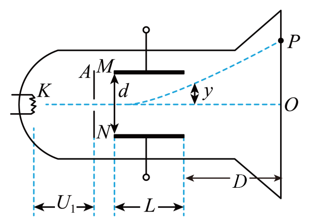

# Physics - 题目 437

**ID**: 69ab22e523aa4fe8880c76611f4a69e3
**年级**: Grade 11
**难度**: Medium-Hard
**题型**: Calculation

## 题目
如图所示为一页空示波管的示意图，电子从灯丝K发出（初速度可忽略不计），经灯丝与A板间的电压U_{1}加速，从A板中心孔沿中心线KO射出，然后进入两块平行金属板M、N形成的偏转电场中（偏转电场可视为匀强电场），电子进入M、N间电场时的速度与电场方向垂直，电子经过电场后打在荧光屏上的P点。​​​​​​​‌已知M、N两板间的电压为U_{2}，两板间的距离为d，板长为L，电子的质量为m，电荷量为e，不计电子受到的重力及它们之间的相互作用力。（1）求电子穿过A板时速度的大小v及电子从偏转电场射出时的侧移量y的表达式；（2）已知M、N两板右边缘与荧光屏的距离为D，求OP之间的距离y_{1}的表达式；（3）众所周知：当电子所受重力与电场力相比很小时，可以忽略重力。而电子从偏转电场中射出后运动到荧光屏的过程中并不受电场力作用，但我们一般仍然忽略重力，把这段运动看成是匀速直线运动。试通过定量推导说明这种做法是否合理？（已知U_{2}=2．0×10^{2}V，d=4．0×10^{-2}m，L=0．1m，D=0．2m，m=9．1×10^{-31}kg，e=1．6×10^{-19}C，g=10 m/s^{2}）

## 解答

1. （1）电子经电压U_{1}加速后的速度为v，由动能定理得 $eU{{}_{1}}=\frac {1}{2}mv{^{2}}-0$
2. 解得 $v=\sqrt {\frac {2eU{{}_{1}}}{m}}$ ，
3. 电子以v的速度进入偏转电场，做类平抛运动，设电子离开偏转电场时的侧移量为y，则在水平方向上 $L=vt$ ，
4. 在竖直方向上 $y=\frac {1}{2}at{^{2}}$ ，
5. 由牛顿第二定律得 $a=\frac {F}{m}=\frac {Ee}{m}=\frac {eU{{}_{2}}}{md}$ ，
6. 解得 $y=\frac {1}{2}at{^{2}}=\frac {U{{}_{2}}L{^{2}}}{4U{{}_{1}}d}$ 。
7. （3）电子在偏转电场中射出时 $v{{}_{y}}=at=\frac {U{{}_{2}}L}{d}\sqrt {\frac {e}{2mU{{}_{1}}}}$ ， ${\tan}θ=\frac {v{{}_{y}}}{v}=\frac {U{{}_{2}}L}{2U{{}_{1}}d}$ ，
8. 电子出电场后做匀速直线运动，根据几何关系可知 $y{{}_{1}}=y+D{\tan}θ$ ，
9. 解得 $y{{}_{1}}=\frac {U{{}_{2}}L}{2U{{}_{1}}d}(\frac {L}{2}+D)$ ，
10. （4）在出偏转电场时速度为 $v^{′}=\sqrt {v{^{2}}+v{{}_{y}^{2}}}$ ，
11. 假设出了偏转电场考虑重力，则在水平方向上 $D=vt^{′}$ ，
12. 解得 $t^{′}=\frac {D}{v}=D\sqrt {\frac {m}{2eU{{}_{1}}}}$ ，
13. 代入数据，在竖直方向上相同时间内由于重力的影响物体移动距离为， $\Delta x=\frac {1}{2}gt^{′}{{^{2}}}=\frac {1}{2}gD{^{2}}\frac {m}{2eU{{}_{1}}}=\frac {mgD{^{2}}}{4eU{{}_{1}}}=\frac {91}{16U{{}_{1}}}\times 10{^{-13}}{\rm{m}}$ ，
14. $y{{}_{1}}=\frac {U{{}_{2}}L}{2U{{}_{1}}d}(\frac {L}{2}+D)=\frac {5}{8U{{}_{1}}}\times 10{^{2}}{\rm{m}}$ ，
15. 可知 $y{{}_{1}}\gg \Delta x$ ，
16. 则重力对运的过程影响可以忽略不计，电子出偏转电场后的运动可以作为匀速直线运动。

## 知识点

**中文**:
  - 示波管的原理

**English**:
  - Principle of Oscilloscope

---
