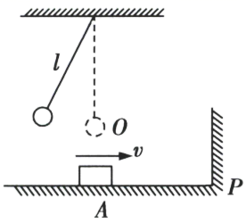

# Physics - 题目 2288

**ID**: 6b8bcce316124c639995c2be5f80a88c
**年级**: Grade 11
**难度**: Medium-Hard
**题型**: Calculation

## 题目
摆长为l的单摆在平衡位置O的左右做偏角小于 $5^\circ $ 的运动，当摆球经过平衡位置O（O在A点的正上方）向右运动的同时，另一个以速度v在光滑水平面上运动的小滑块恰好经过A点向右运动，如图所示，小滑块在与竖直挡板P碰撞后以原来的速率返回，忽略碰撞所用时间，试问：(1)A、P间的距离满足什么条件，才能使滑块刚好返回A点时，摆球也同时到达O点且向左运动？(2)A、P间的最小距离是多少？​​​​​​​‌

## 解答

1. （1）设小滑块做匀速直线运动从过A点到再次返回到A点所用时间为 $t{{}_{1}}$ ， $AP=s$ ，则
2. $t{{}_{1}}=\frac {2s}{v}$
3. 设单摆做简谐运动从经过平衡位置O点向右运动到回到O点且向左运动所需时间为 $t{{}_{2}}$
4. $t{{}_{2}}=\frac {T}{2}+nT(n=0，1，2，\cdots )$
5. $T=2π\sqrt {\frac {l}{g}}$
6. 由题意可知 $t{{}_{1}}=t{{}_{2}}$ ，即
7. $\frac {2s}{v}=\frac {T}{2}+nT$
8. $s=\frac {v}{2}\left ({\frac {1}{2}+n}\right )T=\frac {(2n+1)πv}{2}\sqrt {\frac {l}{g}}(n=0，1，2，\cdots )$
9. (2)当 $n=0$ 时，A、P间的距离最小
10. $s{{}_{{\rm \min }}}=\frac {πv}{2}\sqrt {\frac {l}{g}}$

## 知识点

**中文**:
  - 单摆周期公式及其应用

**English**:
  - Pendulum Period Formula and Applications

---
