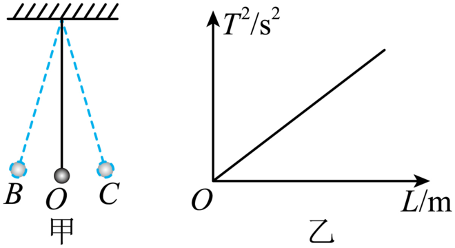

# Physics - 题目 2431

**ID**: 6c1207eb213046f0b634ef977f8b6c67
**年级**: Grade 11
**难度**: Medium-Hard
**题型**: Calculation

## 题目
单摆是我们研究简谐振动中常用的模型，已知某单摆的小球质量为m，摆长为l，当地重力加速度为g，尝试回答下述问题：（1）在θ角很小时， ${\sin}θ\approx \frac {x}{l}$ （其中x为小球位移），由此写出单摆回复力与位移的关系式，并说明为何单摆可视为简谐振动。​​​​​​​‌（2）简谐运动的周期公式为 $T=2π\sqrt {\frac {m}{k}}$ （其中k是力与位移的比例系数），结合上一问推导出单摆的周期公式。（3）依据单摆的周期公式，我们可通过实验来测定当地的重力加速度，分析以下实际情况，测出的重力加速度是“偏大”、“偏小”还是“准确”，简述判断理由。a.测量摆长时，仅考虑摆线长度，未计入小球半径。b.计时后提前停下秒表，导致测量的周期略小。（4）一位同学测量多组数据后画出周期平方摆长（T^{2}一L）的图像见乙图，若该直线的斜率为 $k{{}_{0}}$ ，写出该同学所测重力加速度的表达式（包含 $k{{}_{0}}$ ）。

## 解答

1. （1）在θ角很小时
2. ${\sin}θ\approx \frac {x}{l}$
3. 由几何关系可知，单摆的回复力为
4. $F=-mg{\sin}θ=-\frac {mg}{l}x$
5. 负号说明回复力方向与位移方向相反，当一个单摆的小球质量为m，摆长为l，当地重力加速度为g，令 $k=\frac {mg}{l}$ ，则单摆的回复力为
6. $F=-kx$
7. 由此可见，单摆在摆角很小的情况下的运动为简谐运动。
8. （2）由（1）分析可知，力与位移的比例系数为
9. $k=\frac {mg}{l}$
10. 又有，单摆在摆角很小的情况下的运动为简谐运动，则单摆的周期公式为
11. $T=2π\sqrt {\frac {m}{k}}=2π\sqrt {m\cdot \frac {l}{mg}}=2π\sqrt {\frac {l}{g}}$
12. （3）根据 $T=2π\sqrt {\frac {l}{g}}$ 可得，当地的重力加速度为
13. $g=\frac {4π{^{2}}l}{T{^{2}}}$
14. a.测量摆长时，仅考虑摆线长度，未计入小球半径，则测量的摆长偏小，可知，重力加速度偏小。
15. b.计时后提前停下秒表，导致测量的周期略小，可知，重力加速度偏大
16. （4）根据 $T=2π\sqrt {\frac {l}{g}}$ 可得
17. $T{^{2}}=\frac {4π{^{2}}}{g}l$
18. 则 $T{^{2}}-l$ 图像中，图线的斜率为
19. $k{{}_{0}}=\frac {4π{^{2}}}{g}$
20. 可得
21. $g=\frac {4π{^{2}}}{k{{}_{0}}}$

## 知识点

**中文**:
  - 实验：用单摆测量重力加速度

**English**:
  - Experiment: Measuring g with Simple Pendulum

---
