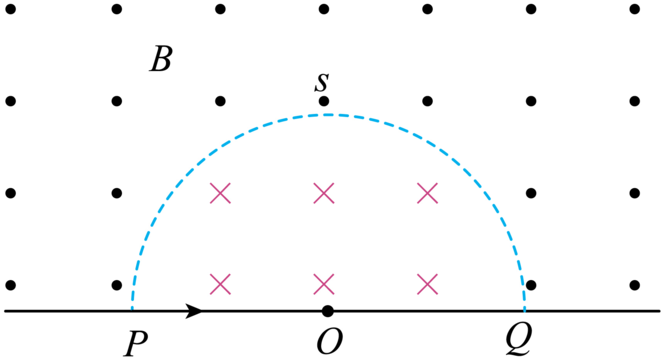

# Physics - 题目 2044

**ID**: 6cd7e6550b1043989ed97f66bfa2d279
**年级**: Grade 11
**难度**: Medium-Hard
**题型**: Calculation

## 题目
如图所示，在以O点为圆心、半径为R的半圆形边界区域内有垂直于纸面向里的匀强磁场，磁感应强度大小为B。​​​​​​​‌半圆形边界区域外有大小相等、方向相反、范围足够大的匀强磁场。现有两个带正电的同种粒子a和b，先后沿直径PQ方向从P点射入半圆形边界的区域内，粒子a由P经过S到达Q，S是半圆形边界的最高点。粒子质量为m、电荷量为q，不计粒子的重力和粒子间的相互作用，求：(1)粒子a运动的速度 $v{{}_{a}}$ 及到达Q的时间 $t{{}_{a}}$ ；(2)若两个粒子能在Q点发生“正碰”，则粒子b的速度 $v{{}_{b}}$ ；(3)若两个粒子能在Q点发生“正碰”，则两个粒子从P点出发的时间差 $Δt$ 。

## 解答

1. （1）由题意，a竖直向上从S点射出，然后到达Q点，运动轨迹如图所示，运动半径 $r=R$
2. 
3. 洛伦兹力提供向心力，有 $qv{{}_{a}}B=m\frac {v{{}_{a}^{2}}}{r}$
4. 联立解得 $v{{}_{a}}=\frac {qBR}{m}$
5. 运动周期 $T=\frac {2πr}{v}=\frac {2πm}{qB}$
6. 可知 $t{{}_{a}}=\left ({\frac {1}{4}+\frac {3}{4}}\right )T$
7. 得 $t{{}_{a}}=\frac {2πm}{qB}$
8. （2）由题意，ab在Q点速度方向均水平，相同或相反，如图所示。
9. 
10. 对于b，有 $r{{}_{b}}=\frac {mv{{}_{b}}}{qB}$
11. 且由几何关系，有 $r{{}_{b}}=R\cdot {\rm{t}}{\rm{a}}{\rm{n}}\left ({α/2}\right )$
12. $α={\rm{π}}/n$
13. 联立解得 $v{{}_{b}}=\frac {qBR\cdot {\rm{t}}{\rm{a}}{\rm{n}}\left ({{\rm{π}}/2n}\right )}{m}\left ({n=3,4,5\cdots \cdots }\right )$
14. （3）如上图所示，当 $n$ 为奇数时： $α={\rm{π}}/n,β={\rm{π}}-α={\rm{π}}-{\rm{π}}/n$
15. 总角度 $θ=\left [\left ({n-1}\right )/2\right ]\cdot 2{\rm{π}}+β=n{\rm{π}}-\frac {1}{n}{\rm{π}}$
16. B运动时间 $t{{}_{b}}=\frac {θ}{2{\rm{π}}}T=\frac {θm}{qB}$
17. 则 $t{{}_{b}}=\left ({n-\frac {1}{n}}\right ){\rm{π}}m/qB\left ({n=3,5,7\cdots \cdots }\right )$
18. 得时间差 ${\rm{Δ}}t=\left ({n-\frac {1}{n}-2}\right ){\rm{π}}m/qB\left ({n=3,5,7\cdots \cdots }\right )$ ；
19. 当 $n$ 为偶数时： $α={\rm{π}}/n,β={\rm{π}}-α={\rm{π}}-{\rm{π}}/n$
20. 总角度 $θ=\left ({n/2}\right )\cdot 2{\rm{π}}{\rm{=}}n{\rm{π}}$
21. 则 $t{{}_{b}}=n{\rm{π}}m/qB\left ({n=4,6,8\cdots \cdots }\right )$
22. 得时间差 ${\rm{Δ}}t=\left ({n-2}\right ){\rm{π}}m/qB\left ({n=4,6,8\cdots \cdots }\right )$
23. 综上，得 ${\rm{Δ}}t=\begin{cases}\left ({n-\frac {1}{n}-2}\right ){\rm{π}}m/qB\left ({n为奇数，n=3,5,7\cdots \cdots }\right )\\\left ({n-2}\right ){\rm{π}}m/qB\left ({n为偶数，n=4,6,8\cdots \cdots }\right )\end{cases}$

## 知识点

**中文**:
  - 带电粒子在有界匀强磁场中的运动

**English**:
  - Motion in Bounded Uniform Magnetic Field

---
