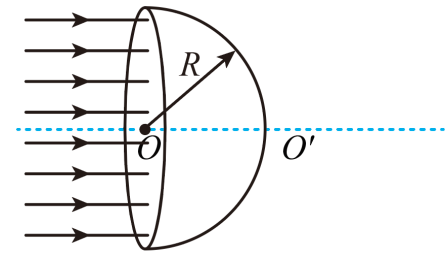

# Physics - 题目 1182

**ID**: 6d7d756b875f4c7f9eec894a47b549cd
**年级**: Grade 11
**难度**: Medium-Hard
**题型**: Calculation

## 题目
如图所示，一透明玻璃半球竖直放置， $OO^{′}$ 为其对称轴，O为球心，球半径为R，半球左侧为圆面，右侧为半球面。​​​​​​​‌现有一束平行红光从其左侧垂直于圆面射向玻璃半球，玻璃半球对红光的折射率为 $\sqrt {2}$ ，真空中的光速为c，不考虑光在玻璃中的多次反射。（1）从左侧圆形截面的某一面积内入射的光线，能从右侧半球面直接射出。求此面积和左侧圆形截面面积的比值；（2）某条光线从距O点 $\frac {R}{2}$ 处垂直左侧圆面射入，从右侧半球面射出后与 $OO^{′}$ 相交于D点（未画出）。求这束光从射入半球到D点的传播时间。

## 解答

1. （1）从左侧圆面垂直入射，不偏折，考虑截面，从左侧的A点入射，光在右侧半球面刚好发生全反射，则由折射定律有 $\sin θ=\frac {1}{n}$
2. $n=\sqrt {2}$
3. 则有 $\sin θ=\frac {\sqrt {2}}{2}$
4. $OA=R\sin θ=\frac {\sqrt {2}}{2}R$
5. 从左侧射入能从右侧射出的光束是以O为圆心，OA长为半径的圆，其面积 $S^{′}=π|OA|{^{2}}=\frac {1}{2}πR{^{2}}$
6. 而左侧入射面的面积 $S=πR{^{2}}$
7. 解得 $\frac {S^{′}}{S}=\frac {1}{2}$
8. （2）设距O点 $\frac {R}{2}$ 的入射点为B，射到半球面上的C点。如图所示
9. 
10. 入射角为i，折射角为r，在 $\mathrm{△}OBC$ 中由几何关系有 $i=30{}\degree $
11. $BC=\frac {\sqrt {3}}{2}R$
12. 考虑在C点折射，由折射定律有 $\frac {\sin r}{\sin i}=n$
13. 解得 $r=45{}\degree $
14. 设从C点的出射光线交 $OO^{′}$ 轴于D点，由图知，在 $\vartriangle OCD$ 中， $∠OCD=135{}\degree $ ， $\angle COD=i=30{}\degree $ ，由几何关系可得∠CDO=15°
15. 则和差公式得 $\sin 15{}\degree =\frac {\sqrt {6}-\sqrt {2}}{4}$
16. $\frac {CD}{\sin \angle COD}=\frac {R}{\sin \angle CDO}$
17. 解得 $CD=\frac {\sqrt {6}+\sqrt {2}}{2}R$
18. 光在玻璃中传播速度 $v=\frac {c}{n}$
19. 光从B点传播到D点的时间 $t=\frac {BC}{v}+\frac {CD}{c}$
20. 解得 $t=\frac {2\sqrt {6}+\sqrt {2}}{2c}R$

## 知识点

**中文**:
  - 全反射与折射的综合应用

**English**:
  - Comprehensive Application of Total Reflection and Refraction

---
