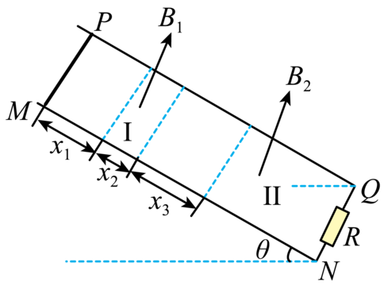

# Physics - 题目 129

**ID**: 70fcc52d81224bccae58687ace724b9c
**年级**: Grade 11
**难度**: Medium-Hard
**题型**: Calculation

## 题目
如图所示，足够长的光滑平行金属导轨MN、PQ倾斜放置，两导轨间距d=0.5m，导轨平面与水平面的夹角为 $θ=30^\circ $ ，导轨N、Q两端连接阻值 $R=10{\rm{Ω}}$ 的电阻。​​​​​​​‌导轨平面内分布着有界匀强磁场区域I和Ⅱ，磁场方向均垂直于导轨平面向上，区域I的上边界距导轨M、P端 $x{{}_{1}}=0.9{\rm{m}}$ 上、下边界之间的距离 $x{{}_{2}}=0.35{\rm{m}}$ ，下边界与区域Ⅱ的上边界之间的距离 $x{{}_{3}}=1.2{\rm{m}}$ ，区域I的磁感应强度大小 $B{{}_{1}}=10{\rm{T}}$ ，区域II的磁感应强度大小 $B{{}_{2}}=5{\rm{T}}$ 。质量 $m=0.5{\rm{k}}{\rm{g}}$ 的金属棒垂直导轨放置，与两导轨接触良好。将金属棒从M、P端由静止释放，进入区域Ⅱ时恰好做匀速运动，取g=10m/s^{2}，不计金属棒及导轨的电阻。求(1)金属棒进入磁场区域Ⅱ时的速度；(2)金属棒经过磁场区域I所用的时间。

## 解答

1. (1)金属棒进入区域II时，感应电动势 $E=B{{}_{2}}dv$ ，电路中的电流 $I=\frac {E}{R}$ ，金属棒所受安培力 $F=B{{}_{2}}Id$ ，因金属棒匀速运动，有
2. $F=mg{\sin}30^\circ $
3. 得
4. $v=4{\rm{m}}{\rm{/}}{\rm{s}}$
5. (2)金属棒在磁场外滑动时有
6. $mg{\sin}30^\circ =ma$
7. 在 $x{{}_{1}}$ 范围内下滑过程 $v{{}_{1}^{2}}=2ax{{}_{1}}$ ，在 $x{{}_{3}}$ 范围内下滑过程 $v{^{2}}-v{{}_{2}^{2}}=2ax{{}_{3}}$ ，金属棒滑过区域I过程，平均感应电动势
8. ${\overline{E}}=\frac {ΔΦ}{t}=\frac {B{{}_{1}}dx{{}_{2}}}{t}$
9. 平均电流 ${\overline{I}}=\frac {{\overline{E}}}{R}$ ，平均安培力 ${\overline{F}}={\overline{I}}{\rm dB}{{}_{1}}$ ，由动量定理
10. $(mg{\sin}30^\circ -{\overline{F}})t=mv{{}_{2}}-mv{{}_{1}}$
11. 联立解得
12. $t=0.15{\rm{s}}$

## 知识点

**中文**:
  - 单杆模型

**English**:
  - Single Rod Model

---
